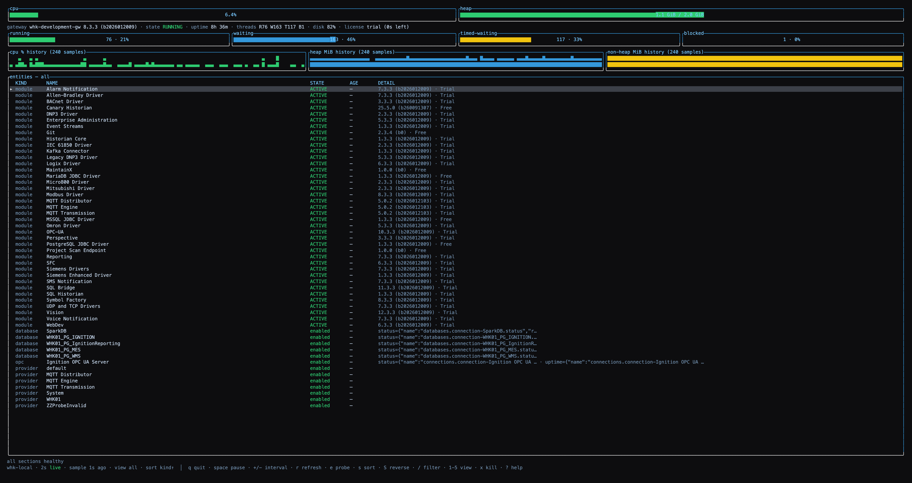
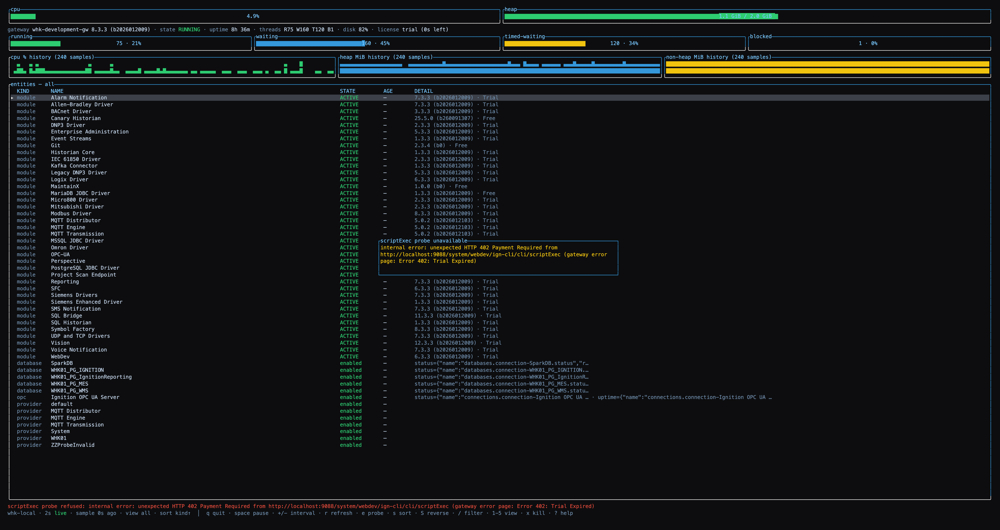
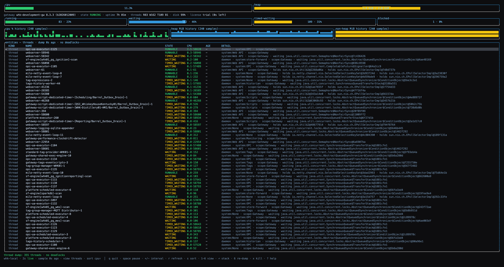
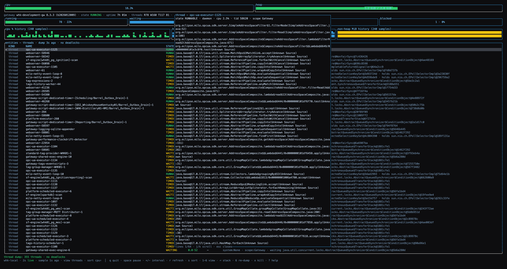

# ign — operate Ignition 8.3+ gateways from the terminal

[Documentation](https://thethoughtagen.github.io/ignition-cli/) · [Releases](https://github.com/TheThoughtagen/ignition-cli/releases) · [Issues](https://github.com/TheThoughtagen/ignition-cli/issues)

One binary that lets a developer (or an AI agent) fully operate and inspect an
Ignition 8.3+ gateway — health, projects, tags, rigs — without opening the
gateway webpage or Designer. Every subcommand is non-interactive by default
and scriptable with JSON output; `ign tui` (below) is the interactive
cockpit over the same actions layer. v1.1 completes the agent surface end
to end: `ign api call` passthrough + curated daily checks, guarded EAM
write lifecycle with blast-radius preview, byte-faithful XML/CSV tag
transfer, a workspace checkout / `ign edit` round-trip, and protocol
transports — MCP (`ign mcp serve`) and LSP (`ign lsp`) — so agents and
editors drive the same binary humans do.

## Watch it in use

### Ignition CLI

Gateway inspection, project discovery, and batch tag reads.

[](https://thethoughtagen.github.io/ignition-cli/docs/demos/)

### Ignition CLI TUI

Explore gateway health, browse tags, and inspect projects from the keyboard.

[](https://thethoughtagen.github.io/ignition-cli/docs/demos/)

[Open the recordings with playback controls and written summaries](https://thethoughtagen.github.io/ignition-cli/docs/demos/). Recorded against a fictional batch process; playback runs at 1.2×.

## Install

```
cargo install ignition-cli
```

(or grab a prebuilt binary from the
[releases](https://github.com/TheThoughtagen/ignition-cli/releases) —
macOS arm64/x86_64, Linux x86_64/arm64). Requires Rust 1.88+ when building
from source. The binary is `ign`.

Agent harnesses can also install the playbook: the
[`ignition-ops` skills](claude-code-plugin/README.md) (5 SKILL.md files —
contract, gateway, tags, workspace, rigs) ride any
[skills-CLI](https://github.com/vercel-labs/agent-skills)-compatible
agent:

```
npx skills add TheThoughtagen/ignition-cli -g
```

Claude Code can alternatively load them as a plugin (see
[Agent transports](#agent-transports--mcp-ign-mcp-serve-and-lsp-ign-lsp)
below).

## Output contract (for agents)

Success prints a stable envelope on **stdout**; errors go to **stderr** in
both modes (exit code carries the same signal):

- Success: `{"ok": true, "profile": <name|null>, "data": {...}}`
- Failure: `{"ok": false, "profile": <name|null>, "error": {"code": "<slug>", "message": "...", "endpoint": <url|null>, "hint": "..."}}`

`--compact` implies `--json` and renders the same envelope on a single line.
Two documented exceptions: clap usage errors exit 2 and are rendered by clap
itself (not JSON); the exit-2 class also covers destructive operations run
without `--yes`.

One success-path exception: `ign completions <SHELL>` writes the raw
completion script to stdout regardless of `--json` — shells source its
output directly, so it is never JSON-wrapped.

### The `ign api call` contract exception

`ign api call` is the one documented exception on the SUCCESS side:
its `data.result.data` is the gateway's OWN JSON — **gateway-verbatim**
(no field dropped, no value coerced, key order preserved), not a
curated model. A 2xx answer with a **non-JSON** body refuses exit 1
`internal` with an explanatory message — binary endpoints belong to
the logs/backup download pipelines, never this command. Gateway error
bodies on the api-call path ride the error envelope's message
verbatim, truncated at **4 KiB** with an explicit `... [truncated]`
marker. Auth-pattern headers (`Authorization`, `X-Ignition-API-Token`,
`Cookie` — case-insensitive) are refused exit 2 BEFORE any request:
credentials come from the profile, full stop.

### The MCP refusal-prose exception (2026-09-16)

The frozen envelope governs the CLI's own stdout/stderr only —
byte-for-byte, always. Over the MCP transport (`ign mcp serve`), a
`confirmation_required` refusal is the SECOND dated envelope-transport
exception (alongside `ign api call` above): its `message`/`hint` PROSE
adapts to the transport — the JSON names `confirm: true` (the
MCP-native confirmation) and marks `--yes`/`IGNITION_YES=1` CLI-only —
while the shape stays byte-stable (same keys, same order,
`ok:false`/`code`/`profile:null`/`endpoint:null` untouched). The MCP
input schema correspondingly keeps `confirm` OUT of `required` for
guarded verbs: schema-required would invite agents to auto-fill
`confirm:true`, so omission is legal and answered by the refusal.

### The `deploy verify` verdict exception (2026-10-14)

`ign deploy verify` is the THIRD documented success-path exit exception (after
`ign lint --strict` and `ign testing run`), and the first in the `deploy`
family: `deploy apply` and the redundant-pair checks of later phases will
reuse the same envelope. A **red verdict** is not an error. The command prints
the frozen success envelope, then ends with **exit 6** (target state):

- stdout: `{"ok": true, "profile": "<master profile>", "data": {..., "ok": false, "slug": "deploy_verify_failed", "checks": [...]}}`.
  The envelope's own `ok: true` stays (the command ran and produced a verdict);
  the verdict is `data.ok`. The findings are in `data.checks[].findings[]`. There
  is no `error` member.
- exit 6, set after the envelope is rendered.
- A **green verdict** has `data.ok: true`, `data.slug: null` and exits 0.

`ign deploy verify --node backup|both` uses the same verdict shape: the backup
node's checks are in `data.backup` and the secret-name check of each node in
`data.secrets`, and a red result there is `data.ok: false`,
`deploy_verify_failed` and exit 6 after the envelope.

`deploy_verify_failed` lives only in `data.slug`. It is not a `CoreError` slug
and is never a row of the exit-code table below; an agent that wants the
verdict reads `data.ok`, and one that only looks at the exit code sees 6. The
rule exists because the error envelope has no `data` field, and a verdict is
only useful with its findings.

Failures **before** a verdict exists stay ordinary error envelopes on stderr
with their own exit codes and an empty stdout: an unreachable gateway
(`network_error`, exit 4), an unknown or secretless profile (exit 3), an
unreadable host (`transport_failed`, exit 4), a refused tree (exit 2), and a
gateway that refuses the scan, mode or resource reads. Over MCP the same
envelope is returned with `isError` false, because the envelope's `ok` is
`true`.

### The `deploy apply` rolled-back verdict exception (2026-10-18)

`ign deploy apply` is the FOURTH documented success-path exit exception, and it
reuses the `deploy verify` shape above. An apply whose post-write verify is red,
whose lock lapsed, whose scan did not complete or whose write failed has
**restored the pre-apply snapshot** and scanned. That is a finished run with a
verdict, not an error, so the command prints the frozen success envelope and
then ends with **exit 6** (target state), as Decision A of the v1.6 milestone
fixed:

- stdout: `{"ok": true, "profile": "<master profile>", "data": {..., "outcome": "rolled_back", "ok": false, "slug": "deploy_rolled_back", "cause": "<cause>"}}`.
  The envelope's own `ok: true` stays (the command ran to a defined end and the
  gateway is back on its snapshot); the verdict is `data.ok`. There is no
  `error` member.
- `data.cause` is one of `lock_expired`, `write_failed`, `scan_incomplete` or
  `verify_failed`; the run directory's `events.ndjson` and `result.json` carry
  the detail. A step after the commit that cannot be answered at all (the lock
  read, the scan or the verify fails with a gateway error) is restored like a
  red verify with the closest cause (`lock_expired`, `scan_incomplete`,
  `verify_failed`), and `data.warnings` holds `post_commit_error (<step>:
  <code>)`.
- exit 6, set after the envelope is rendered.
- A successful apply has `data.outcome` `applied`, `data.ok: true`,
  `data.slug: null`, `data.cause: null` and exits 0; an empty plan is outcome
  `noop`, exits 0 and touched nothing.

`deploy_rolled_back` lives only in `data.slug`. It is not a `CoreError` slug and
is never a row of the exit-code table below. A caller that only checks the
envelope's `ok` would read a rolled-back apply as a success, so an agent that
applies must read `data.ok` (or `data.outcome`); one that only looks at the exit
code sees 6.

Failures **before** the write, and a rollback that could **not** restore, are
ordinary error envelopes on stderr with their own exit codes and an empty
stdout: `plan_stale`, `destructive_change_refused`, `deploy_blocked`,
`deploy_preflight_failed`, `deploy_journal_present` and `rollback_failed` are
rows of the table below. The verb is not in the MCP catalog.

### The `deploy apply` backup-unsynced verdict exception (2026-10-20)

`ign deploy apply` to a redundant pair has a second verdict, and it is the FIFTH
documented success-path exit exception (after `ign lint --strict`,
`ign testing run`, `deploy verify` and the rolled-back apply above). The master
applied and verified, but the backup node could not be proven to hold the same
files within `--backup-timeout`. That is a finished run with a verdict, not an
error, so the command prints the frozen success envelope and then ends with
**exit 6** (target state), as Decision A of the v1.6 milestone fixed:

- stdout: `{"ok": true, "profile": "<master profile>", "data": {..., "outcome": "applied_backup_unsynced", "ok": false, "slug": "deploy_backup_unsynced", "cause": null, "backup": {"converged": false, "reason": "<reason>", ...}}}`.
  The envelope's own `ok: true` stays (the command ran to a defined end and the
  master is deployed); the verdict is `data.ok`. There is no `error` member.
- `data.backup.reason` is one of four words, ranked in this order when more than
  one is true on the final observation: `unreachable` (a backup REST call or
  file read could not be answered; the check detail carries the error code),
  `sync_exhausted` (the backup logged that it gave up syncing during this run
  and will not catch up by waiting; a line logged before the run began does
  not count, and the CLI host's clock and the gateway's are assumed to agree to
  within a few seconds), `not_syncing` (the pair link is down or the backup's
  `lastSyncTimestamp` did not advance past the value sampled once the scan-lock
  was held, just before the first write) and `content_differs` (the backup is syncing but its files or its REST
  read-back differ from the render).
- A backup with no `ssh` or `local` transport in `nodes.backup` is checked over
  REST only: its convergence rests on the timestamp, the mode and the REST
  read-back, and the file comparison is a `warn`.
- exit 6, set after the envelope is rendered.
- The master is **not rolled back**: its run record stays `applied`, its files
  are the verified render, and nothing is restored. The only write the backup
  check makes is one resync request to the master (`data.backup.resync`).
- A converged backup has `data.outcome` `applied`, `data.ok: true`,
  `data.slug: null` and exits 0; a target without `nodes.backup` has
  `data.backup: null`.

`deploy_backup_unsynced` lives only in `data.slug`. It is not a `CoreError` slug
and is never a row of the exit-code table below. A caller that only checks the
envelope's `ok` would read an unsynced backup as a success, so an agent that
applies must read `data.ok` (or `data.outcome`); one that only looks at the exit
code sees 6, the same code as a rolled-back apply, and tells them apart by
`data.outcome`.

A run killed during the backup wait (Ctrl-C, a lost terminal) has an **applied
master** and no verdict. Follow it with
`ign deploy verify --env <ENV> --node backup` to see whether the backup caught up.

## Exit codes

| Code | Class         | Meaning                                            | Stable slugs
|------|---------------|----------------------------------------------------|-----------------------------------------------|
| 0    | ok            | success                                            | —
| 1    | internal      | unexpected failure — report as a bug               | `internal`
| 2    | usage         | usage error (rendered by clap), destructive op without `--yes`, JVM profiling without `--i-accept-the-risk`, an invalid import file, an unreadable command input, a raw api call the gateway rejected with an unclassified 4xx (body carried verbatim), a declared deploy tree that fails render validation or carries an embedded secret, or a deploy apply of a destructive or drifted plan without its flag | `confirmation_required`, `profiling_risk_not_accepted`, `invalid_import_file`, `invalid_input`, `gateway_client_error` (P9), `deploy_tree_invalid`, `embedded_secret`, `destructive_change_refused`
| 3    | config        | local configuration problem                        | `profile_not_found`, `no_active_profile`, `secret_unavailable`, `password_unavailable`, `config_invalid`, `poll_interval_too_small`, `module_not_registered`
| 4    | network       | gateway, or a module release feed, unreachable / timeout / TLS, or a deploy host transport failure (an unreadable gateway data directory or a hostile live tree) | `network_error`, `module_feed_unreachable`, `transport_failed`
| 5    | auth          | gateway rejected credentials                       | `auth_rejected`
| 6    | target_state  | command invalid for the gateway's current state, a module artifact the feed refused to serve or verify, a held config scan-lock, a resource write refused for its signature, a create naming a resource or mode that already exists, an unusable on-box deploy declared-names ledger, a deploy plan that changed since it was reviewed, a deploy removal a core copy shadows, a failed apply preflight, an interrupted deploy's journal still on the box, live files a rollback would overwrite, an unusable deploy run record, a rollback that could not restore, or a project the git module still manages (`.git` present) | `gateway_too_old`, `gateway_not_commissioned`, `gateway_restarting`, `not_found`, `project_exists`, `resource_binary`, `trial_not_expired`, `provider_not_found`, `routes_not_deployed`, `webdev_unlicensed`, `route_version_mismatch`, `webdev_route_error`, `tag_collision`, `alarm_journal_missing`, `import_denied`, `session_not_prunable`, `eam_not_controller`, `eam_task_type_refused`, `eam_task_in_flight`, `script_exec_not_configured`, `lint_tool_absent`, `node_tool_absent`, `provider_root_unsupported`, `bundle_not_available`, `module_release_not_found`, `module_digest_mismatch`, `module_feed_unusable`, `module_digest_changed`, `module_uninstall_denied`, `scan_lock_held`, `resource_signature_rejected`, `resource_exists`, `mode_exists`, `deploy_ledger_invalid`, `plan_stale`, `deploy_blocked`, `deploy_preflight_failed`, `deploy_journal_present`, `deploy_live_changed`, `deploy_run_invalid`, `rollback_failed`, `project_git_managed` |
| 7    | rig           | docker/compose rig failure (discovery, lifecycle, port conflicts) | `rig_error` |

The exit-code table lives in exactly two places — this README and
`CoreError::exit_code()` in `crates/ignition-core/src/error.rs` — kept in
sync by two tests: `exit_code_mapping_enumerated` pins the enum to its
exit-code/slug literals, and `readme_exit_table_agreement` parses THIS
table via `include_str!` and cross-checks every slug ↔ exit-code row
against those literals in both directions, so a missing, stale, or
misplaced table row fails the test suite (the Three-Place rule: enum +
literals + this table, all machine-checked).

`ign api call` partitions gateway answers through the same classifier:
401/403 → 5 `auth_rejected`, 404 → 6 `not_found`, 503 → 6
`gateway_restarting`, 500 → 1 `internal`, and every OTHER 4xx → 2
`gateway_client_error` with the response body carried verbatim in the
message (4 KiB cap, `... [truncated]` marker). Usage-class input
problems (auth-pattern headers, bad `--path`, malformed
`--header`/`--query`) refuse exit 2 `invalid_input` BEFORE any
resolution — the envelope's `profile` is null and zero requests hit
the gateway.

## Gateway authentication (8.3)

Machine auth against Ignition 8.3 `/data` REST routes is **token-only**:

- Send the header `X-Ignition-API-Token: <name>:<key>` — the FULL
  `name:key` string the gateway UI shows when you create the key
  (Platform → Security → API Keys). Key-only headers are rejected (401).
- **Basic auth does not work on 8.3 `/data` routes** (verified: valid
  commissioned admin credentials → 401). `ign` keeps the basic-credential
  profile arm for future/legacy surfaces, warns loudly on stderr each
  time it is used against the gateway, and never silently retries —
  create an API token instead.
- Token-authenticated mutations need **no CSRF** machinery (CSRF applies
  only to cookie/session auth).

Creating a working token: gateway UI → Platform → Security → API Keys →
Create (Basic Token) → pick a security level → **uncheck "Require secure
connections"** for `http://` gateways → copy the full `name:key` string.

The two rejection codes carry distinct diagnoses:

| Response | Meaning | What to fix |
|----------|---------|-------------|
| 401 | token not recognized | the header must be the full `name:key` string — no `name:` prefix or wrong key → 401; Basic never works on `/data` |
| 403 | token recognized but under-permitted | three-part setup: (1) token holds an adequate security level, (2) gateway read/write permissions include that level, (3) "Require secure connections" unchecked for http — `ign doctor` diagnoses all three |

### Credential resolution order

Which env var or store answers for a profile depends on that profile's
declared `auth` shape — the generic, profile-less env vars no longer win
for every profile:

| Step | Source | Applies to |
|------|--------|-----------|
| 1 | `IGNITION_TOKEN_<PROFILE_UP>` | EVERY auth shape — the universal explicit override |
| 2 | the profile's own `token_env` var | `TokenEnv` profiles |
| 3 | bare `IGNITION_TOKEN` | ONLY a profile whose auth equals the default — i.e. no `auth` key in the TOML |
| 4 | keyring entry `ignition-cli` / `profile:<name>` | every profile (unconditional — the lookup is already profile-named) |
| 5 | the profile's own `user_env`/`password_env` | `Basic` profiles |
| 6 | bare `IGNITION_USER` + `IGNITION_PASSWORD` | a default-auth profile, or a `Basic` profile whose own named vars are unset |

The generic `IGNITION_TOKEN` and `IGNITION_USER`/`IGNITION_PASSWORD` vars
(steps 3 and 6) apply ONLY to a profile with no `auth` block. A profile
that declares `auth = { keyring = ... }` or `auth = { token_env = ... }`
/ `auth = { user_env = ..., password_env = ... }` authenticates as
itself — it never falls through to an unrelated shell credential meant
for a different gateway.

`IGNITION_TOKEN_<PROFILE_UP>` (step 1) is the universal escape hatch: it
still overrides every auth shape, including keyring profiles. The
profile name maps to the var name by uppercasing and turning every
non-alphanumeric character into `_` — profile `my-rig` reads
`IGNITION_TOKEN_MY_RIG`.

This matters most right after `ign adopt`, which rewrites the adopted
profile to `auth = { keyring = ... }`. Before this order existed, a
leftover `IGNITION_TOKEN` for some OTHER gateway in the developer's
shell would shadow the freshly-stored keyring credential, and
`ign --profile <name> status` would answer `auth_rejected` (exit 5)
immediately after a successful adopt. Now a keyring profile with an
empty keyring entry and a foreign `IGNITION_TOKEN` in the shell refuses
loudly with `secret_unavailable` (exit 3) instead of silently sending
the wrong token — a diagnosable refusal beats a misleading rejection.

### Token-setup troubleshooting (the three-part failure, `ign doctor`'s bread and butter)

A 403 means the gateway RECOGNIZED your token but its security level
doesn't satisfy the gateway's permissions. The setup has exactly three
parts — all three must hold:

1. **The token holds an adequate security level.** When creating the
   key (Platform → Security → API Keys), pick a level the gateway's
   permissions already accept — only leaf paths count (granting
   `Authenticated/Roles` mid-tree logs a WARN and is ignored).
2. **The gateway's read/write permissions include that level.** Under
   8.3 defaults, Gateway Read/Write Permissions only include
   `Authenticated/Roles/Administrator` — a token granted just
   `Authenticated` gets 403 (verified live, then fixed by adding the
   level to the permission lists). `ign doctor` reads the
   `security-properties` config and shows you the actual wiring; when
   even that read 403s, the wiring is your culprit.
3. **"Require secure connections" is unchecked** when the gateway URL
   is `http://` (the create dialog CHECKS it by default — the #1
   http-rig trap; uncheck it).

`ign doctor` walks the whole chain — URL/TCP reachability, liveness
(no credential involved, so down-ness is never confused with bad
auth), commissioning, 401-vs-403, the permissions wiring, write
permission, WebDev-route presence, and Docker presence — and exits 0
whenever the diagnosis completes so agents can parse `checks[]` from a
broken setup without a nonzero exit getting in the way.

### Gateway adoption (`ign adopt`)

Doctor diagnoses the three-part token setup; **adopt fixes it**. One
idempotent, profile-scoped verb walks a commissioned-but-unadopted
gateway to a fully working profile:

```bash
export IGNITION_PASSWORD='<gateway admin password>'
ign adopt --profile se-slot5-backend --project Flux --testing \
  --checkout ~/gateways/slot5 --bake ~/rigs/slot5/restore.gwbk
```

Five bootstrap steps, each reported as a doctor-shaped row, each
skippable when already satisfied — **re-running on an adopted gateway
is an all-skip no-op**:

| Step | What it does |
|------|--------------|
| `login` | The native OIDC dance (session cookie + CSRF) — the same machinery as `ign rig trial reset`, the only credential path that can mint the first key |
| `key` | Mints an Administrator-level API key named `ign-cli` with "Require secure connections" **off** — idempotent by name over the `ignition/api-token` resource list |
| `permissions` | Adds the key's level root to the gateway's read/write permission lists (merge-only, never removes) |
| `probe` | `gateway-info` with the fresh `name:key` — the live end-to-end proof |
| `persist` | Stores the credential in the **OS keyring** and rewrites the profile to `auth = { keyring = … }`; on headless hosts falls back to `IGNITION_TOKEN_<PROFILE>` and prints the token **exactly once** |

Composition flags ride the bootstrap after the key is proven working:
`--project NAME` deploys the CLI's WebDev routes (scriptExec on, the
existing secret lifecycle), `--project … --testing` additionally ships
the embedded Jython test framework + `testing/run`/`testing/tags`
routes and **asserts the suite is live** before reporting green
(discover ≥1 module + a passing smoke run — the empty-suite trap;
a freshly deployed route's first-touch lazy-compile 500 is retried
once), `--checkout DIR` lands every enabled project at
`DIR/<project>` (scripts decoded, existing targets skip), and
`--bake FILE` saves a roaming gwbk **after** everything landed — a
gateway reset restored from it keeps the key, the wiring, and the
routes (live-proven on 8.3.6).

Flags: `--user NAME` (default `admin`), `--key-name NAME` (default
`ign-cli`), `--level PATH` (default `Authenticated/Roles/Administrator`).
The password comes from `IGNITION_PASSWORD` env-only (missing → exit
3, rejected → exit 5). Unlike doctor, adopt **mutates**: a failed
step is a hard error through the normal exit-code taxonomy, never a
skip-ahead table. A same-name key that is disabled or
secure-connections-only is a hard error (its plaintext is
unrecoverable — delete it and re-run).

`--testing` only **smoke-checks** the bundle it deploys (discover ≥1
module + a green `testing.__tests__` sentinel run). Running the suite
itself is [`ign testing run --project NAME`](#commands) — the
standalone verb over the same `testing/run` route, with `--discover`,
`--module`/`--package` selection, `--format junit|text`, and the
verdict in the exit code (0 green, 6 red with the full results still
in the envelope).

Wire shapes, pitfalls, and the fresh-gateway verification log live in
[`.planning/research/ADOPT-RESEARCH.md`](.planning/research/ADOPT-RESEARCH.md).

### Live-gateway verification (opt-in)

An `#[ignore]`-gated suite (`crates/ignition-core/tests/live_gateway.rs`)
runs read-only checks against a real commissioned gateway when
`IGNITION_LIVE_URL` (and optionally `IGNITION_LIVE_TOKEN`) are set:

```bash
cargo test -p ignition-core --test live_gateway -- --ignored
```

With no envs set the suite skips cleanly (green no-op). The file header
carries the one-command Docker rig recipe for reproducing a test gateway.

A second `#[ignore]`-gated suite
(`crates/ignition-core/tests/live_rig_module_injection.rs`) spins a real
stock Ignition container and is the only proof that a declared module is
mounted, loaded, undeclared and finally **uninstalled from the gateway**.
It needs Docker in Linux-container mode and network egress to GitHub, and it
is destructive by design — the uninstall it performs cannot be undone within
a run:

```bash
IGNITION_LIVE_RIG_MODULES=1 \
  cargo test -p ignition-core --test live_rig_module_injection -- --ignored --nocapture

# and again on a second pinned 8.3.x, because the uninstall contract was
# probed live on 8.3.3 only
IGNITION_LIVE_RIG_MODULES=1 IGNITION_LIVE_RIG_IMAGE_TAG=8.3.9 \
  cargo test -p ignition-core --test live_rig_module_injection -- --ignored --nocapture
```

With `IGNITION_LIVE_RIG_MODULES` unset the suite skips cleanly, so CI and any
machine without a Docker daemon are unaffected. `IGNITION_LIVE_RIG_IMAGE_TAG`
defaults to `8.3.3`; unset reproduces the default run exactly.

## Commands

| Command | What it does | Notes |
|---------|--------------|-------|
| `ign version` | CLI version; gateway check when a profile resolves | unreachable gateway degrades to a warning (exit 0) |
| `ign status` | Identity, platform (Java/OS), uptime, CPU/memory/disk, license incl. trial countdown | merges gateway-info + `/overview` + unauthenticated `/StatusPing`; authed read (exit 3 without a secret, exit 5 on bad credentials) |
| `ign modules [--quarantined]` | Every module: `id  name  version  state  licenseState` | default = healthy list; `--quarantined` swaps to the quarantined list (usually empty) |
| `ign metrics [--history]` | Current CPU %/heap and thread execution counts | `--history` appends first/last datapoint summaries per series (`systemPerformance` endpoints) |
| `ign sessions [--type designer\|perspective\|vision]` | All three session families in one merged output (`designers (N)` / `perspective (N)` / `vision (N)` sections) | `--type` filters to one family; JSON always carries all three keys (filtered-out = `[]`); replaces the webpage's Sessions pages |
| `ign sessions terminate --type <T> --id <ID> [--message MSG]` | Terminate a session (designer: prune / vision: close / perspective: terminate, `--message` shown to the user) | **destructive**: exit 2 (`confirmation_required`) without `--yes` or `IGNITION_YES=1`; a nonexistent id exits 6 (`not_found`); pruning a LIVE Designer session answers 409 on the gateway and exits 6 (`session_not_prunable`) — prune removes stale entries only, close the Designer first |
| `ign connections [--type database\|opc]` | Database/OPC connections: `name  enabled  healthchecks` | `healthchecks` is passthrough as the gateway reports it (populated detail LOW-confidence until captured live); replaces the webpage's Connections pages |
| `ign project list` | Every runnable project: `name  title  enabled  parent  inheritable` | inheritance info comes from the list items themselves; JSON items also carry `description` (all six keys always present, null when unset); replaces the webpage's Projects list |
| `ign project new <NAME> [--title --description --parent --inheritable --disabled]` | Create a project | only provided fields ride the create body (never empty-string references); the result is a `find` read-back; audit-logged server-side |
| `ign rig module uninstall <REGISTRY-ID>` | Remove a provisioned module from the rig's gateway (`DELETE /data/api/v1/modules/uninstall`) | **destructive**: exit 2 (`confirmation_required`) without `--yes` or `IGNITION_YES=1`; refuses with exit 7 while the rig still declares the module, and exit 3 (`module_not_registered`) for an unknown registry id; the gateway refuses a module whose `.modl` is still mounted, answering exit 6 (`module_uninstall_denied`). **NOT reversible by re-declaring** — recovery is `ign rig reset`, which destroys the data volume |
| `ign project copy <SRC> <DST>` | Copy a project with all its resources | non-destructive (creates DST) — no `--yes`; audit-logged server-side |
| `ign project rename <OLD> <NEW>` | Rename a project (native rename, not copy+delete) | non-destructive relabel — no `--yes`; audit-logged server-side |
| `ign project set <NAME> [--title --description --parent --set-enabled\|--disabled --inheritable BOOL]` | Set project fields — `--parent` IS the inheritance move (reparent) | only provided flags ride the modify body (absent = untouched); at least one field required; audit-logged server-side |
| `ign project delete <NAME>` | Delete a project | **destructive**: exit 2 (`confirmation_required`) without `--yes`; the wire DELETE always carries the server's own `confirm=true` query param (both guard layers); a nonexistent name exits 6 (`not_found`); audit-logged server-side |
| `ign project export <NAME> [-o FILE]` | Export a project as a ZIP archive | the ZIP STREAMS to disk chunk-by-chunk (no memory buffering; 120 s per-request timeout); default filename from `Content-Disposition`, else `<name>.zip`; stdout stays data-only — JSON carries `{project, file, bytes, scope}` (see scope metadata below) |
| `ign project import <NAME> --file PATH\|--file - [--collision-policy abort\|overwrite]` | Import a project from a ZIP (`-` reads stdin) | default policy **abort**: importing over an existing name exits 6 (`project_exists`) BEFORE any upload; **overwrite** is destructive — exit 2 without `--yes` and it REPLACES the entire project (resources absent from the ZIP are deleted; merge is Designer-only); a non-ZIP, >512 MB, or structurally-corrupt (truncated) input exits 2 (`invalid_import_file`) before any network I/O — every member is validated up front because the gateway would otherwise accept a truncated ZIP and wipe the target (live-witnessed); a gateway import refusal riding HTTP 200 (`{success:false}`) exits 6 (`import_denied`) with the gateway's problem text; 300 s per-request timeout |
| `ign project diff <PROFILE_A> <PROFILE_B> --project <NAME>` | Compare a project across two gateway profiles — per-resource `added`/`removed`/`changed`/`same` statuses (read-only, no guard) | **statuses are B-relative-to-A**: `added` = in B only, `removed` = in A only, `changed` = differing content after `resource.json` normalization (`attributes.lastModification`/`…Signature` stripped, keys canonicalized — identical content exported from two gateways reports `same`); each side exports once and NOTHING is imported; the envelope's `profile` stays the ACTIVE profile while the data carries `profile_a`/`profile_b`; the root `project.json` rides `project_meta` (title/enabled/parent deltas), never the resource entries; diffing a profile against itself exits 2 `invalid_input`; scope is project-only (see the tag-promotion pipe below); a missing project on either side exits 6 `not_found` |
| `ign project sync <PROFILE_A> <PROFILE_B> --project <NAME> --resource PATH... [--all-changed] [--delete]` | Promote selected resources from A into B (direction is ALWAYS A→B — source A, target B) | **destructive on B**: the whole project is overwrite-imported — exit 2 (`confirmation_required`, profile null, ZERO requests) without `--yes`; at least one of `--resource` (repeatable) or `--all-changed` required (else exit 2 pre-resolution); `--all-changed` promotes everything A has that B lacks or differs on (the diff's `removed`+`changed` under B-relative-to-A labels); default is upsert-ONLY — B's extra resources are never deleted unless `--delete` is passed (then the diff's `added` set — B-only — is removed; an explicit `--resource` path absent in A is a deletion request under `--delete`, `not_found` without); replace_member's descriptor-merge landing rules ride free; B's `project.json` is never touched; `--all-changed` with nothing changed performs NO import (zero-write honesty); JSON data `{scope, profile_a, profile_b, project, synced, removed}` |
| `ign workspace checkout <PROJECT> <TARGET> [--decode-scripts]` | Check a project's resources out to a local tree — mapped paths + the recorded `.ign-workspace.json` manifest + an idempotent `.gitignore` | read-only on the wire (one export GET, ZERO imports); an unrelated non-empty target refuses exit 2 (never clobbered — the pre-existing file is untouched), a corrupt or foreign-manifest target refuses naming what it found, a same-project re-checkout refreshes; `--decode-scripts` decodes embedded JSON scripts to editable `.py` sidecars (nvim-editable; the UNEDITED re-encode is byte-exact — see the workspace section and Script decode/encode below); profile NAME rides into the manifest; JSON data `{project, target, member_count, scripts_decoded}` |
| `ign workspace status [PATH]` | Report workspace drift against the gateway — a PATH/STATE table (clean rows INCLUDED — agents diff full state) + the `x local edits, y gateway drift, z conflicts, n untracked` summary | states are **push-relative** (each row names what push would do — the table in the workspace section below); the project comes from the manifest, never re-typed; a missing/corrupt/foreign-schema manifest refuses exit 2 PRE-resolution (profile null, ZERO requests — the usage-guard convention); read-only (one export GET); JSON data `{project, clean, rows}` |
| `ign workspace push [PATH] [--delete]` | Push local edits to the gateway — manifest-recorded local bytes spliced into a FRESH export, imported exactly once | **destructive**: exit 2 (`confirmation_required`) without `--yes` and the refusal message IS the blast-radius preview (exactly what would be written/deleted); **conflicts refuse EVEN WITH `--yes`** (manual reconciliation — see the workspace section); locally-deleted members need `--delete` (default: reported as `skipped`); untracked files are NEVER imported; an empty selection writes nothing and never prompts; JSON data `{project, wrote, deleted, skipped}`; over MCP the tool carries an OPTIONAL `confirm` boolean and `confirm: true` is the MCP-native confirmation for it — `--yes`/`IGNITION_YES` remain CLI-only, and the conflict refusal is still never confirmable on either surface |
| `ign deploy render --env <ENV> [--repo DIR] [--out DIR]` | Render a declared `gateways/<name>/` tree for one environment into the bytes the gateway holds on disk, and report file and byte counts plus the `render_sha256` digest | offline: `profile: null`, no network, no credentials, no profile resolution; deterministic `render_sha256` (listing format in the deploy section); refusals exit 2 `deploy_tree_invalid` / `embedded_secret`; `--env` must be a safe single path component (`invalid_input` otherwise); MCP tool `deploy_render` is unguarded (Decision D; the `--out` clobber ladder is the safety); JSON data `{env, gateway, mode, out, files, bytes, render_sha256, resources, tag_providers, uuids_minted, opaque_files, warnings}` |
| `ign deploy plan --env <ENV> [--repo DIR] [--base DIR] [--diff]` | Plan one environment against the master node's live gateway files: each unit is `added`, `changed`, `removed`, `same` or `unmanaged`, with where live copies sit (`live_in`) and the `core` relation, plus the canonical `plan_sha256` | read-only; exits 0 whether or not anything changed (SF-2); resolves no session, so no secret is needed and no gateway is contacted; `profile` is the master node's profile name from the target; reads the host through `nodes.master.local` (or `ssh`); refusals exit 2 `deploy_tree_invalid` (master with neither `ssh` nor `local`) and exit 4 `transport_failed` (unreadable host); MCP tool `deploy_plan` is unguarded (Decision D); JSON data `{env, gateway, mode, node, transport, render_sha256, plan_sha256, summary, entries, delete_set, base, warnings}`; `--base DIR` adds three-way drift against a re-hashed previous render, `--diff` adds a redacted text diff (secret-bearing members withheld) |
| `ign deploy pull --env <ENV> [--repo DIR]` | Bootstrap `gateways/<name>/` in the local repo from the master node's live tree: `core` files into `resources/` and `tags/`, the mode collection's files into `modes/<ENV>/`, a manifest generated when none exists | read-only against the gateway (it reads the host through `nodes.master.local` or `ssh`, resolves no session, sends no REST request, writes nothing to the host); writes only the local repo; units holding a secret, or that `render` would not reproduce byte for byte, are skipped and listed in `data.skipped[]` with a reason (they show as `unmanaged` in `plan`); **guarded**: replacing existing files in `resources/`, `tags/` or `modes/<ENV>/` exits 2 `confirmation_required` without the global `--yes` (the message names the file count and the first five paths), `manifest.yaml` and other environments' overlays are never touched; MCP tool `deploy_pull` advertises `confirm`; JSON data `{env, gateway, mode, node, transport, out, files_written, manifest, render_sha256, skipped, warnings}` |
| `ign deploy verify --env <ENV> [--repo DIR] [--project NAME] [--node master\|backup\|both]` | Verify that the master gateway runs what the target declares, through six checks: `scan`, `mode`, `read_back`, `files`, `loaded`, `probes`; `--node backup\|both` also checks the backup node of a redundant pair and that every secret name the tree references exists on each node | read-only (no scan is triggered, no scan-lock taken, nothing written); the master's `profile` from the target resolves through the normal secret chain (`profile_not_found` exit 3, `secret_unavailable` exit 3, `network_error` exit 4 when unreachable, `transport_failed` exit 4 when the host cannot be read); **verdict exit**: green exits 0, a RED verdict renders the success envelope with `data.ok: false`, `data.slug: deploy_verify_failed` and the findings in `data.checks`, and exits **6** after the envelope (see [the verdict exception](#the-deploy-verify-verdict-exception-2026-10-14)); failures before a verdict exists stay ordinary error envelopes with their own exit codes; `--project` (default `ign-cli`) names the project hosting the WebDev `tags` route used for probes; MCP tool `deploy_verify` is unguarded (Decision D); JSON data `{env, gateway, mode, node, project, ok, slug, checks, resources_checked, warnings}`, plus `backup` and `secrets` for `--node backup\|both` only |
| `ign deploy apply --env <ENV> [--project NAME] [--repo DIR] [--base DIR] [--plan-sha256 HASH] [--allow-destructive] [--allow-drift REASON] [--designers fail\|wait\|proceed] [--designers-timeout SECS] [--skip-gwbk] [--backup-timeout SECS]` | Apply one environment: write the declared tree into the master node's mode collection under the gateway scan-lock, scan, then verify it; a red verify restores the pre-apply snapshot automatically; when the target declares `nodes.backup`, then wait (default 300 s, `--backup-timeout` 1 to 86400, twice at most) for the backup node to hold the same files, reading it only (never writing to it) | **guarded**: exit 2 `confirmation_required` without the global `--yes`, and the refusal message IS the plan (env, gateway, mode, each changing entry with its flags, the delete-set count and `plan_sha256`); **Decision C**: with `--json`, or when stdin or stdout is not a terminal, a missing `--plan-sha256` is `invalid_input` (exit 2) before any host or gateway contact, and a hash that is not the current plan's is `plan_stale` (exit 6); an empty plan prints outcome `noop`, exits 0 and creates no `.ign/` directory and sends no lock, backup, scan or restart request; a red post-apply verify renders the success envelope with `data.outcome` `rolled_back`, `data.ok: false`, `data.slug` `deploy_rolled_back` and `data.cause`, and exits **6** after the envelope; a master that applied with a backup that did not converge renders the success envelope with `data.outcome` `applied_backup_unsynced`, `data.ok: false`, `data.slug` `deploy_backup_unsynced` and `data.backup.reason`, and also exits **6** after the envelope (the master is not rolled back); one fixed 176 s lock hold serves every target, and a change of **1,528 or more files** (writes plus deletes) is refused by the `hold_budget` preflight (`deploy_preflight_failed`, exit 6); staging a large tree is silent on the wire (up to about 9 minutes at 1,520 files), so in human mode a stderr line announces it, and progress lines are prefixed `ign deploy apply:` (under `--json` stderr stays silent until an error envelope); the flag set has no option that skips the plan hash, the verify or the rollback; **not in the MCP catalog** (Decision D); JSON data `{env, gateway, mode, node, transport, run_id, run_dir, outcome, ok, slug, cause, plan_sha256, render_sha256, summary, written, deleted, warnings, gwbk, skip_gwbk, restart_pending, restart_pending_new, backup}` |
| `ign deploy rollback --env <ENV> --run <ID> [--repo DIR] [--discard-live-changes] [--designers fail\|wait\|proceed] [--designers-timeout SECS]` | Roll back one past run by id, from a fresh process: restore the on-box snapshot the run took into the master node's mode collection, delete the files the run created, scan, and record the rollback in a run directory of its own. Also recovers an interrupted run (see [`deploy rollback`](#deploy-rollback)) | **guarded**: exit 2 `confirmation_required` without the global `--yes`, and the refusal message names the run, the gateway, the mode and how many files it would restore and delete (and any live change it would overwrite); a malformed `--run` is `invalid_input` (exit 2) before any host or gateway contact; a file changed since the run is `deploy_live_changed` (exit 6) unless `--discard-live-changes`; a journal of another run is `deploy_journal_present` (exit 6); one fixed 176 s lock hold serves the rollback; in human mode progress lines are prefixed `ign deploy rollback:` on stderr (under `--json` stderr stays silent until an error envelope); **not in the MCP catalog** (Decision D); JSON data `{env, gateway, mode, run_id, target_run_id, run_dir, outcome, ok, restored, deleted, discarded_live_changes, warnings, restart_pending, restart_pending_new}` |
| `ign deploy projects --env <ENV> --release <TAG> --check [--repo DIR] [--targets DIR]` | Check what deploying one Ignition project from its own repo would do. Reads `deploy/project.yaml` (strict, `schema_version: 1`, `project`, `environments`) and the root `project.json`, reads `targets/<ENV>.yaml` below `--targets` (default `--repo`), builds the artifact from the checkout, reads the live project, and reports the action: `create` for a project absent from the gateway, `skip` when the live project equals the artifact, `import` otherwise | read-only: `--check` is required in this release and sends GET requests only (`projects/list`, `projects/find/<name>`, `projects/export/<name>`); it creates no `.ign/` directory and writes nothing; `--env` must be listed in `deploy/project.yaml` (`deploy_tree_invalid`, exit 2, before any request); the artifact holds the root `project.json` and, below the top-level `ignition` and module-id directories, each `resource.json` with the files it lists, and a symlink in that walk refuses `deploy_tree_invalid`; `artifact_sha256` and `live_sha256` are canonical digests that ignore zip entry order and the fields the gateway rewrites on import; other projects on the gateway are listed by name in `unmanaged` and never read or changed; **not in the MCP catalog** (Decision D); JSON data `{env, gateway, project, release, check, action, would_change, artifact_sha256, live_sha256, members, removed, removed_count, excluded, excluded_count, unmanaged, unmanaged_count, warnings, outcome, ok, slug}`, with `members` as `{added, changed, removed, same}` and the lists byte-sorted and capped at 200 entries |
| `ign edit <PROJECT> <RESOURCE_PATH> [--yes]` | Fetch a gateway resource, edit it in `$EDITOR`, push back — the kubectl-edit loop over ONE resource (whole-tree authoring is `ign workspace`'s job) | **destructive**: the push re-imports the project — exit 2 (`confirmation_required`) without `--yes` and the refusal message IS the blast-radius summary; **ZERO stdout in every mode** (the editor owns the terminal — all prose on stderr, see the edit section); an unchanged save is a clean no-op (nothing pushed, never prompted); a gateway changed since fetch refuses EVEN WITH `--yes` (`changed on gateway since fetch` — re-run to fetch fresh); a JSON-breaking save refuses FAIL-CLOSED with the temp tree kept (path printed); no `$EDITOR`/`VISUAL` refuses exit 2 pre-resolution (profile null, zero requests) |
| `ign resource list <PROJECT> [--prefix PREFIX]` | A project's resource members, one path per line | rides project-export ZIP surgery (05-02): the project is exported, the member tree under `<collection>/resources/…` is mapped to user paths (`resources/` stripped — `ignition/script-python/…`); `--prefix` filters client-side; JSON items carry exactly the typed `path` |
| `ign resource get <PROJECT> <PATH>` | Read ONE resource: JSON pretty-printed, text raw — the surgical edit loop's first half | `PATH` keeps its slashes (e.g. `ignition/script-python/myscript`) and addresses a ZIP MEMBER (the file at `<collection>/resources/<rest>`); a binary member (data.bin-class, sniffed from the member bytes) refuses with exit 6 `resource_binary` (use export/import instead — never corrupted through the JSON loop); JSON data carries `{project, path, content_kind, content}` |
| `ign resource put <PROJECT> <PATH> --file PATH\|--file -` | Write ONE resource member (upsert: created if absent, replaced if present) | **destructive**: the whole project is re-imported (`overwrite=true`) after the member surgery — exit 2 (`confirmation_required`) without `--yes`; content is sniffed (json/text); binary input refuses exit 6 `resource_binary` before any network I/O; an unreadable file/stdin exits 2 `invalid_input`; concurrent Designer edits are REPLACED (see the resource section) |
| `ign resource delete <PROJECT> <PATH>` | Delete ONE resource member | **destructive**: exit 2 (`confirmation_required`) without `--yes`; the surgery drops the member and re-imports the project; a nonexistent path/member exits 6 (`not_found`) |
| `ign logs [--logger L] [--min-level L] [--since SPAN] [--limit N]` | Recent log entries, newest first (`ISO-UTC  LEVEL  logger  message`) | `--limit` is ALWAYS explicit (default 200 — the server default is unlimited); `--since` takes EPOCH-MS or `500ms/30s/5min/2h`; sorts `desc(timestamp)` so you see the NEWEST entries, never the oldest 200 |
| `ign logs -f [--interval S] [--timeout S]` | Live tail: entries stream to stdout as they occur | poll-based (no server push exists — `GET /logs?startTime=<cursor>` IS the tail); `--timeout` expiry ends cleanly (exit 0); without it, run until Ctrl-C (default process kill, no envelope); see the streaming exception below |
| `ign logs download [-o FILE]` | Download the log archive — a SQLite `.idb`, never a zip | bytes written exactly as received; default filename from `Content-Disposition`, else `<profile>-logs-<ts>.idb`; `--json` data is `{file, bytes, content_type}` |
| `ign logs loggers [--search S]` | Logger registry: `name  level  context` | explicit limit 200 (same unlimited-default guard) |
| `ign logs loggers set <NAME> <LEVEL>` | Set one logger's level (TRACE..OFF) | **mutation**: exit 2 (`confirmation_required`) without `--yes`; audit-logged server-side |
| `ign logs loggers reset` | Reset ALL custom logger levels to defaults | **mutation**: exit 2 without `--yes`; audit-logged server-side |
| `ign restart [--wait] [--timeout S] [--interval S]` | Restart the gateway — the one big red button | **always `--yes`-guarded** (it takes the whole gateway down); without `--wait`: POST + "READY in ~1 min" advisory; with `--wait`: POST → 5 s floor → polls the unauthenticated `/StatusPing` until RUNNING (default 300 s budget; a timeout exits 4 naming the last observed state) |
| `ign wait gateway [--interval S --timeout S]` | Wait until the gateway reports RUNNING | unauthenticated `/StatusPing` poll — works with no/broken credential; already-RUNNING = immediate success (default 120 s) |
| `ign wait restart [--interval S --timeout S]` | Wait for a restart to complete | shares `restart --wait`'s semantics: a non-RUNNING state observed once → RUNNING completes immediately (witnessed restart, no floor wait); an all-RUNNING wait reports success only after the same 5 s floor — no false positive when run right after `ign restart` |
| `ign wait module <ID> [--interval S --timeout S]` | Wait until a module reports ACTIVE | polls `modules/healthy?search=<id>` (authed); timeout names the id + last observed state |
| `ign doctor [--check-write] [--webdev-route NAME]` | Diagnose the setup: url (parse + TCP dial), liveness (unauth `/StatusPing`), commissioning (302→`/welcome`), auth (401 vs 403), the permissions deep-dive (`security-properties`), write permission, WebDev-route presence, Docker/rig presence | **exits 0 whenever the diagnosis completes** — failing checks are data, not CLI errors (agents parse `checks[]`; humans read the table); `--check-write` fires the harmless `scan/projects` rescan (2xx = write OK, 403 = read-only token); `--webdev-route NAME` probes that route's version action in the CLI's `ign-cli` WebDev project — **405 = absent** (the live-proven 8.3 marker; the earlier 404 assumption was wrong), 402 = module unlicensed, 200 = present (+ handshake version); config errors (no profile) still exit 3 |
| `ign adopt [--user NAME] [--key-name NAME] [--level PATH] [--project NAME] [--testing] [--checkout DIR] [--bake FILE]` | Bootstrap a commissioned gateway to a working profile: native OIDC login → mint an Administrator-level API key (`ign-cli`, secure-connections off, idempotent by name) → merge the level root into gateway read/write permissions → live-probe the fresh `name:key` → persist (OS keyring + profile rewrite; env-var fallback prints the token exactly once) | password from `IGNITION_PASSWORD` env-only (missing → exit 3, rejected → exit 5); **mutating-verb exits** — a failed step is a hard error (doctor-shaped `steps[]` rows, SKIP = already satisfied; re-run on an adopted gateway is an all-skip no-op); a same-name key that is disabled or secure-only is a hard error (delete it and re-run); composition flags run after the key is proven: `--project` deploys the WebDev routes, `--testing` (requires `--project`) ships the Jython test framework + testing routes and asserts discover ≥1 module + a green smoke run, `--checkout DIR` lands every enabled project (scripts decoded), `--bake FILE` saves a restore-ready roaming gwbk; see the [Gateway adoption section](#gateway-adoption-ign-adopt) |
| `ign session login [--user NAME]` | Obtain a live gateway login session through the native OIDC dance — the SAME flow `ign adopt` and the trial-reset ladder already run, exposed as JSON so a browser harness can skip the login form entirely. Returns `{cookie_name, cookie_value, csrf_token, gateway_url, storage_state}`, where `storage_state` is a ready-to-write Playwright `storageState` document (one cookie, empty origins) | **this verb emits a LIVE credential by design — that is its product**, and the exposure is disciplined: the session material (cookie value, CSRF token, `storage_state`) rides the envelope **only under the global `--json` flag**; the human render deliberately prints just the cookie NAME and the gateway URL and withholds the rest (pinned by a unit test over the pure render function, so a future edit cannot leak it silently). Password is env-only via `IGNITION_PASSWORD` (never a flag — the rig family's rule): **missing → exit 3 `password_unavailable`**, **rejected → exit 5 `auth_rejected`**, and neither refusal path emits any session material. `--user` resolves flag → `$IGNITION_USER` → `admin`. The profile resolves DEGRADED (no API token required — logging in is what happens *before* one exists). The storage-state cookie follows Playwright's rules: `domain` is the gateway host **without** its port, `path` is `/`, `httpOnly` true, `sameSite` `Strict`, `expires` `-1` (a session cookie), and `secure` true only for an `https` gateway. Consumed verbatim by the `ign e2e init` scaffold's `global-setup.mjs` |
| `ign webdev deploy [--project NAME] [--with-script-exec] [--rotate-secret] [--with-testing]` | Install the CLI's own WebDev route bundle into the dedicated `ign-cli` project (default) — `tags`, `tagConfig`, `alarms`, `tagHistory` (+ `scriptExec` only with `--with-script-exec`, + the testing bundle only with `--with-testing`) | **not `--yes`-guarded by design**: the dedicated project is CLI-OWNED — born from the first deploy zip, overwrite-REPLACED on every deploy (replace-not-merge is the contract here; user projects are never touched); every WebDev-dependent tag command (Phase 5) refuses exit 6 `routes_not_deployed` naming `ign webdev deploy` until this runs; `--with-script-exec` generates a fresh hex secret (stored in the profile config at 0600) when none exists, `--rotate-secret` regenerates unconditionally (requires `--with-script-exec`); the secret NEVER appears in any output, envelope, or log (it lives in exactly one place: the baked route zip member); `--with-testing` appends the embedded TESTING bundle (the Jython framework, the permanent `testing.__tests__` smoke sentinel, and the POST-only `testing/run`/`testing/tags` routes) — NOTE: a testing-only deploy OVERWRITES and drops `scriptExec`; compose both flags (or let `ign adopt --project … --testing` do it); JSON data `{project, routes, script_exec, secret_rotated, import}` |
| `ign webdev status [--project NAME]` | The version-handshake sweep: probe every route's version action — per-route `{route, status, deployed_version, expected_version}` | **a read — exits 0 whenever the sweep completes** (per-route degradation is DATA, the doctor precedent): `present`/`absent`/`unlicensed`/`auth_gated`/`secret_mismatch`/`version_mismatch` per route; the `ok` flag (data, not exit code) is true only when every always-on route is present with a matching version; scriptExec is probed ONLY when a secret is configured for the profile and never gates `ok` |
| `ign tags provider list` | The gateway's tag providers: `name  enabled  tags  health` (+ `(managed)` marker) | NATIVE config-resource REST (no deployed routes needed) — the healthy seam: `metrics.tagCount` + `healthchecks.status` ride as the gateway reports them; the built-in `System` provider (and any MANAGED-type) is flagged; JSON rows carry `{name, enabled, tag_count, health, managed}` (all keys always) |
| `ign tags provider create <NAME>` | Create a STANDARD tag provider | MVP creates the fixed STANDARD shape only (`{profile:{type:"STANDARD"}, settings:{}}` — the live-proven array-body POST); DB-backed providers are out of scope; audit-logged server-side |
| `ign tags provider delete <NAME>` | Delete a tag provider (find → signature → delete chain) | **destructive**: exit 2 (`confirmation_required`) without `--yes` — the guard fires before ANY resolution (zero network work); a nonexistent provider exits 6 (`provider_not_found`, hint names `ign tags provider list`); the delete embeds the record's server signature on the path; audit-logged server-side |
| `ign tags browse [PATH] [--filter SUBSTR] [--include-properties] [--project NAME]` | Browse tags as a tree — providers at the root, folders/tags nested | needs the deployed routes (see the version-negotiation matrix above — refuses exit 6 pre-deploy); **Property children are filtered out by default** (`--include-properties` keeps them — the display default); `--filter` is a case-insensitive substring on name and full path; human mode renders the indented tree with tagType badges, JSON is the flat `{path, name, tag_type, has_children, data_type}[]` (nesting derivable from `path`) |
| `ign tags browse --from-export PATH [--filter SUBSTR] [--include-properties]` | Browse a tag export OFFLINE — no gateway, no credential, no deployed routes (`profile: null`; the positional browse path and this flag are mutually exclusive) | THREE layouts accepted: the CLI's own `tags export` JSON (the interchange file — provider = file stem), a legacy `<provider>.json` whole tree, or a **git-module directory** (a `tags/` root, or the dir itself when it holds provider folders/`.json` files) — per provider: individual `.json`-per-leaf files (folders = directories, `_types_/*.json` = UDT definitions, names decoded from `%XX`-encoded filenames, dot-entries skipped, `System` excluded, `.tag-config.json` ignored) OR the legacy single-file tree; the output reuses the SAME tree render + flat JSON row shape as the live browse; a nonexistent path or unparseable JSON exits 2 `invalid_input` (zero network) |
| `ign tags read <PATH>... [--project NAME]` | Read one or more tag values — `path  =  value  [quality]  timestamp` | needs the deployed routes; always batch on the wire (a single path is a one-element batch); rows pass through VERBATIM — quality strings carry their own detail (`Good`, `Bad_NotFound`, …) and are never parsed further: a missing tag is DATA (exit 0, quality `Bad_NotFound`), not an error |
| `ign tags write <PATH> --value V [--project NAME]` | Write a value to a tag — returns the post-write quality | needs the deployed routes; **the write-scalar-is-JSON rule**: `--value` parses as a JSON scalar (`42`, `1.5`, `true`, `null`, `"quoted"`); text that does not parse is sent as the bare string (`--value hello` is the string `hello`); arrays/objects refuse exit 2 (`invalid_input`) before any network I/O — the tag value wire slot is a scalar; a nonexistent target writes back a `Bad…` quality (quality is data) |
| `ign tags config get <PATH> [--project NAME]` | A tag's configuration as (pretty) JSON — the surgical edit loop's read half | needs the deployed routes; the gateway hands `value`/`defaultValue` back as STRINGIFIED JSON — the CLI re-parses them into real JSON objects/arrays so agents see structured data, not JSON-in-a-string (unparseable and scalar-parse strings stay strings); JSON data carries `{project, path, tag_type, config}`; a missing tag exits 6 (`not_found` — the route's own denial); **provider-ROOT paths (`[default]` alone) exit 6 `provider_root_unsupported`** (see the bulk export note below); a config carrying history bindings appends an additive `history:` block in human mode (see **Tag↔historian bindings** below) |
| `ign tags config create <PATH> --file FILE\|- [--project NAME]` | Create a tag from a JSON definition (`-` = stdin) | needs the deployed routes; the definition is the configure shape — see the **configure-shape traps table** below; the CLI splits the path into configure's basePath + per-tag name (a bare path rides under `[default]`; the path-derived name wins over any `name` in the definition) and does NOT otherwise reshape the dict; collision policy `'a'` (abort): creating over an existing node refuses server-side; `--file` JSON errors exit 2 (`invalid_input`) pre-resolution |
| `ign tags config edit <PATH> --file FILE\|- [--project NAME]` | Edit a tag's configuration from a JSON definition (`-` = stdin) | the same configure call with collision policy `'o'` scoped to the single named node (edit = overwrite that node); NOT `--yes`-guarded — a single-node edit is not a project-wide destructive |
| `ign tags config delete <PATH>... [--project NAME]` | Delete tag configurations | **destructive**: exit 2 (`confirmation_required`) without `--yes` — the guard fires before ANY resolution (zero network work); the delete is batch on the wire (`deleteTags {paths}`); JSON data `{project, deleted}` |
| `ign tags udt types [--provider NAME] [--project NAME]` | List a provider's UDT types (`[provider]_types_` browse) | needs the deployed routes; JSON data `{project, provider, types: [{name, tag_type}]}` |
| `ign tags udt def <NAME> [--provider NAME] [--project NAME]` | A UDT definition (parameters + nested children, recursive) | needs the deployed routes; the SAME stringified re-parse applies (parameter `defaultValue`s and child values become real JSON); JSON data `{project, provider, name, definition}` |
| `ign tags export <PATH>... [-o FILE] [--format json\|xml\|csv] [--project NAME]` | Export tag subtrees — the bulk-transfer half | needs the deployed routes; `--format json` (default) fetches the gateway's native JSON interchange: the payload is parsed, validated (a list of subtrees), and written PRETTY — default file `<last-path-segment>.json` in the cwd, `-o FILE` overrides, **`-o -` prints the raw pretty payload in every mode** (the fourth sanctioned stdout exception — pipe it into `tags import --file -`); `--format xml` passes the gateway's own XML through RAW-BYTE (CRLF/no-declaration document verbatim, no added trailing newline; default file `.xml`); `--format csv` is **CLI-GENERATED and LOSSY** — see the CSV honesty note below (default file `.csv`; what was dropped prints on stderr and rides `data.loss_report`); JSON data `{project, paths, file, stdout, tag_count, loss_report?}`; **provider-ROOT paths (`[default]` alone, or a bare provider name like `default`) exit 6 `provider_root_unsupported`** — see the bulk export note below |
| `ign tags import --file FILE\|- --provider NAME [--format json\|xml\|csv] [--collision-policy abort\|overwrite] [--project NAME]` | Import a tag export into a target provider | needs the deployed routes; the provider must exist (`ign tags provider create NAME`); **the loss gate (TAGS-12)**: xml/csv inputs are SCANNED before anything is sent — if the scan reports losses, the CLI prints the loss report and refuses exit 2 `invalid_input` (profile null, zero requests) unless `--yes`; with `--yes` the structured scan summary rides `data.loss_report`; **the locked collision matrix**: abort (default) pre-checks by browsing the target and refuses exit 6 (`tag_collision`, hint names `--collision-policy overwrite`) BEFORE any write, then imports with server-side abort as the backstop; overwrite replaces existing tags — **destructive: exit 2 without `--yes`**, no pre-check (the server is the authority); merge is Designer-only (not a value); JSON data `{project, provider, collision_policy, imported, format, top_level_names, loss_facts, failed?, loss_report?}` |
| `ign tags alarms active [--source S] [--priority P] [--state S] [--project NAME]` | List ACTIVE alarms — `eventId (FULL uuid)  source  state  priority  name` | needs the deployed routes; only present filters ride the wire (kwargs passthrough to `system.alarm.queryStatus`); state strings read `'Active, Unacknowledged'` verbatim — never parsed; JSON rows carry `{event_id, source, state, priority, name}` (name null when the event carries none); the printed eventId is copy-pasteable straight into `tags alarms ack` |
| `ign tags alarms history --start T --end T [--project NAME]` | Query alarm history (journal rows, columns dataset-dependent) | needs the deployed routes; **a journal-provisioned gateway only** — default rigs refuse exit 6 `alarm_journal_missing` with the hint naming the provisioning chain (see **Alarm history** below); `--start/--end` take RFC3339 or epoch-ms; rows ride VERBATIM (the journal schema varies by Ignition version — the header IS the column list) |
| `ign tags alarms ack ID... --username NAME [--note NOTE] [--project NAME]` | Acknowledge alarms — the count + the unacknowledged remainder | needs the deployed routes; the gateway-scope 3-arg wire form needs the username, so `--username` is REQUIRED (the CLI never guesses one); **NOT `--yes`-guarded by design** — acknowledging never un-acknowledges anything (a state-advancing, read-adjacent verb); ids: full UUIDs pass through verbatim, SHORT prefixes expand against the active-alarm list (ambiguous → exit 2 naming the candidates; unknown → exit 2 naming the miss); the 8.3 return IS the unacknowledged remainder — `acknowledged` is computed honestly (requested − remainder); JSON data `{project, acknowledged, unacknowledged}` |
| `ign tags history query PATH... --start T --end T [--return-size N] [--aggregation MODE] [--project NAME]` | Query HISTORICAL tag values — the `t_stamp` column + one column per tag | needs the deployed routes; **structurally safe on ANY rig** (zero historians → a well-formed dataset with null values, exit 0); DATA requires a provisioned historian (see **Tag history** below); `t_stamp` is preserved EXACTLY (never renamed) and tag columns ride PROVIDER-RELATIVE (`[default]P5H/T1` surfaces as `P5H/T1` — live-proven); `--start/--end` take RFC3339 or epoch-ms; `--aggregation` defaults to the route's `LastValue`; JSON data `{project, paths, columns, rows, row_count}` |
| `ign rig [--rig NAME] up [--timeout S]` | Bring a Docker compose rig up (`compose up -d --wait`) and wait for the gateway | docker-only (`profile: null` envelope); `--timeout` is BOTH compose's `--wait-timeout` and the commissioned-probe deadline (default 300 s); a fresh-volume rig reports `"up, uncommissioned"` as DATA (exit 0, wizard URL in `warnings`) |
| `ign rig [--rig NAME] down` | Stop the rig (`compose down --remove-orphans`; volumes KEPT) | docker-only; the volume-deleting teardown belongs to `rig reset` |
| `ign rig [--rig NAME] reset [--timeout S]` | Tear the rig down AND remove its volumes, then bring it back up fresh (`down -v --remove-orphans` → pre-flight → `up --wait` → commissioned wait) | **destructive**: exit 2 (`confirmation_required`) without `--yes` or `IGNITION_YES=1`, BEFORE any discovery runs; `removed_volumes` in the data reports exactly what `-v` took; no stale project/trial state survives (a fresh volume usually boots uncommissioned — exit 0, wizard URL in `warnings`) |
| `ign rig [--rig NAME] status` | Structured rig status: services (state/health/ports), volumes, ports occupancy | docker-only; an ALLOWLIST only — never a compose-config passthrough (the resolved config contains gateway passwords); a down rig is exit-0 data |
| `ign rig [--rig NAME] logs [--tail N] [-f] [SERVICE]` | Stream the rig's container logs (`compose logs` passthrough) | raw lines in EVERY mode — the third stdout exception (see §Streaming); `--tail` default 200; `-f` follows until Ctrl-C (default process kill); compose diagnostics go to stderr, never the data stream |
| `ign rig [--rig NAME] trial status` | Show the rig gateway's trial state: licenseMode, trialState, seconds left, expired — plus the banners cross-check | **credential-free** (the trial/banners endpoints answer unauthenticated — verified live on 8.3.3 AND 8.3.6; a fresh rig with no token reports fine); addresses the RIG's derived gateway URL (never the profile's); data `{license_mode, trial_state, trial_remaining_s, expired, emergency, emergency_remaining_s, development, banners: {severity, expire_time_ms, active}, warnings}` — `banners.active` is the Pitfall-7 cross-check (`severity=="info"` AND `expireTime>now_ms`), never the primary truth (`expired` is) |
| `ign rig [--rig NAME] trial reset [--user NAME]` | Reset an EXPIRED trial to a fresh ~2 h window via the mechanism ladder | **destructive**: exit 2 (`confirmation_required`) without `--yes`, BEFORE any discovery; ladder = tier 0 `POST /data/api/v1/trial` with `X-Ignition-API-Token` (token from `IGNITION_TOKEN`) → tier 1 native gateway login (internal-IdP OIDC challenge dance → session cookie + CSRF header), creds `--user`/`IGNITION_USER` + `IGNITION_PASSWORD` (password NEVER a flag); success REQUIRES the read-back flip (`expired` false on re-fetch — a bare 2xx never suffices); a NON-expired trial refuses exit 6 `trial_not_expired` (the gateway 403s resets while active — live-verified); no creds at all → exit 3 |
| `ign rig [--rig NAME] snapshot [-o DIR]` | Snapshot the rig's gateway: native gwbk (`GET /backup?type=roaming`, STREAMED to disk) + per-project exports + `manifest.json` — composed in a timestamped dir | addresses the rig's derived gateway URL; requires `IGNITION_TOKEN` (the backup route 401s unauthenticated — live-verified shape); default dir `./ign-rig-snapshots/<rig>-<yyyyMMdd-HHmmss>/`; data `{dir, gwbk_bytes, projects, manifest_path}` — the manifest names BOTH composition exclusions (see §rig snapshot/restore) |
| `ign rig [--rig NAME] restore --file PATH [--timeout S]` | Restore a gwbk onto the rig's gateway (raw octet-stream POST), wait for the witnessed post-restore RUNNING | **destructive**: exit 2 without `--yes`, BEFORE any discovery; the restore is synchronous and the gateway RESTARTS after — success is a WITNESSED StatusPing→RUNNING (deadline floored at 300 s), never a bare 2xx; data always carries the token-clobber warning (`API tokens may have been reset by restore…`, see §rig snapshot/restore); requires `IGNITION_TOKEN` |
| `ign backup download [-o FILE] [--type roaming\|all]` | Download a gwbk from ANY profiled gateway (streamed to disk — the standalone sibling of `rig snapshot`'s gwbk leg) | `--type roaming` (default) = the portable backup; `all` includes gateway-specific state; default filename from `Content-Disposition`, else `<profile>-backup.gwbk`; read, unguarded; JSON data `{file, type}` |
| `ign backup restore <FILE> --yes` | Restore a gwbk onto THIS gateway (the ACTIVE profile's — `rig restore`'s standalone sibling without the rig wait) | **destructive — the 8th `--yes`-guarded verb**: exit 2 (`confirmation_required`, profile null, ZERO network) without `--yes`; REPLACES this gateway's state, then the gateway restarts and blocks for minutes (the 2xx is acceptance — see §Backups); a nonexistent/empty/non-regular file exits 2 `invalid_input` pre-network; JSON data `{restored: true}` |
| `ign eam history [--limit N] [--search TEXT]` | EAM task run history — `ISO  taskName  [level]  target  detail` rows (newest first) | rides the RUNTIME seam: a stock (non-controller) gateway refuses exit 6 `eam_not_controller` with the manual-flip hint (definitions still list — see below); `--limit` defaults to 200 and is ALWAYS sent explicitly (the server default is unlimited); outcomes are DATA (`Failed` + GNET-not-connected detail read exit 0); JSON data `{items, count}` — items passthrough under the gateway's own camelCase keys (`taskName`, `taskStart` epoch-ms, `taskType`) |
| `ign eam tasks [NAME]` | Task definitions: bare form lists (`name  type  schedule  state`); with a name shows the full definition + its scheduled state | rides the config-resource seam (`com.inductiveautomation.eam/eam-tasks`) — definitions answer on STOCK gateways (no controller needed); JSON list data `{tasks: [{name, task_type, schedule_mode, current_state}]}` (all keys always; `current_state` null on list records — find answers carry it); detail data `{name, definition, state}`; an unknown name exits 6 `not_found` |
| `ign eam task new <NAME> <TYPE> [--target NAME]... [--setting K=V]... [--definition PATH] [--schedule-mode MODE]` | Create a task definition — the typed guard ladder | **the planner-locked ladder**: `eam_backup` + OnDemand (the default schedule) fires UNGUARDED (it never auto-fires and only acts when forced); MUTATING types (`eam_restart`, `eam_sendProject`, `eam_sendResource`, `eam_sendTags`, `eam_activateLicense`, `eam_updateLicense`, `eam_unactivateLicense`) and ANY non-OnDemand `--schedule-mode` (`Immediate`/`Scheduled`/`AtTime`/`AtDelay` — they arm autonomous actions) need `--yes` (exit 2 pre-resolution, zero network); the FLEET-DESTRUCTIVE trio (`eam_restoreBackup`, `eam_installModules`, `eam_remoteUpgrade`) REFUSES outright — exit 6 `eam_task_type_refused` naming the EXT-03 (v2) scope (run them from the EAM console); `--setting K=V` auto-types scalars (bool/int ride typed, else string); `--definition PATH` deep-merges a full-JSON settings file over the composed `config.settings` (objects merge, arrays/scalars replace) — mutually exclusive with `--setting`; the POST body is the config-resource ARRAY shape with the live 8.3.3 profile/settings split (`config.profile` = `{type, scheduleMode}` only; `config.settings` = `{targetGateways, targetGroups, …}`); `targetGateways` defaults to `["_controller"]` when no `--target` is given (the controller itself); JSON data carries the composed definition verbatim |
| `ign eam task force <NAME> --yes` | Force-dispatch a task NOW (find → owner → POST → history read-back) | **destructive — always `--yes`-guarded** (dispatches to the agent targets immediately; exit 2 pre-resolution without); the guard is the two-tier blast-radius gate (see below): the refusal message IS the preview line naming the task, its agent targets, and the factual impact; the owner resolves from the healthcheck's `scheduledTaskState.details.owner` (fallback `eam`); a 2xx is DISPATCH acceptance — the run's OUTCOME lands in history as data (`Failed` + GNET-not-connected detail is the honest shape of an unconfigured agent; trial expiry blocks runs); JSON data `{task, owner, dispatched, history}` |
| `ign eam task suspend <NAME> --yes` | Suspend a task definition's scheduled dispatches (runtime seam) | **guarded — the two-tier blast-radius gate** (exit 2 pre-check + preview-in-the-refusal without `--yes`, zero writes; exit 6 `not_found` on a bad name BEFORE any prompt); on a stock gateway the runtime seam honestly refuses exit 6 `eam_not_controller` (manual-flip hint); TASK-scoped — there is NO agent-level suspend on the wire (see the reconciliation note below); JSON data `{task, action, previous_state, config_suspended, pending, fired, reason}` |
| `ign eam task resume <NAME> --yes` | Resume a suspended task definition (runtime seam) | the suspend inverse — same guard, same seams, same honesty; JSON data as suspend |
| `ign eam task cancel <NAME> --yes` | Cancel a task's PENDING execution (runtime seam) | same guard; nothing pending is an honest no-op (`fired: false` + the reason ride the data — a write we declined is reported, never disguised); a `canCancel: false` row surfaces the gateway's own refusal |
| `ign eam task modify <NAME> [--enable\|--disable] [--schedule-mode MODE] [--setting K=V]... [--description TEXT] --yes` | Rewrite targeted keys of a task definition (config seam — works on stock gateways) | full-record read-modify-write: every key the gateway answered rides back, only the targeted keys change, and the body carries the record's `signature` (a stale signature is refused by the gateway); `--enable`/`--disable` conflict (clap-validated); `--setting` reuses the `eam task new` K=V auto-typing and deep-merges over `config.settings` (repeatable); a modify that targets nothing refuses exit 2 pre-network (a no-op PUT would still rotate the server-side signature); **no `--rename` by wire honesty** — the gateway answers a renamed PUT with 404 empty; rename is the create-new + delete-old composite; the guard is the two-tier gate (preview reflects the post-change impact); JSON data `{task, changed, definition, put_outcome, readback}` |
| `ign eam task delete <NAME> --yes` | Delete a task definition (config seam — works on stock gateways) | **signature-keyed** (the gateway refuses a stale signature) behind the two-tier gate; JSON data `{task, deleted, affected}` — `affected` names the resources the gateway reported |
| `ign script run --code PY\|--file PATH\|- [--project NAME]` | Execute gateway-side Python (Jython) through the secret-gated `scriptExec` route — non-interactive, the route's entire purpose | **the opt-in is STRUCTURAL, not a flag**: `scriptExec` deploys only via `ign webdev deploy --with-script-exec` (which generates + persists the secret); without it the verb exits 6 `script_exec_not_configured` with ZERO HTTP, hint naming the deploy flag; **no `--yes` by design** — the deploy flag IS the opt-in and agents need it non-interactive; `--code`/`--file` are mutually exclusive (both or neither → exit 2 `invalid_input` before any resolution; `--file -` reads stdin — the agent pipe path); each run probes the route's version handshake then execs (two round trips); JSON data `{stdout, result, elapsedMs}` — ALL keys always; a route-side Python exception surfaces its traceback verbatim (exit 6 `webdev_route_error`); NO server-side execution timeout exists — a long-running script holds the HTTP connection (the client's per-request timeout class applies); the secret NEVER appears in any output mode (see the scriptExec posture below) |
| `ign testing run --project NAME [--discover] [--module DOTTED\|--package PREFIX] [--format json\|junit\|text]` | Run the gateway's own Jython test suite through the deployed testing bundle and return a machine verdict — the agent/CI verb (no Designer, no `ign adopt`) | `--project` is **required** (the bundle deploys per project and a run executes THAT project's gateway-side code — there is deliberately no `ign-cli` default); `--discover` lists the discovered test modules; `--discover`/`--module`/`--package` are mutually exclusive (exit 2 `invalid_input` naming both flags, with ZERO HTTP requests); **the verdict rides the BODY, never the status line** — the route answers 200 on green and **207** on failures/errors and both are success transport shapes, so `failed + errors > 0` is the only oracle; a green run exits 0; a RED run renders the FULL results in the **success** envelope and exits **6** with `data.slug = "tests_failed"` (the `ign lint --strict` precedent — the error envelope has no `data` field to carry results, and every test runner puts the report on stdout and the verdict in the exit code; `tests_failed` is NOT a `CoreError` slug and never appears in the exit-code table); an undeployed bundle exits 6 `routes_not_deployed` with a hint naming `ign webdev deploy --with-testing` / `ign adopt --project NAME --testing` (404/405/501 are all absent markers — a raw-status probe runs BEFORE the run POST so an absent bundle can never read as a passing suite); a first-touch lazy-compile 500 is retried exactly once (3 s) on each leg; `--format` renders **client-side** — the route is ALWAYS asked for json, so the verdict and exit code are identical in every format (the route's own junit/text answers stay HTTP 200 and carry no counts), with the rendered document in `data.report` and the structured truth in `data.results`; JSON data `{mode, project, modules, count, verdict, slug, passed, failed, skipped, errors, total, durationMs, report, results}` — ALL keys always; NO server-side execution timeout exists — a long-running suite holds the HTTP connection (the client's per-request timeout class applies) |
| `ign lint PATH... [--strict] [-- ARGS...]` | Lint local project files by delegating to `ignition-lint` (PATH-discovered; no gateway, `profile: null`) | **doctor posture**: exit 0 whenever the tool RAN — findings, `child_exit_code`, and the parsed JSON report ride as data (ALL keys always; `report` null + `stdout` verbatim when unparseable; `stderr_preview` capped at 4000 chars); `--strict` exits with the tool's own code for CI (envelope prints first — the one sanctioned success-path exit exception; 1 = findings at the `--fail-on` threshold); PATHS map to `--target <path>` pairs + `--report-format json` on an ARG VECTOR (never a shell string); anything after `--` passes through verbatim; no tool on PATH → exit 6 `lint_tool_absent` with the install hint (`uv tool install ignition-lint-toolkit`); pair with `project export --decode-scripts` to lint the decoded sidecars |
| `ign e2e doctor [DIR] [--project NAME]` | Diagnose the browser-E2E setup before (or instead of) scaffolding one: `node` (≥20, version-probed), `npm`, `@playwright/test` inside `DIR` (default `./e2e`), a downloaded chromium in the Playwright browsers cache, the gateway's **testing bundle**, and the gateway's **trial** state | **doctor posture — exits 0 whenever the diagnosis COMPLETES**: every finding is a `checks[]` row, never an exit code, so a toolless host, an unreachable gateway, and an undeployed bundle all still return the full report (agents parse `checks[]`; humans read the table). Six rows in a fixed order — `node`, `npm`, `playwright`, `chromium`, `testing-bundle`, `trial` — each in the standard `{name, status, detail, hint}` shape with `status` one of `ok`/`warn`/`fail`/`skip`. Read-only and **offline-safe**: chromium presence is a pure filesystem scan of `PLAYWRIGHT_BROWSERS_PATH` (else the per-OS default — `~/Library/Caches/ms-playwright` on macOS, `~/.cache/ms-playwright` on Linux) for a `chromium-*` or `chromium_headless_shell-*` entry, deliberately **not** `npx playwright install --dry-run`, which would reach for the npm registry. A missing browser or an uninstalled runner is `warn` (one command away), an absent or too-old node is `fail` with the install hint. The two gateway rows report **`skip`** when no profile resolves or no `--project` is given — `--project` has no default, and a profile that will not resolve is not an error for this verb (envelope `profile` is null); an absent bundle is `fail` hinting at `ign webdev deploy --with-testing`, an expired trial is `warn` hinting at `ign rig trial reset` |
| `ign e2e init [DIR] [--project NAME] [--run-project NAME] [--browsers] [--yes]` | Scaffold a Playwright browser-E2E suite into `DIR` (default `./e2e`) and `npm install` it: `playwright.config.mjs`, a `global-setup.mjs` that logs in via `ign session login` and gates on `ign testing run`, `lib/gateway.mjs` (tag/script helpers over the testing routes), `tests/example.spec.mjs`, `.gitignore`, `README.md` — seven members, all embedded in the binary | **requires the global `--yes`**; without it the verb writes NOTHING and spawns NOTHING and refuses exit 2 `confirmation_required` after previewing the target, every member with its would-be status, and both command lines verbatim — **the refusal IS the dry run**, which is why no separate `--dry-run` flag exists. **Idempotent**: an existing file is reported `skipped` and never overwritten, so a re-init over a suite you have edited is safe. A non-empty target that is not already a scaffold (no `playwright.config.mjs`) refuses exit 2 `invalid_input` **naming files it found**, before any write. A host with no `node` on PATH refuses exit 6 `node_tool_absent` with the same install hint `ign e2e doctor`'s node row carries. Both gates run before any write AND are re-run inside the action, so in-process TUI/MCP callers get the same refusals. `npm install` (and, with `--browsers`, the Chromium download) run with ARG VECTORS, never shell strings, streaming their output through; a **non-zero installer is DATA, not an error** — a network-less host is still left with a usable scaffold on disk. `--project` defaults to `ign-cli` (the CLI's own WebDev project), `--run-project` defaults to the effective `--project`; the gateway URL comes from the profile, falling back to `http://localhost:8088` when none resolves (scaffolding must work before a profile exists). JSON data `{dir, files[{path, status}], npm_install, browsers}` — ALL keys always | 
| `ign api call --method M --path /P [--data TEXT] [--header "Name: Value"]... [--query k=v]...` | Raw passthrough to any gateway REST endpoint — the escape hatch for the uncurated endpoint families (any HTTP verb accepted) | the envelope's `data.result.data` IS the gateway's JSON **verbatim** (no field dropped, no value coerced, key order preserved — the documented contract exception above); a non-JSON 2xx body exits 1 `internal` with the explanation (binary endpoints: use logs/backup downloads); auth-pattern headers (`Authorization`, `X-Ignition-API-Token`, `Cookie` — case-insensitive) refuse exit 2 pre-resolve with ZERO gateway requests (credentials come from the profile); `--path` must start with `/`, refuses host-shaped URLs and embedded `?` (use repeatable `--query k=v` — the ONE query mechanism); `--header` splits on the FIRST `:` (repeatable), `--data` is raw text on ANY method (GET/DELETE bodies allowed — curl parity); exit partition: 401/403→5, 404→6, 503→6, 500→1, every other 4xx→2 `gateway_client_error` with the body verbatim (4 KiB cap + `... [truncated]` marker) |
| `ign license status` | The license morning-check in ONE command: license mode + countdown, then per-hardware-key item rows (`name  title  version`) | merges TWO reads — `/data/api/v1/licenses` (the inventory) + `/data/api/v1/trial` (the trial companion); the license MODE lives on the trial wire, not the licenses payload (live-capture fact — fresh-rig `/licenses` carries no mode/edition keys); models are version-tolerant: unknown keys ride the JSON passthrough, license-array ELEMENT shapes were not capturable on fresh rigs (no activations) and stay lenient; JSON data `{license, trial}` — trial carries `license_mode`, `trial_seconds_left`, `expired`; authed read (exit 3 without a credential, exit 5 on bad auth) |
| `ign redundancy status [--peer PROFILE]` | The redundancy morning-check: role, project state, activity, peer connection, config access, sync/failover pending, uptime, last-sync | units AS CAPTURED on 8.3.3 + 8.3.6: `uptime` = **ms since gateway start** (wall-clock proven twice); `lastSyncTimestamp` = epoch-ms (proven on a live 8.3.6 pair), `-1` = **never synced** (JSON rides the raw value); `role` is a String (`Independent`/`Master`/`Backup` seen — unknown future roles ride, never refuse), and activity (`Active`/`Cold`) decides which node serves; role does not; peer-connected shapes were not capturable on a single fresh rig (peer fields lenient); JSON data `{status}` with the gateway's own camelCase keys; `--peer` reads the second node (through PROFILE's own secret chain) and adds `active_node` (`this`, `peer`, `both` or `neither`), decided by activity level, never role; `both` is a split-brain signal; a Cold backup with `uptime: -1` is a healthy standby; naming the active profile as `--peer` is exit 2 `invalid_input` before any request; without `--peer` the output is unchanged; authed read |
| `ign gan status` | The Gateway Area Network morning-check: total/running connections, in/out byte rates, remote gateways | the zero-connection capture IS the canonical shape — all zeros on a non-GAN gateway are healthy data, not absence of feature; byte rates ride JSON floats (`0.0`), counts ints; one-command truth (`overview/gan`) — the full remote-gateway list stays with `ign api call`; JSON data `{status}`; authed read |
| `ign diagnostics bundle generate` | Start a diagnostics support-bundle generation (POST, no body) — the 200 answer IS the fresh status | capture-encoded state machine (8.3.3 + 8.3.6, 09-02 rigs; `Invalid` added from the 2026-09-07 UAT): the captured vocabulary is `Generating` (mid-generation), `Valid` (terminal/ready), and `Invalid` (terminal "no current bundle" — see `wait`); PascalCase; `state` is a String, never an enum, so an unobserved future state rides verbatim and never refuses; generation takes ~2–6 s on a fresh rig — pair with `wait`; JSON data `{state}`; authed read |
| `ign diagnostics bundle status` | The bundle status: captured state + size | `fileSize` (bytes) is ABSENT while `Generating` (the key is missing on the wire — not null, not 0) and appears with `Valid`, equal to the download's byte count exactly; JSON data `{state, fileSize}`; authed read |
| `ign diagnostics bundle download [-o FILE]` | Download the bundle ZIP (streamed to disk) | the request rides a **300 s per-request timeout override** (the 30 s client default would truncate MB-sized bundles — Pitfall 8); bytes land verbatim (`PK\x03\x04` ZIP magic live-verified); default filename is the gateway's `Content-Disposition` basename, else `ignition-diagnostics-bundle-<unix_ts>.zip`; the ready state persists after download (repeatable — live-captured); JSON data `{file, bytes, content_type}` |
| `ign diagnostics bundle wait [--interval SECS] [--timeout SECS]` | Poll the status until the bundle is ready — defaults 2 s / 300 s (the restart --wait shape) | **the captured vocabulary drives termination** (three states, live-proven on the 09-02 rigs + the 2026-09-07 UAT): `Valid` (terminal/ready) exits 0 with `{state, fileSize}`; `Generating` (mid-generation) keeps polling; **`Invalid` is a TERMINAL steady state — the gateway's "no current bundle" answer** (observed 2026-09-07 on 8.3.6: a `Valid` bundle decays to `Invalid` within ~2 min unprompted and stays `Invalid`) — wait exits IMMEDIATELY exit 6 `bundle_not_available` naming the state; only a fresh `generate` changes it (polling cannot); an UNKNOWN state (outside the captured vocabulary) is honestly NOT terminal — it keeps polling until the deadline, and the deadline message carries the last observation instead of claiming unreachability (the gateway answered, so it never says the gateway was unreachable); a deadline with NO observation stays exit 4 `network_error`; JSON data `{state, fileSize}`; authed read |
| `ign jvm sample [--duration-secs 5–120] [--interval-ms 5–1000] [--top 1–100] [--folded-out PATH] [--follow] --i-accept-the-risk [--project NAME]` | **SPECIAL MODE** — sample every JVM thread's stack for a capped window through the secret-gated `scriptExec` route and rank the hottest methods/stacks (folded output is flamegraph-ready); `--follow` is CONTINUOUS mode: bounded windows back-to-back until Ctrl-C | **ACTIVE instrumentation — never a routine diagnostic**: refused exit 2 `profiling_risk_not_accepted` without `--i-accept-the-risk` (the global `--yes`/`IGNITION_YES` deliberately does NOT satisfy this gate — zero HTTP either way); durations are HARD-CAPPED (120 s; refused, never clamped — over-cap is exit 2 `invalid_input`, profile null, before any resolution); CPU overhead grows with thread count × frequency — **never run on a production server outside an approved change window**; every render leads with the production warning (stderr banner in human mode, `data.warning` in JSON); `--follow` streams each window as it lands — NDJSON envelopes under `--json`/`--compact` (the `logs -f` streaming exception, `data.warning` on every line), defaults drop to the gentler 10 s @ 50 ms cadence, and `--folded-out` is refused with it (exit 2 — one sidecar cannot hold every window); requires the scriptExec deploy (`ign webdev deploy --with-script-exec`, else exit 6 `script_exec_not_configured`); JSON data `{warning, duration_secs, interval_ms, samples, thread_peak, observations, wall_ms, hot_methods, top_stacks, folded, elapsedMs}` — ALL keys always, `warning` first; every `pct` is `count / observations` (per-THREAD counts normalize against total thread stacks observed, never against samples), and `wall_ms` is the gateway-measured loop time (the requested interval rides on dump cost — the effective cadence is longer on busy gateways) |
| `ign jvm jfr start [--duration-secs 10–300] [--settings default\|profile] --i-accept-the-risk [--project NAME]` | Start a Java Flight Recording named `ign-cli` via the JVM's DiagnosticCommand MBean | **same special-mode gate as `sample`** (`--i-accept-the-risk` required, `--yes` does not satisfy); memory-buffered (nothing touches gateway disk until `stop` dumps) and duration-capped so it AUTO-STOPS even if you forget (hard cap 300 s, refused not clamped); a leftover `ign-cli` recording refuses route-side naming `ign jvm jfr stop`; JSON data `{warning, name, duration_secs, settings, detail, elapsedMs}` |
| `ign jvm jfr status [--project NAME]` | List the JVM's flight recordings verbatim (`jfrCheck`) | READ-only and **ungated** — checking is how you confirm cleanup; JSON data `{warning, active, recordings, elapsedMs}` (`active` = an `ign-cli` recording exists) |
| `ign jvm jfr stop [-o FILE] [--project NAME]` | Stop the `ign-cli` recording, dump it, fetch the `.jfr` (base64 through the envelope), and DELETE the gateway-side file | cleanup — **ungated by design** (stopping reduces risk and must never be refused); dumps over 32 MiB are NOT streamed: the recording stops, the file stays on the gateway, and `fetched:false` + `remote_file` report it (never silently truncated); default local name `ign-cli-<unix_ts>.jfr`; JSON data `{warning, name, file?, fetched, bytes, remote_file, remote_deleted, elapsedMs}` |
| `ign profile add/list/use` | Manage gateway profiles | — |
| `ign completions <SHELL>` | Shell completion scripts | raw stdout regardless of `--json` |

All gateway commands honor the envelope (`--json`/`--compact`) with the
`[profile: NAME]` header in human mode. The inspection trio (`status`,
`modules`, `metrics`) replaces the gateway webpage's Status Overview,
Config > Modules, and Performance & Diagnostics pages; `sessions`,
`connections`, the `logs` tree, and the `project` tree replace its
Sessions, Connections, Logs console, logger-config, and Projects pages.

## TUI cockpit (`ign tui`)

An interactive ratatui cockpit over the SAME actions layer the CLI
dispatches through — every screen is the CLI family rendered live, not
a parallel implementation:

| Screen | What it shows |
|--------|---------------|
| Dashboard | Status/modules/metrics/sessions panels on a 5 s refresh; the global verbs (`version`, `connections`, `wait …`, `doctor`, `restart`) and the profile switcher (`p`) |
| Logs | Live tail (`ign logs -f`) with the level filter (`l`), follow/scrollback, and the loggers family behind `a` |
| Tags | The k9s-style browser: providers → tree → detail with on-demand reads; live watch (`w`); the tags family behind `a`; the Alarms tab carries active/history/ack |
| Projects | Project list → detail (record + resources) → resource preview; the project/resource/webdev families behind `a` |
| Rig | The compose rig's status summary, the full rig verb menu behind `a`, and a raw `rig logs -f` pane (`l`) |
| **JVM profiling (special mode — not a tab)** | Deliberately outside the Tab rotation: `J` opens a typed-`ACKNOWLEDGE` interstitial (the TUI-side `--i-accept-the-risk`) before the screen exists; inside, a persistent red banner, a flight-recorder status pane, and the capped safe defaults only — `s` sample 30 s @ 20 ms, `w` live watch (continuous 10 s @ 50 ms windows; stops on toggle/exit), `f` JFR start (60 s cap), `F` JFR stop + fetch, `r` refresh, `Esc` leaves. Switching profiles revokes the acknowledgment (see JVM profiling below) |

Behavior contract:

- **Interactive-only.** `ign tui` requires a TTY — piped stdout
  refuses with a usage error (exit 2) before the alternate screen is
  ever touched. Profile resolution failures (no profile, missing
  secret) also surface BEFORE the terminal flips: the normal stderr
  envelope and exit taxonomy, not a flash of alt-screen.
- **Silent stdout on success.** The alternate screen owns all display;
  a clean exit prints NOTHING on stdout (no envelope, no summary
  line). Errors after the terminal is restored render to **stderr**
  per the frozen taxonomy — the envelope contract is the CLI's.
- **Confirm parity.** Exactly the CLI's `--yes`-guarded verbs open a
  Confirm modal first (`y` ≡ `--yes`, Esc spawns nothing): restart,
  sessions terminate, loggers set/reset, tags provider/config delete,
  tags import-overwrite, project delete/import-overwrite, resource
  put/delete, rig reset/restore, rig trial reset. Everything else
  fires directly — including `rig down` and `webdev deploy`, which
  the CLI deliberately leaves unguarded.
- **Keybindings.** `q`/Ctrl-C quit (Ctrl-C works even behind a modal;
  `q` never quits behind a modal — it types) · Tab/Shift-Tab cycle
  screens (the JVM-profiling special mode is NOT in the cycle — `J`
  enters it through its gate, `Esc` or Tab leaves) · Enter/Esc
  navigate (Esc ascends one level on the browser
  screens) · `a` opens the screen's actions menu (grouped and
  prose-labeled — the Projects menu clusters project/resource/webdev
  verbs with each row naming its consequence) · `p` opens the profile
  switcher. Per-screen: `r` refresh (Dashboard/Rig; on Tags it
  refires the deepest-visible pane so a stale error visibly
  reloads), `l` level filter (Logs) / logs pane toggle (Rig), `f`
  follow, `w` watch a tag (Tags), `h` alarm history (Alarms), `t`
  terminate a session (Dashboard). Modals take vim motions: in every
  list-bearing menu `j`/`k` step and `g`/`G` jump to first/last; the
  Result modal scrolls line-wise with `j`/`k` (arrows and PgUp/PgDn
  unchanged) and half-pages with Ctrl-d/Ctrl-u.
- **Coverage is CI-enforced.** A structural test
  (`crates/ignition-cli/tests/tui_coverage.rs`) walks the live clap
  command tree and asserts bidirectional equality with the TUI route
  registry: every CLI leaf (plus the bare-invocable `sessions`,
  `logs`, `logs loggers` forms) has a TUI mapping and no orphan rows
  exist — adding a CLI command without a cockpit surface FAILS CI.
  The only unmapped leaf is `completions` (out-of-band by design).

### Themes & capability degradation (`[ui].theme`)

Four named themes — `default`, `dark`, `light`, `mono` — selected by the
top-level `[ui].theme` config key (set it with any TOML editor; `ign
profile` never needs to be involved). Every theme is AUTHORED at four
capability tiers — truecolor, ANSI-256, ANSI-16, mono — detected at
startup from `NO_COLOR` / `COLORTERM` / `TERM`: the palette steps down
without breaking layout or contrast. `default` and `mono` render
byte-identically at every tier (their non-mono slots are Reset);
`dark` carries WCAG-AAA body contrast (14.2:1 text on black); `light`
keeps black-text structure on either terminal background. Discipline is
CI-enforced: `Color::` literals live ONLY in the style-tokens module
(`ui/theme.rs`) — a grep gate fails any style literal anywhere else.
A wrong-typed or unknown `[ui].theme` value warns and falls back to
default — a config typo never kills TUI startup.

### Polling cadence (`poll_interval_secs`)

Each profile takes an optional `poll_interval_secs` — the Dashboard
refresh period, default 5 s, with ONE source of truth in the code.
Sub-second values are refused at config load (`poll_interval_too_small`,
exit 3 — the hard floor against hammering the gateway). The active value
adopts live across profile switches (same ride-along path as the theme).

## itop — the live monitor (`ign top`, alias `ign itop`)

htop for the gateway: one full-screen ratatui instrument over ONE
profile — header CPU/heap gauges with sparkline history, a
thread-state mix panel, a scriptExec diagnostics probe, and a
sortable, filterable **process list** of the gateway's live entities.
It is deliberately NOT a cockpit tab: htop is a single-view
instrument, and `itop` is the same actions layer composed for
watching, not operating.



*(captured live against a dev gateway: 8.3.3, 35 modules, seeded
240-sample history, the honest `Trial Expired` scriptExec refusal in
the footer)*

| What | Where |
|------|-------|
| Header | CPU % and heap used/max gauge bars (threshold-colored), gateway identity, RUNNING state, uptime, disk fill, license incl. trial countdown |
| Threads | The execution-state mix as four bars — running / waiting / timed-waiting / blocked, share of the total; any blocked thread renders the `error` slot |
| History | CPU %, heap MiB, and non-heap MiB sparklines — 240-sample rings, SEEDED from the gateway's own performance history (`systemPerformance/charts`) so they open full, then continued from the sampled gauges |
| Table | One row per live entity: `module` (healthy list), `designer` / `perspective` / `vision` sessions, `database` / `opc` connections, `tag provider` — KIND/NAME/STATE/CPU/AGE/DETAIL columns, state-colored |
| Footer | Per-section errors verbatim (one failing endpoint degrades its section, never the screen), cadence/pause/staleness state, key hints |



The `e` probe runs one gateway-side Jython snapshot through the
deployed scriptExec route — JMX internals (thread pool mix, JVM memory
pools, class-loader counts) that NO REST endpoint exposes — and renders
the result document in a modal. A profile without the route refuses
inline (`ign webdev deploy --with-script-exec` first); a refused route
renders the gateway's own error verbatim, as above.

More views (click through): [connections](website/static/demos/itop-connections.png)
· [filter applied](website/static/demos/itop-filter.png) ·
[paused](website/static/demos/itop-paused.png) ·
[keymap](website/static/demos/itop-help.png)

### The threads view (`6`) — Gateway-web-UI parity

`6` enters the threads view AND fetches the live dump
(`/data/api/v1/diagnostics/threads/dump/formatted` + `…/deadlocks`,
fetched concurrently, each call degrading independently). One JVM
thread per row: NAME, verbatim `java.lang.Thread` STATE, CPU (the
dump's `cpuUsage`, threshold-colored) with the Thread ID folded in,
and the DETAIL column's monitor evidence — daemon / system / scope
markers, what the thread is waiting on, and what it holds. Threads the
JVM's own deadlock detection names carry the `⚠` in the STATE cell and
the banner in the table title.



`Enter` on a row opens the stack viewer: header facts, the holds/
waiting annotations, then the stack frames verbatim — scrollable
(`j`/`k`, pgup/pgdn), with the line position in the title.



The dump is ON-DEMAND, never on the sample cadence (a hundreds-of-
threads snapshot every 2 s would hammer the gateway; the web UI
fetches on click and so does itop). Re-pressing `6` re-dumps;
`1` returns to the mixed view.

Keys (htop's gestures, `ign`'s verbs):

- `q`/Ctrl-C quit · `space`/`p` pause sampling (the rings freeze; a
  manual `r` still works) · `+`/`-` sample interval 1–60 s (default
  **2 s** — itop's own cadence, not the Dashboard's `poll_interval_secs`)
- `s` cycles the sort key (kind/name/state/age/cpu/detail), `S` reverses ·
  `/` filters by substring across every rendered column (Esc clears) ·
  `1`–`6` switch the view (all / modules / sessions / connections /
  providers / threads) · `j`/`k`/arrows move (pgup/pgdn page, `g`/`G`
  jump) · in the threads view, `6` re-dumps and Enter opens the row's
  stack viewer
- `x`/F9 **terminates the selected session** (designer prune /
  perspective terminate / vision close) behind a Confirm modal —
  `y` ≡ `--yes`, Esc spawns nothing; non-session rows refuse honestly
  (modules and connections have no safe per-entity restart verb)

Behavior contract — the cockpit's, verbatim where it applies: a TTY is
required (piped stdout refuses exit 2 before alt-screen), a clean exit
prints NOTHING on stdout, resolution failures surface BEFORE the
terminal flips, themes apply (`[ui].theme`), and the profile is fixed
at launch — restart with `--profile` to retarget.

## Rigs (Docker compose lifecycle)

`ign rig` manages a **compose rig** — a Docker compose project running
an Ignition gateway plus its satellites. It shells out to
`docker compose` (the v2 plugin line; **compose ≥ v2 required** — the
legacy `docker-compose` v1 binary is not supported and a missing/old
compose fails fast with exit 7 and an install hint). Every operation
starts with a one-shot resolve run (`docker compose -f <file>
--project-directory <dir> config --format json`); the resolved project
`.name` — which honors the rig's own `.env` `COMPOSE_PROJECT_NAME` —
is the identity truth, and every later op passes it as an explicit
`-p <name>` (no implicit directory-name projects, ever).

### Rig discovery (in this order)

| Level | Source | Notes |
|-------|--------|-------|
| 1 | `--rig NAME` | looks up `[rigs.NAME]` in the config; unknown name → exit 7 with the known rigs listed |
| 2 | `IGNITION_RIG` env | same lookup (folded into the flag — one env→flag home) |
| 3 | `[rig].default` | the config's explicit preference — BEATS the cwd scan; a stale default is a loud exit 7 |
| 4 | cwd compose files | `./docker/compose.yml`, `./docker/docker-compose.yml`, `./compose.yml`, `./compose.yaml`, `./docker-compose.yml` |
| 5 | WHK conventions | `ignition-git-module/docker/docker-compose.yml`, then `whk-environment-orchestration/docker-compose.yml` — each probed under BOTH `~/Documents/whiskeyhouse/` and `~/whiskeyhouse/` (first hit wins) |

Config surface:

```toml
[rig]
default = "git-module"

[rigs.git-module]
compose_file = "~/Documents/whiskeyhouse/ignition-git-module/docker/docker-compose.yml"
# project_name optional — omit to honor the rig's own .env
```

`compose_file` expands `~` and `${VAR}`. `IGNITION_RIG_ROOTS`
(path-separated) overrides the convention home roots — for machines
whose WHK checkouts live elsewhere (and for test isolation). Nothing
found → exit 7 with the full search trail in the message.

### The docker-only contract: `profile: null`

Rig verbs are the first commands with **no gateway dependency**: no
profile, secret, or client is resolved, and the envelope echoes
`profile: null` on both success and error. `--profile` has no effect
on `rig`.

### `rig up` semantics

1. compose version gate (fail fast, exit 7 + install hint);
2. port pre-flight — a host port held by ANOTHER project's container
   aborts before anything starts: `port 9088 in use by container X
   (rig Y)` (same-project occupants are recreate-safe; a non-docker
   host process is attributed via `lsof` when available);
3. `up -d --wait --wait-timeout <N> --remove-orphans`;
4. commissioned wait: the rig's own gateway port is derived from the
   resolved mappings (first target 8088 → `http://localhost:<pub>`,
   else target 443 → https) and its `/StatusPing` is polled
   header-less until RUNNING — same budget as `--timeout`.

**Uncommissioned is data, not failure.** A fresh-volume gateway
terminally 302s to `/welcome` — there is no headless commissioning
(verified: no commissioning endpoints exist). `rig up` then exits 0
with `state: "uncommissioned"` and the wizard URL inside `warnings`
(the version-command degradation precedent). A deadline reached while
still STARTING is a real exit-7 failure.

```json
{"ok": true, "profile": null, "data": {"rig": "ignition-devops", "project": "ignition-devops",
 "state": "uncommissioned", "gateway_url": "http://localhost:9088",
 "warnings": ["gateway uncommissioned — open http://localhost:9088/welcome in a browser and complete the commissioning wizard (no headless commissioning exists)"]}}
```

### Rig modules — opt-in, signed, never automatic

A rig can declare modules to provision. Nothing is installed unless you
ask for it: a rig with no `modules` table behaves exactly as it always
has.

```toml
[rigs.dev]
compose_file = "docker/compose.yml"
# Optional: only needed when the gateway service cannot be derived from
# the compose file (ign picks the first service publishing a port
# targeting 8088, then 443).
# module_service = "gateway"

[rigs.dev.modules.git]
version = "2.3.4"

[rigs.dev.modules.project-scan-endpoint]
version = "1.0.0"
```

Registered modules:

| Registry id | Source repository | Gateway module id | Min gateway |
|---|---|---|---|
| `git` | `WhiskeyHouse/ignition-git-module` | `com.axone_io.ignition.git` | 8.3.1 |
| `project-scan-endpoint` | `bw-design-group/ignition-project-scan-endpoint` | `project-scan-endpoint` | 8.3.0 |

The two rows differ in every column — including the gateway module id's
shape (reverse-DNS vs bare slug), which is why it is a separate field
rather than derived from the registry id. Only **signed** release
artifacts are ever installed; `ign` will not build, sign, or fetch an
unsigned module.

**Trying one without editing config.** `--with-module ID@VERSION` on
`rig up` and `rig reset` is repeatable and additive for that invocation
only. A flag wins over a config declaration for the same id. There is
deliberately no subtractive form — you cannot run *without* a
config-declared module; remove it from config instead.

```bash
ign rig up --with-module project-scan-endpoint@1.0.0
```

**Fetch policy.** A verified artifact is cached by version, and a cache
hit makes no network request. Two flags change that:

| Flag | Effect |
|---|---|
| `--refresh` | Re-checks the feed for the pinned version. If upstream now publishes a different digest than the one cached, this REFUSES (exit 6) and names both digests; the cached artifact is left untouched. |
| `--accept-upstream-change` | Accepts a changed upstream digest and caches the new bytes — which are still verified against the newly published digest. Never implied by `--refresh`: accepting a re-released artifact is a deliberate act. |

**The override file.** `ign` writes `compose.ign-modules.yml` next to
the rig's compose file and passes it as a second `-f`. That file is
`ign`'s: it is regenerated whole on every provisioning run, never
hand-merged. **`ign` never writes to the compose file you wrote.**
Deleting `compose.ign-modules.yml` stops the module being mounted, and the
next `rig up` with nothing declared removes the file for you.

**It does not uninstall the module from the gateway.** Ignition installs an
accepted module into its own data directory, which lives in the rig's volume
and outlives the mount — so a gateway that already loaded a module keeps
reporting it after the override is gone (verified live, not inferred).

To remove it from the gateway, use the deliberate verb:

```bash
ign rig module uninstall git --yes
```

The id is a **registry id** — the same one `--with-module` and the config table
take, not the gateway's own module id. The verb needs `IGNITION_TOKEN`, the same
credential contract as `rig snapshot` and `rig restore`.

In the TUI it is the Rig screen's actions menu (`a` → `module uninstall`): a
form takes the registry id, an unknown id is refused locally against the same
registry, and a Confirm gate — the cockpit's `--yes` — states the
irreversibility before the write goes out.

**The order matters, and the gateway enforces it.** Undeclare the module, run
`ign rig up` so the mount goes, *then* uninstall. The gateway refuses to
uninstall a module whose `.modl` is still mounted. Once it succeeds the effect
is immediate — no gateway restart. `ign` refuses up front if the rig's config
still declares the module, rather than letting you get a confusing failure back
from the gateway.

**This is not undone by re-declaring the module.** A re-declared, re-mounted
module does not come back — verified live. Recovery today means `ign rig reset`,
which destroys the rig's whole data volume along with everything else in it.
That makes this the most severe of `ign`'s guarded operations: the others cost
you a re-run, this one costs the volume. It refuses without `--yes` for that
reason, and it is a separate verb rather than something `ign rig up` offers,
because `IGNITION_YES=1` would turn a mid-`up` prompt into no prompt at all.

**When you stop declaring a module, `ign rig up` tells you.** It drops the
mount and deletes the override, then reports the module rather than removing it
from the gateway:

```console
$ ign rig up
...
orphaned: git (com.axone_io.ignition.git) — still installed on the gateway
  remove with: ign rig module uninstall git --rig dev --yes
```

The same data is on the `--json` envelope, on an always-present key that is an
empty list when there is nothing orphaned:

```json
{
  "orphaned_modules": [
    {
      "id": "git",
      "gateway_module_id": "com.axone_io.ignition.git",
      "remove_with": "ign rig module uninstall git --rig dev --yes"
    }
  ]
}
```

`rig up` does not remove it for you, for two reasons that are not style
preferences. `IGNITION_YES=1` is a documented pattern for agents and CI, and it
merges into `--yes` — so a confirmation asked mid-`up` would be no confirmation
at all for exactly the callers least able to notice an irreversible act. And
`rig up` needs no gateway credential today; performing a gateway write would
change that contract for every user of the verb. Removal stays something you
type.

**The report comes from `ign`'s own override file, not the gateway's module
list.** `ign` diffs what it provisioned last time against what you declare now,
so it can only ever report modules it installed itself. A module you installed
by hand is invisible to that diff and will never be named — which is the point:
the report leads to an irreversible command, so it must not point at something
`ign` did not put there.

Provisioning **mounts** a module; it does not commission one. No
repository, credential, or module configuration is supplied — a
provisioned module is present and accepted by the gateway, not set up.

### `rig status` is an allowlist

Status NEVER passes through `docker compose config`/`inspect` output —
the resolved config contains `GATEWAY_ADMIN_PASSWORD` and friends.
The JSON data is exactly `{rig, project, compose_file, services[]:
{name, state, health, exit_code, publishers[]: {published_port,
target_port, protocol}}, volumes: [names], ports_free}` — all keys
always present (empty arrays when none). A down rig is exit-0 data
(`ports_free: true`, empty services).

### `rig reset` semantics (the no-stale-state contract)

`reset` is the phase's destructive verb: it refuses without `--yes`
(exit 2, `confirmation_required`, hint names `--yes` and
`IGNITION_YES=1`) and the guard fires BEFORE any discovery runs — a
refusal costs nothing (no docker, no config scan; binary-pinned by
exiting 2 in a directory with no rig discoverable at all).

The cycle, in order:

1. **preview** — `docker volume ls` label-filtered to the project:
   the `removed_volumes` array in the result data reports exactly
   what reset removes, as it acts;
2. compose version gate (exit 7 + install hint when absent);
3. `down -v --remove-orphans` — the LOCKED teardown: `-v` removes the
   project's named AND anonymous volumes (gateway data, trial state,
   everything), `--remove-orphans` kills renamed-service strays —
   `down && up` without `-v` is the classic stale-state anti-pattern
   reset exists to kill;
4. port pre-flight with FRESH EYES — teardown frees the rig's own
   ports first; if another rig grabbed one mid-cycle, reset aborts
   with attribution and names the torn-down state in the hint;
5. `up -d --wait` (the `rig up` invocation verbatim);
6. commissioned wait — same semantics as `rig up`: a fresh volume
   usually terminally reports the wizard, which is DATA (exit 0,
   `state: "uncommissioned"`, wizard URL in `warnings`); still-STARTING
   at the deadline is a real exit-7 failure.

The result data is `{rig, project, removed_volumes, state, warnings}` —
all keys always. No project, trial, or gateway state survives the
volume deletion; commission from scratch or restore a backup (04-04)
afterward.

### `rig logs` is passthrough

`rig logs` streams `docker compose logs` output RAW: one line per
stdout line, no envelope in ANY mode — compose log lines are not
gateway JSON objects, and wrapping would corrupt them (`rig logs
--json` is the same passthrough; contrast `logs -f --json`, whose
entries ARE gateway NDJSON). `--tail N` (default 200) bounds the
history; `-f` follows until Ctrl-C (default process kill, no
envelope); an optional SERVICE positional filters to one service.
Compose's own stderr diagnostics go to `ign`'s stderr, never the
data stream.

### `rig trial` — state, and the reset ladder

`rig trial status` is **credential-free truth**: both
`GET /data/api/v1/trial` and `GET /data/api/v1/overview/banners`
answer unauthenticated (live-verified on 8.3.3 and 8.3.6, expired AND
active states), so a fresh rig with no provisioned token reports its
trial state fine. The trial endpoint is the PRIMARY source
(`trialState ∈ {AllInDemo, SomeInDemo, NoneInDemo}`,
`trialSecondsLeft` in seconds, the `expired` flag); the trial banner
is the cross-check — `expireTime` is epoch **milliseconds** or
`null`, and an EXPIRED trial shows `severity:"warning"` + `null`
(code expecting a future timestamp misreads expired as active), so
`banners.active` is computed as `severity=="info"` AND
`expireTime>now_ms` and never the reverse derivation.

`rig trial reset` runs the **mechanism ladder** (the spike-resolved
native approach — browser delegation rejected: it needs
Node+chromium, broke across 8.3.3's UI rewrite, and verifies via DOM
text):

1. **tier 0 — token-auth POST** `POST /data/api/v1/trial` with
   `X-Ignition-API-Token` (token from `IGNITION_TOKEN`; token
   mutations need no CSRF). One cheap call; on 2xx it wins.
2. **tier 1 — native gateway login** (the live-verified mechanism,
   end-to-end on 8.3.3: `expired:true → false`, `0 → 7199s`): the
   internal IdP's OIDC challenge dance (rotating tokens, ~4 captured
   cookies replayed by hand, `webui-sid-<id>` session cookie,
   `csrfToken` from `/data/app/session`) → the reset POST with the
   session cookie + `X-CSRF-Token`. Credentials: `--user` (or
   `IGNITION_USER`) + `IGNITION_PASSWORD` — the password NEVER rides
   a flag, env only.

Success REQUIRES the read-back flip: after a 2xx the trial is
re-fetched and `expired` must be false — a bare 2xx never suffices
(the mutation-reads-back discipline). The result data is
`{rig_url, mechanism: "token"|"login", expired_before,
expired_after, trial_remaining_s}`.

**State gate (live-discovered):** the gateway answers 403 to reset
attempts on a NON-expired trial (verified from the browser page with
the exact UI headers) — `ign` surfaces this honestly as exit 6
`trial_not_expired` naming the seconds left, instead of a misleading
auth error. Wait for expiry (watch `rig trial status`) or `rig reset
--yes` for a completely fresh trial volume.

**Verification note:** the reset path is verified end-to-end against
8.3.3 (the git-module rig, by hand during 04-03) and the
login-flow machinery against 8.3.6 (ign-research; steps 1–5 +
bad-credential shapes). Repeatable live gates ship as `#[ignore]`
tests (`cargo test -p ignition-core --test trial_contract --
--ignored` with `IGNITION_LIVE_URL` + credentials +
`IGNITION_LIVE_MUTATIONS=1` against an expired rig). A tier-2
Playwright fallback exists ONLY as this documented env contract —
`ignition-trial-resetter` / WHK-Global's `e2e/reset_trial.mjs` — and
is never shipped as `ign`'s mechanism.

### `rig snapshot` / `rig restore` — repeatable state

`rig snapshot` composes a rig's gateway state HONESTLY into one
directory (default `./ign-rig-snapshots/<rig>-<yyyyMMdd-HHmmss>/`,
`-o` overrides; the stamp is std-only, no clock dependency):

- **`<rig>.gwbk`** — the native roaming backup (`GET
  /data/api/v1/backup?type=roaming`, `Accept:
  application/octet-stream`), STREAMED to disk chunk-by-chunk (never
  buffered in memory — gwbks are tens of MB);
- **`projects/<name>.zip`** — one export per runnable project (the
  `project export` machinery reused; file names percent-encode the
  project name injectively, so `My Project` → `My%20Project.zip`).
  The gwbk *should* already contain projects (postman semantics,
  MEDIUM confidence), but the explicit exports are the honest
  redundancy that makes the manifest truthful either way;
- **`manifest.json`** — the composition record: `{rig, taken_at
  (epoch s), ignition: {version}, gwbk, projects: [{name, file}],
  notes}`. The notes name BOTH exclusions explicitly, verbatim:
  **the trial clock is NOT captured by gwbk** (its restore behavior
  is unknown — reset separately via `rig trial reset`), and
  **tag-provider bulk export is Phase 5 scope** (gwbk captures tag
  *config* via gateway data). No reader can mistake either for a
  silent drop.

`rig restore --file <path.gwbk>` is the guarded inverse
(`--yes`-refusal exit 2 before any discovery, the fifth destructive
verb). The POST is a RAW `application/octet-stream` body — NOT
multipart — with the four scope params (`restoreDisabled`,
`disableTempProjectBackup`, `renameEnabled`, `restoreLocal`) sent
explicitly as `false`. Restore is synchronous AND the gateway
restarts afterward, so BOTH wire directions ride a 300 s per-request
budget and success is a **witnessed** post-restore
StatusPing→RUNNING (the `--timeout` budget floors at 300 s — a short
explicit timeout cannot buy an unknown-state mid-restart report).
A bare 2xx never suffices.

⚠ **API tokens may be clobbered (Pitfall 5).** Tokens stored under
CORE config (`data/config/CORE/ignition/api-token`) are
"modified/cleared often by gwbk restores" (83-api) — after a
restore, stored profiles may 401. The restore data ALWAYS carries
`"API tokens may have been reset by restore — re-provision via
gateway UI, then ign doctor"` as its first warning, in every render
mode. 83-api's recommendation: keep durable tokens in an EXTERNAL
location, not CORE config.

Both verbs address the rig's derived gateway URL and source their
credential from `IGNITION_TOKEN` (the rig-family chain — the backup
route 401s unauthenticated, unlike the trial endpoints; a missing
token is exit 3). The round-trip is pinned live by the opt-in e2e
gate:

```bash
IGNITION_LIVE_URL=http://localhost:9088 \
IGNITION_LIVE_TOKEN='name:key' \
IGNITION_LIVE_MUTATIONS=1 \
cargo test -p ignition-cli --test e2e_rig -- --ignored
```

(the rig must be discoverable — run from the rig's checkout, set
`IGNITION_RIG`, or configure `[rig].default`; **verify with `ign rig
status` first that the intended rig is the one UP** — the gateway
verbs address the derived `localhost:<port>` URL, and a port
collision with another stack would silently point them at the WRONG
gateway). The gate snapshots a
pre-witness project, creates a post-snapshot marker, restores, and
asserts BOTH halves: witness SURVIVED, marker GONE.

### Gateway backups (`ign backup`)

The standalone gwbk surface on ANY profiled gateway — the same wire
`rig snapshot`/`rig restore` ride (Phase 4), without the rig
machinery:

- **`ign backup download [-o FILE] [--type roaming|all]`** — a
  streamed read (never buffered in memory; 300 s per-request
  timeout). `roaming` is the portable backup (cross-gateway — the
  default); `all` includes gateway-specific state. Default filename
  follows the export convention: the gateway's
  `Content-Disposition` basename when it sends one, else
  `<profile>-backup.gwbk` (streamed to a `.part` first, renamed on
  completion — a failed download leaves no half-written impostor).
- **`ign backup restore <FILE> --yes`** — REPLACES this gateway's
  state from the gwbk. Destructive: the 8th `--yes`-guarded verb
  (guard BEFORE resolution — a refusal does zero work). The restore
  POST is synchronous; **the gateway then RESTARTS and blocks for
  minutes** — the 2xx is acceptance, not readiness (`ign wait
  restart` is the readiness witness if you want one; `rig restore`
  bundles that wait for rigs). API tokens inside the backup may
  clobber current ones — see the `rig restore` token warning, same
  mechanics here.
- **There is NO `ign backup list`** — no native listing endpoint
  exists (exactly GET/POST on `/data/api/v1/backup`). Honesty over
  verb theater: your filesystem is the list. The EAM archive store
  (`storage/archived-backups`) is a DIFFERENT thing — it belongs to
  the EAM controller's fleet backups, not this gateway's gwbk files.

The trial clock is NOT captured by a gwbk (see the rig snapshot
exclusions — same mechanics).

## EAM tasks (`ign eam`)

The Enterprise Administration Module's task surface — the read-heavy
family with guarded writes (`eam task new`, `force`, and the
10-04 lifecycle/mutation verbs: `suspend`/`resume`/`cancel`/
`modify`/`delete`).

**The controller state gate.** On a stock gateway the EAM module is
installed but its `module-settings` singleton carries
`installMode: "NotInstalled"` — every RUNTIME endpoint
(`/data/eam/api/v1/*`) answers 403 with "This operation can only be
performed when EAM is configured as a controller." That is a STATE
refusal, not an auth failure: the CLI classifies it to
`eam_not_controller` (exit 6) with the manual-flip hint, never a
misleading `auth_rejected`. **Definitions are different**: they are
plain config resources
(`resources/com.inductiveautomation.eam/eam-tasks`) and answer on
stock gateways — `ign eam tasks` works everywhere; `ign eam history`
needs the controller.

**The manual flip (deliberately NOT a CLI verb — a gateway-ROLE
decision):** config-resource PUT on
`com.inductiveautomation.eam/module-settings` with
`installMode: "Controller"`, array body carrying the current record's
`signature` (find it first: `GET …/resources/find/
com.inductiveautomation.eam/module-settings`). Live-proven during
07-RESEARCH; the CLI surfaces the state and refuses honestly instead
of automating the role change.

**Execution honesty (research Pitfall 3).** Even on a controller,
task EXECUTION needs (1) a Gateway-Network-connected agent target
(even `_controller` self-targets fail with "Gateway network for
agent … not connected" until GNET is configured) and (2) a live
trial/license ("Trial timer is expired" blocks runs). These outcomes
surface as DATA in history rows (`level: Failed` + the gateway's own
`detail` text) — exit 0 reads, never hidden.

**Deferred reads:** the `scheduled`/`retry` list views remain v1
backlog. The `suspend`/`resume`/`cancel` task verbs shipped (the
guarded lifecycle set below); agent-level writes did NOT — see the
reconciliation note. The EAM archive store
(`storage/archived-backups` — a controller's fleet-backup inventory,
needs `serverids`) is a different thing from this gateway's gwbk
files and stays out of MVP scope.

### The guarded task lifecycle verbs (`suspend` / `resume` / `cancel` / `modify` / `delete`)

All five run the **two-tier blast-radius guard**, and `force` composes
onto the same gate:

1. **Tier 0 — pure precheck** (no network): an empty or whitespace
   task name (or a `modify` that targets no keys) refuses exit 2
   `invalid_input` before anything is resolved.
2. **Tier 1 — preview fetch** (read-only): the CLI finds the
   definition and its scheduled state and composes the blast radius —
   task, type, agent targets, pending executions, and the factual
   controller impact. A bad task name refuses exit 6 `not_found`
   HERE, before any prompt: the preview IS the pre-flight.
3. **Tier 2 — confirm-with-preview**: without `--yes` the CLI
   refuses exit 2 `confirmation_required` and **the refusal message
   IS the preview line**
   (`suspend nightly-backup: suspends task nightly-backup … targets:
   [gw-a, _controller] pending: 1`). The refusal names the task, its
   agent targets, and the impact — an agent can read the blast
   radius from stderr alone. Zero mutations have fired.
4. With `--yes` the action runs — and core re-checks the state it
   captured (the authoritative re-read), so a race between preview
   and write still lands honestly (e.g. suspend on an
   already-suspended task refuses, `fired: false` on cancel with
   nothing pending).

**The seam honesty:** `suspend`/`resume`/`cancel` ride the RUNTIME
seam — on a stock gateway they refuse exit 6 `eam_not_controller`
with the manual-flip hint (the preview fetch's definition read still
works everywhere; the refusal comes from the write). `modify` and
`delete` ride the config-resource seam and work on stock gateways.

**The agent-vs-task reconciliation (read this before scripting):**
the EAM wire has **no agent-level suspend/resume**. Suspend, resume,
and cancel are TASK-scoped runtime verbs — an "agent" is suspended
by suspending its tasks, and the blast-radius preview names the
affected agents through `targetGateways` so the task-scoped verb
still answers the fleet question. Genuinely agent-level writes DO
exist on the wire — quarantined-agent delete, agent approve, agent
upgrade — but they are deliberately NOT exposed in v1.1 (deferred
scope; nothing plans them).

### The `eam task new` guard ladder

| type class | examples | guard |
|---|---|---|
| benign | `eam_backup` | none with the default `OnDemand` schedule (it never auto-fires; force owns the dispatch) |
| mutating | `eam_restart`, `eam_sendProject`, `eam_sendResource`, `eam_sendTags`, `eam_activateLicense`, `eam_updateLicense`, `eam_unactivateLicense` | `--yes` — they act on their agent targets when dispatched |
| fleet-destructive | `eam_restoreBackup`, `eam_installModules`, `eam_remoteUpgrade` | REFUSED outright (exit 6 `eam_task_type_refused`) — they push backups/modules/upgrades to every agent; run them from the Ignition EAM console (EXT-03 v2 scope) |

ANY `--schedule-mode` other than `OnDemand` additionally requires
`--yes` (it arms autonomous gateway actions — even `eam_backup`).
An unknown type classifies fail-safe (`--yes`); the server's own
validation is the backstop.

### Settings forms (`--setting` vs `--definition`)

- `--setting K=V` auto-types scalars: a value that parses cleanly
  as `true`/`false` or an integer serializes as a JSON bool/number;
  anything else stays a string. Arrays and objects are OUT of scope
  for K=V.
- `--definition PATH` is the typed/array path: a full-JSON file
  whose top-level object deep-merges over the composed
  `config.settings` (objects merge recursively; arrays and scalars
  REPLACE). Example
  (the live-captured `eam_backup` settings shape):

  ```json
  {
    "targetGateways": ["gw-a", "gw-b"],
    "targetGroups": [],
    "concurrentBackups": 2,
    "forceBackups": true
  }
  ```

  (`--setting` + `--definition` together is a usage error.)

### `eam task force` semantics

`force` = find (owner from `scheduledTaskState.details.owner`,
fallback `eam`) → `POST /eam-tasks/force/{owner}/{name}` (204 =
dispatched) → a history re-read. The history entry rides the result
so the OUTCOME is visible immediately: `level`/`detail` are data —
a `Failed` run with "Gateway network for agent … not connected" or
"Trial timer is expired" is the honest report of the gateway's
execution prerequisites (GNET agent + live trial), never hidden.

A leftover run occupying the task's slot refuses with exit 6
`eam_task_in_flight` — the gateway's own 409 page text ("Task 'X
(forced)' already exists! It must be completed or deleted …") rides
the message verbatim; resolve the run from the EAM console (no
`ign` verb deletes runs).

**`eam_restoreBackup` vs `ign backup restore`** — different axes:
`ign backup restore` restores THIS gateway from gwbk bytes; the EAM
`eam_restoreBackup` type dispatches an ARCHIVED backup to fleet
AGENTS (and is therefore refused in `task new` — run it from the
EAM console).

### Project export/import specifics


**Timeouts.** Long transfers are the classic default-timeout death, so
both operations carry per-request budgets instead of the 30 s client
default: export 120 s, import 300 s. The import is synchronous (the
gateway answers when it finishes — no job IDs). If an import times out
or the connection drops mid-flight, the gateway state is unknown:
**verify with `ign project list`** (and re-run) rather than assuming.

**Scope metadata.** A project export contains views, scripts,
named-queries, and the other module project-resources — it does NOT
contain tag providers, tags, or UDTs: those are gateway configuration,
not project resources (this is why git-module conventions keep a
separate `tags/` tree). Both `project export` and `project import`
carry the same static `scope: {includes, excludes}` arrays in their
JSON data so agents and humans always know what a ZIP does and does
not contain.

**Collision policy.** REST exposes exactly two choices: `abort` (the
default — the CLI pre-checks with `find` and refuses with
`project_exists` before uploading anything) and `overwrite` (replaces
the ENTIRE project — resources absent from the ZIP are deleted).
`merge` is the Designer import popup's mode and is not available via
REST; the CLI rejects it at the flag level by simply not offering it.

### Script decode/encode (`--decode-scripts` / `--encode-scripts`)

`ign project export NAME --decode-scripts [-o DIR]` writes the
export's members to a DIRECTORY (default `<name>-export/`) plus, for
every JSON member with embedded scripts, editable sidecars:

```
MyProj-export/
├── project.json
├── com.inductiveautomation.perspective/resources/views/Dashboard/
│   ├── view.json                  # the member, marker-free
│   ├── view.json.1.py             # decoded + dedented script
│   ├── view.json.2.py
│   └── resource.json
└── scripts-manifest.json          # JSON-pointer addresses → sidecar
```

Edit the `.py` sidecars in nvim/VS Code, lint them with
[ignition-lint](#linting-ign-lint), then re-import the whole tree:
`ign project import NAME --file MyProj-export --encode-scripts`
(the sidecars are spliced back and the manifest stripped before the
standard import path — `--file -` is invalid in this mode). An
edited member changes ONLY at the spliced spans; a sidecar deleted
from the tree keeps the JSON's current value.

**The unedited round-trip is byte-exact.** Decode → encode with no
edits reproduces every member byte-identically (contract-pinned).
This rides the exact "Ignition Flint" escape codec ignition-nvim
uses (backslash-first multi-pass encode, single-pass decode, common
tab-prefix dedent/reindent) with splicing done at raw byte spans —
key order and formatting of the gateway's JSON are never touched.

**Scope honesty.** Only scripts EMBEDDED in JSON resources decode
(Perspective `view.json` component/event scripts, tag event scripts,
…). `ignition/script-python` project resources are ALREADY plain
`.py` members in the export — they land in the tree verbatim and
never grow sidecars. Single-line Ignition expressions (under
`expression` and friends) pass through untouched: a value decodes
only when it carries script-ish escape markers AND decodes to
multiple lines.

### Cross-gateway diff & sync

`ign project diff <PROFILE_A> <PROFILE_B> --project <NAME>` compares
one project's resources across two gateway profiles — the dev→test→
prod promotion workflow's first half. **Direction semantics:** the
output is always **B-relative-to-A** — `added` means the resource
exists only in B, `removed` only in A, `changed` in both with
differing content (after normalization), `same` in both. Human mode
prints grouped ADDED/REMOVED/CHANGED sections plus the
`N same, N added, N removed, N changed` summary; JSON carries
`{scope, profile_a, profile_b, project, project_meta, summary,
entries}` with every key always present.

**Normalization.** Every gateway-written `resource.json` carries
`attributes.lastModification` and `attributes.lastModificationSignature`,
which differ between gateways even for identical content — a byte
compare would report everything CHANGED. The diff strips exactly
those two fields and compares canonicalized (key-sorted) JSON; every
other byte — script bodies, view JSON, descriptors' semantic fields —
compares as-is.

**Scope honesty.** Diff and sync carry `scope: "project"` in their
output metadata: they operate on project resources ONLY. Tag
providers are gateway configuration on a different seam — promote
them with the shipped pipe across profiles instead:

```bash
ign --profile dev tags export [default]P5 -o - | ign --profile prod tags import --file - --provider P5
```

**Two-sided secrets.** Each side resolves its own credential through
the same chain (env tokens → keyring → basic env pair), and that chain
is auth-shape-conditional (see [Credential resolution
order](#credential-resolution-order)): the generic `IGNITION_TOKEN` and
basic env pair reach a side only when THAT side's profile declares no
`auth` block. A side declaring keyring or named-env auth resolves its
own credential and never picks up the other side's — or the shell's —
generic token. For real two-gateway use, store per-profile tokens in
the keyring (`ign profile add --keyring`) so each side authenticates as
itself.

**Envelope.** The output envelope keeps its single `profile` field —
the ACTIVE profile, exactly as every other command resolves it —
while `data.profile_a`/`data.profile_b` name both sides explicitly.

**Sync.** `ign project sync <A> <B> --project <NAME> --resource
PATH... [--all-changed] [--delete] --yes` is the second half: the
selected resources from A land in B. The mechanism is the resource
family's surgery generalized to two clients — export both sides,
splice A's member bytes into B's zip (`replace_member`'s put-new
descriptor landing rules ride free), then ONE overwrite-import into
B. Semantics: direction is always explicit A→B; the default is
upsert-only (nothing on B is ever deleted unless `--delete` is
passed); `--all-changed` promotes everything A has that B lacks or
differs on. The `--yes` guard is mandatory — sync implicitly
overwrite-imports the WHOLE project on B (replacing concurrent
Designer edits, the resource-put consequence pattern) — and fires
before either client resolves: a refusal is exit 2 with profile null
and performs zero requests of any kind. An empty effective selection
(`--all-changed` with nothing changed) performs NO import — zero
writes, empty `synced`/`removed` lists.

**e2e witness.** The promotion loop is live-runnable against two
real gateways: `crates/ignition-cli/tests/e2e_projects.rs`
(`project_sync_two_gateways_witness`, `-- --ignored`, needs
`IGNITION_LIVE_URL` + `IGNITION_LIVE_URL_B` +
`IGNITION_LIVE_TOKEN` + `IGNITION_LIVE_MUTATIONS=1`) puts a
differing resource on A, diffs it, syncs it, and re-reads it on B
(the adoption oracle — never trusting the import's success body).
`IGNITION_LIVE_TOKEN` applies to both sides in the harness (the
two-sided-secret caveat above).

### Resource editing — the surgical loop (export-zip surgery)

`ign resource` changes ONE view/script/query member — the
get → edit → put loop:

```bash
ign resource list PlantFloor                       # member paths from the export tree
ign resource get PlantFloor ignition/script-python/e2e/scratch > scratch.json
# ...edit scratch.json...
ign resource put PlantFloor ignition/script-python/e2e/scratch --file scratch.json --yes
ign resource delete PlantFloor com.example/views/OldView/view.json --yes
```

**Mechanism (05-02 re-point).** There are NO per-resource REST
endpoints on 8.3 gateways (the Phase-3 family originally targeted
`/projects/{p}/resources/**` routes that do not exist —
openapi-evidenced against real 8.3.x, 575 paths, zero matches). Every
resource op therefore rides the native export/import round-trip:
export the project to a temp ZIP → perform member surgery (list /
read / replace-inject / remove) → import back with `overwrite=true`.
Paths keep their slashes and address ZIP MEMBERS — the file at
`<collection>/resources/<rest>`, listed as `<collection>/<rest>`
(the core module's folder is `ignition/`, not the
`com.inductiveautomation.ignition` the old docs suggest).

`put` sniffs its input: valid JSON parses, other UTF-8 rides as text
— and BINARY content (a NUL byte near the head, `data.bin`-class
resources like Perspective session-permissions) refuses with exit 6
`resource_binary` on BOTH get and put: binary resources belong to
the export/import family, never the JSON loop.

**Perf honesty (accepted trade).** Every resource op round-trips the
WHOLE project ZIP — heavier than a hypothetical per-resource route,
but rigs and dev projects are small and the alternative was the
family not working at all. **Concurrent-edit race:** because put and
delete re-import the project, edits made in a Designer between the
CLI's export and import are REPLACED (replace-not-merge — resources
absent from the ZIP are deleted). This is the documented, accepted
trade for the CLI's dev-tool scope; both verbs are `--yes`-guarded
and their refusal messages name the consequence.

**e2e witness.** The loop is live-runnable for the first time since
Phase 3: `crates/ignition-cli/tests/e2e_projects.rs` (`-- --ignored`,
needs `IGNITION_LIVE_URL` + `IGNITION_LIVE_TOKEN` +
`IGNITION_LIVE_MUTATIONS=1`) drives list/get/put/delete through the
surgery implementation against a real gateway, including two-sided
put honesty (the export before a put carries the member's old
content; the export after carries the new).

### Workspace — the local edit loop (checkout / status / push)

`ign workspace` is a git-like loop over a project's resources: check
the resources out to a local tree, edit them with any tool, then push
guarded changes back to the gateway.

```bash
ign workspace checkout PlantFloor ./plantfloor --decode-scripts
# ...edit ./plantfloor/... with your editor; commit the tree...
ign workspace status ./plantfloor
ign workspace push ./plantfloor --yes --delete
```

**Scope honesty.** The workspace is PROJECT RESOURCES only — the
source is strictly the project export zip. Tag values NEVER appear in
the tree (tags are `ign tags` verbs, and this is structural: checkout
ingests the export zip and nothing else, so tag data cannot ride in).

**The manifest is the workspace identity.** Checkout records
`.ign-workspace.json` at the tree root: the project, the profile it
resolved against, the checkout time, and every member's
gateway↔local path pair plus a content hash (descriptor-normalized —
gateway `lastModification` volatility never masquerades as drift).
Status and push READ that manifest and never re-derive anything, so
the project is never re-typed. **Commit `.ign-workspace.json`;**
checkout also writes an idempotent `.gitignore` covering
`scripts-manifest.json` and `*.py` — the decode artifacts are
generated, not source.

**Status states are push-relative** — one direction, every row names
what push would do to the GATEWAY:

| State | Meaning | What push does |
|-------|---------|----------------|
| `clean` | both sides match checkout | nothing |
| `local_edit` | changed locally, gateway at baseline | writes the member |
| `gateway_drift` | gateway moved, local at baseline | untouched (re-checkout to refresh) |
| `conflict` | BOTH sides diverged since checkout | refuses — see below |
| `deleted (local)` | member removed locally | removes gateway-side under `--delete`, else reported as skipped |
| `deleted (gateway)` | member removed gateway-side | untouched (re-checkout to refresh) |
| `added` | exported gateway-side since checkout | untouched (re-checkout brings it in) |
| `untracked` | a local file that is not a member | ignored — never imported |

Human mode includes `clean` rows (agents diff the full state) and
ends with the `x local edits, y gateway drift, z conflicts,
n untracked` summary; the JSON's `clean` flag is the same verdict in
one key.

**Push is guarded, spliced, and honest.** The refusal without `--yes`
carries the blast-radius preview AS its message — exactly which
members would be written and deleted. Conflicts refuse EVEN WITH
`--yes`: writing over a concurrent Designer edit is beyond any flag,
so reconcile manually (keep your local change or the gateway's) and
re-checkout. The splice rides the manifest-recorded local bytes into
a FRESH export — never a stale full zip, so members the gateway
deleted since checkout are not resurrected — and imports exactly
once. Deletions are `--delete` opt-in (without it, locally-deleted
members are reported as `skipped`). Untracked files are never
imported. An empty selection performs zero mutations and never
prompts. Over MCP, `confirm` is the field: omitting it returns the
blast-radius preview as the tool result, setting `confirm: true`
executes the push, and neither form can push over a conflict.

**`--decode-scripts` round-trip guarantee.** Embedded JSON scripts
decode to counter-named `<member>.<n>.py` sidecars keyed by
`scripts-manifest.json` (also gitignored); the UNEDITED tree
re-encodes through the codec BYTE-EXACTLY per member — proven at tree
scale by the checkout contract suite. See
[Script decode/encode](#script-decodeencode---decode-scripts----encode-scripts)
for the codec contract.

Editing ONE resource without checking out the whole tree is
[`ign edit`](#edit--the-kubectl-edit-loop-over-one-resource-ign-edit)'s
job — the workspace is for whole-tree authoring.

### Edit — the kubectl-edit loop over one resource (`ign edit`)

`ign edit <PROJECT> <RESOURCE_PATH>` is the single-resource
counterpart of the workspace loop: fetch the project export → decode
the whole tree into a private (0700) temp directory → open the ONE
resource in `$EDITOR` → on save, re-encode, gate, and push the
spliced result back with exactly one project import.

```bash
EDITOR="code --wait" ign edit PlantFloor ignition/script-python/e2e/scratch
```

**The `$EDITOR` contract.** `VISUAL` wins over `EDITOR` (trimmed; an
empty value counts as unset); both unset refuses exit 2 BEFORE
anything resolves — the envelope's `profile` is null and zero
requests hit the gateway. The variable may carry flags:
`EDITOR="code --wait"` splits into an argument vector with the file
path appended LAST (never a shell string) — IDE users need the wait
flag INSIDE `EDITOR` so the CLI observes the saved file, not just the
opened one. The editor's exit code is ADVISORY: whether an edit
happened is decided by CONTENT (a byte-compare of the re-encode
against the untouched re-encode), never by the exit code — editors
that daemonize or fork cannot flip a verdict.

**Behavior table.**

| What you did | What happens |
|--------------|--------------|
| saved unchanged | clean no-op — `edit: no changes — nothing pushed`, exit 0; nothing is pushed, nothing is prompted |
| saved a change | the blast-radius summary renders (exactly which members the push would write); without `--yes` that same summary IS the refusal (exit 2 `confirmation_required`); with `--yes` the push rides one overwrite import |
| the gateway moved since the fetch | refuses exit 2 `invalid_input` — `changed on gateway since fetch` — **EVEN WITH `--yes`** (forcing would clobber a concurrent Designer edit); re-run to fetch fresh and retry |
| saved something the codec cannot encode | refuses FAIL-CLOSED exit 2 with the codec's own reason, and the temp edit tree is KEPT — its path is printed (`the edit tree is preserved at …`); fix the member by hand and re-run to retry |

**Stdout contract.** `ign edit` writes ZERO bytes to stdout in EVERY
mode — the child `$EDITOR` owns the terminal, so all prose (the
no-op line, the blast-radius summary, the pushed line, and every
refusal) renders to stderr. The contract is byte-scan pinned at the
binary level under maximum diagnostics. Success prose is stable and
greppable: `edit: no changes — nothing pushed` and
`edit: pushed N member(s) to <PROJECT>`.

### Streaming output (the stdout exceptions)

`ign logs -f` is a STREAM: entries print to stdout as they arrive, so
there is no single result to wrap. In human mode that means live lines
(`ISO-UTC  LEVEL  logger  message`, profile header first). Under
`--json`/`--compact` the tail emits **NDJSON — one compact entry object
per line, no envelope** — the second sanctioned stdout exception (after
`completions`). Every other command still emits exactly one envelope.
A `--timeout` expiry ends the tail cleanly with exit 0; without it the
tail runs until Ctrl-C, which uses the process default kill (no
envelope — plan for it in pipelines).

`ign rig logs` is the THIRD exception: its output is raw compose log
lines, NOT gateway JSON — so it streams verbatim in EVERY mode
(`--json` changes nothing; there is no envelope to add and no NDJSON
transformation to attempt). `-f` follows until Ctrl-C (default process
kill, no envelope), exactly the `logs -f` pipeline caveat.

`ign tags export -o -` is the FOURTH exception: the export payload IS
the product, so it prints raw in EVERY mode (no envelope even under
`--json`/`--compact` — the rig-logs precedent). This is what makes the
pipe round-trip work:
`ign tags export [default]P5 -o - | ign tags import --file - --provider other`.
File-mode exports (the default, `-o FILE`) keep the normal envelope.
Since Phase 11 the exception covers every format: `--format xml` and
`--format csv` stdout mode write the RAW BYTES — the gateway's XML
document (CRLF line endings, no declaration, trailing CRLF) or the
generated CSV, byte-for-byte, never re-encoded, never pretty-printed,
no added trailing newline. In human mode the artifact summary line
(`exported … → stdout …`) goes to STDERR so a pipe stays pure; json
mode keeps stdout data-only. The loss-gate refusal prose (below) is
stderr-only for the same reason.

`ign edit` is the inverted FIFTH exception: it writes NOTHING to
stdout in ANY mode — the child `$EDITOR` owns the terminal and all
prose renders to stderr — so it never participates in the envelope
system at all (see the
[edit section](#edit--the-kubectl-edit-loop-over-one-resource-ign-edit)).

### Destructive operations

Commands that change gateway state (`sessions terminate`,
`logs loggers set`/`reset`, `project delete`, `project import
--collision-policy overwrite`, `project sync` (the cross-gateway
promotion — overwrite-imports the whole project on its TARGET
profile), `resource put`, `resource delete`
(both re-import the whole project — their refusal messages name the
consequence), `workspace push` (splices local edits into a fresh
export of the workspace's project — its refusal message IS the
blast-radius preview, and its conflict refusal fires even with
`--yes`), `edit` (the single-resource loop — its guarded push
re-imports the project and its refusal message IS the staged diff
summary; its staleness and fail-closed refusals fire regardless of
any flag), `tags provider delete`, `tags config delete`, and
`tags import --collision-policy overwrite` (abort-policy imports need
no `--yes` — the pre-check fails safely before any write),
`restart` — the
big one: it takes
the whole gateway down for ~1 min — and `rig reset`, which deletes
the rig's volumes, plus `rig trial reset`, which restarts the trial
window, and `rig restore`, which REPLACES the gateway's state with a
gwbk, and `backup restore` — `rig restore`'s standalone sibling on
any profiled gateway, same whole-state replacement — plus the EAM
writes: `eam task new` for MUTATING types or any non-OnDemand
schedule (the typed ladder above; `eam_backup` + OnDemand needs no
`--yes` and the fleet-destructive trio refuses outright instead of
guarding), and `eam task force`, which dispatches NOW, plus the guarded task
lifecycle verbs `eam task suspend`/`resume`/`cancel`/`modify`/
`delete` — each refusal carries the blast-radius preview in the
message (the two-tier gate above)) refuse
without `--yes`
(exit 2, `confirmation_required`, hint names both the flag and
`IGNITION_YES=1`) — non-interactive by design, so scripts and agents
pass `--yes` once and humans get a speed bump. `restart` is guarded in
BOTH forms: plain and `--wait`. The guard fires before any network
activity: a refusal never touches the gateway. The rig guards
(`rig reset`, `rig trial reset`, `rig restore`) fire before even rig
DISCOVERY (a refusal does zero work of any
kind). `project delete` and
`project import --collision-policy overwrite` are the doubly-relevant
pair: besides the CLI refusal, delete's wire request always carries
the gateway's own `confirm=true` query param, and overwrite REPLACES
the entire project (abort-policy imports need no `--yes` — they fail
safely server-side). `resource put` joined this family in 05-02: its
member surgery implicitly overwrite-imports the project (the 03-03
unguarded put is superseded), as does `resource delete`. Termination,
restart, project mutations, and resource
writes are
audit-logged server-side by the gateway. Non-destructive project
mutations (`copy`, `rename`, `set`, `export`) create, relabel, or read
rather than destroy, so they carry no `--yes`. `tags alarms ack`
likewise carries no guard — acknowledging is state-advancing but
never destructive (it cannot un-acknowledge anything), the
read-adjacent verb family's line.

## The CLI's WebDev routes (`ign webdev`)

Every tag operation the CLI performs on a gateway rides the CLI's own
WebDev route bundle — small Jython `doPost.py` routes deployed into a
DEDICATED project (`ign-cli` by default) under
`/system/webdev/ign-cli/cli/{route}` (the wire protocol — NOT
`/data/webdev/*`, which does not exist). The bundle is embedded in the
binary at build time and carries a `ROUTE_BUNDLE_VERSION` handshake
(`{"action":"version"}` → `{routeVersion, minCli}`) on every route.

### Deploy semantics

`ign webdev deploy` packs the embedded bundle into a project zip and
imports it with `overwrite=true` — a **clean replace**, never a merge.
The dedicated project is CLI-OWNED: it is born from the first deploy
zip and wholesale-replaced by every later deploy, which is why deploy
carries **no `--yes` guard** (user projects are never touched; you
cannot accidentally deploy over anything you own — use `--project`
only if you deliberately want a different name). There is no
pre-flight project create (the gateway's first-import quirk); the
import is the deployment.

### The version-negotiation refusal matrix

WebDev-dependent commands (the tag family, from Phase 5 on) probe the
canonical `tags` route's handshake BEFORE doing anything, and refuse
exit 6 with an actionable error — no auto-upgrade magic, ever:

| Probe answer          | Slug                   | Hint                                                |
|-----------------------|------------------------|-----------------------------------------------------|
| 405 (route/project absent) | `routes_not_deployed` | run `ign webdev deploy`                             |
| deployed < expected   | `route_version_mismatch` | run `ign webdev deploy` (old routes on the gateway) |
| deployed > expected   | `route_version_mismatch` | update `ign` (the binary is older than the routes)  |
| 402                   | `webdev_unlicensed`   | license the gateway (trial-expired rigs cannot serve `/system/webdev`) |
| 200 body denial, unmapped code | `webdev_route_error` | the route's own `code` + `message` verbatim |

Two wire facts the matrix is built on (live-proven on 8.3): **denials
ride HTTP 200** — WebDev ignores a `status` key in route returns, so
every refusal is detectable only from the body envelope
`{ok, data|error}`; and **405 = absent** (missing routes and missing
projects both answer 405 — `ign doctor`'s earlier 404 assumption was
wrong and has been re-pinned).

**The route-authoring contract (live-bisected 05-06):** every
`doPost.py` must begin with `def doPost(...)` at BYTE 0. Any
module-level content before it — comments, constants, even a blank
line — makes the route silently unloadable on the real WebDev engine
(the servlet answers 200 with an empty body; nothing is logged). The
route sources keep their header docs and `ROUTE_VERSION`/`MIN_CLI`
constants NESTED inside `doPost` for exactly this reason. A second,
related engine quirk: the `exec(...)` CALL form can fail to compile
at deep nesting on this Jython build — use the statement form
(`exec code in globals`) in route scripts.

`ign webdev status` itself is a READ: it exits 0 whenever the sweep
completes and reports per-route degradation as data (the doctor
precedent) — the refusal matrix above belongs to the tag commands
that DEPEND on the routes, not to the sweep that inspects them.

### The configure-shape traps (authoring tag definitions)

`tags config create|edit` definitions ride `system.tag.configure`
verbatim — the CLI never reshapes them. Four traps reproduced live
during Phase 5 research (each one silently breaks or misleadingly
errors on a real 8.3 gateway — author definitions against this
table):

| Trap | Wrong | Right |
|------|-------|-------|
| Discriminator key | `"type": "AtomicTag"` | `"tagType": "AtomicTag"` (`type` is silently ignored) |
| Nesting | slash-names (`"name": "P5/T1"`) — rejected | children NEST under a `tags` array on Folder/UdtType entries |
| Alarms | a name-keyed dict — silently ignored (returns Good, no alarm attached) | alarms are a **LIST** of dicts: `"alarms": [{"name": "HighLimit", "mode": "AboveValue", "setpointA": 100, "priority": "High"}]` |
| Base path | a provider name as configure's first arg | a basePath (`[default]P5`) + per-tag `name`s — the CLI derives both from the PATH you pass, so this trap cannot bite via the CLI |

A minimal memory tag definition: `{"tagType": "AtomicTag",
"dataType": "Int4", "value": 123}`.

### Tag↔historian bindings — the surfaced field set (TAGS-13)

When a tag's config carries history-binding keys, `tags config get`
human mode appends an additive `history:` block after the pretty
JSON — one line per present field. The key names are CAPTURE-LOCKED
to the 13-01 live spike record (both trial rigs, read-back + data
proof; provenance: `.planning/phases/13-composite-engine-workspace-historian-edit/13-LIVE-CAPTURES.md`
§Field-set table). No name below is guessed:

| Config key | Type | `history:` line | Meaning |
|------------|------|-----------------|---------|
| `historyEnabled` | Boolean | `enabled: true` | The binding switch |
| `historyProvider` | String | `provider: <name>` | The storage provider's name (the doc-corrected key — `historicalProvider` is a documented typo that does NOT bind) |
| `sampleMode` | Enum | `sample mode: TagGroup` | The capture enum VERBATIM (`"TagGroup"` binds via the gateway's DEFAULT historical group — no group key is needed and none is guessed) |
| — (no captured key) | — | `historical group: …` | Rendered only if a key is ever captured; the spike bound without one |

Additive-only contract: a config WITHOUT history keys renders
byte-identically to the pre-TAGS-13 output (pinned by test), and the
compact/JSON envelope is unchanged (the full `config` passthrough
already carries the keys there).

**The binding recipe (TAGS-14, live-proven on both trial rigs):**
binding a tag to a storage provider is a plain tag-config write —
the CLI's existing `tags config create|edit` passthrough needs NO
new surface. Provision an InternalHistorian first (native REST, no
database: `POST /data/api/v1/resources/com.inductiveautomation.historian/historian-provider`
with the array body `[{name, type: "com.inductiveautomation.historian/historian-provider",
collection: "core", enabled: true, config: {profile: {type:
"InternalHistorian"}, settings: {}}}]`), then send the COMPLETE node
shape plus the three history keys in ONE write:

```json
{"tagType": "AtomicTag", "dataType": "Int4", "value": 0,
 "historyEnabled": true, "historyProvider": "my-historian",
 "sampleMode": "TagGroup"}
```

Two wire truths make the "complete node shape" mandatory (both from
the 13-01 captures): (1) `tags config` writes REPLACE the whole node
— an edit that sends only the history keys silently drops
`dataType`/`defaultValue` and nulls `value`; (2) NO historical-group
key is needed — at `sampleMode: "TagGroup"` the gateway binds its
DEFAULT historical group. Follow-through: write tag values, then
`ign tags history query` — the tag-group scan stores at 40–50 s
cadence, so allow a couple of scans before expecting the written
values as DATA rows (live-proven on 8.3.6 AND 8.3.3; the e2e gate
`live_tags_history_bindings` re-proves the full chain). Provider
cleanup rides the generic resources API: find
`GET /data/api/v1/resources/find/{module}/{type}/{name}` → signature
→ `DELETE /data/api/v1/resources/{module}/{type}/{name}/{signature}`.

### Bulk export/import (the portability loop)

`tags export` → `tags import` moves a tag subtree between providers
(or gateways) with values intact. `--format json` (both sides'
default) is the gateway's own JSON interchange, parsed and written
pretty — the lossless round-trip. `--format xml` passes the gateway's
own XML document through RAW-BYTE both directions (export: the
gateway's `exportTags format=xml` answer decoded verbatim; import:
your bytes ride base64 to the gateway's `importTags` untouched — the
gateway's parser is the only semantic actor). The collision
conventions are IDENTICAL to project import's (locked in Phase 3):
abort pre-checks and refuses before any write; overwrite is
`--yes`-guarded with no pre-check. `export -o -` pipes into
`import --file -` in any format.

#### The CSV contract (read this before `--format csv`)

The gateway cannot export tags to CSV (official Ignition 8.3 docs:
"Ignition does not export tags to a CSV format").
`ign tags export --format csv` output is **CLI-generated** from the
gateway's JSON interchange and is **LOSSY**:

- **No alarm configurations** — the legacy CSV grammar cannot carry
  them; alarm data in the source is dropped (live-proven: even a CSV
  imported with the undocumented `AlarmStates` column lands nothing).
- **The legacy column set only** — modern properties (tag groups,
  bindings, UDT parameter overrides, scan-class-adjacent and
  history-retention columns) have no legacy column and are dropped.
- **Numeric enum coercion** — `TagType`/`DataType`/`ExpressionType`
  ride legacy numeric codes; folders flatten (the legacy `Path`
  column is unusable — any non-empty value crashes the gateway's
  importer wholesale, so every row carries an empty Path).

The command prints exactly what was dropped on stderr
(`warning: csv export dropped field(s): …`) and carries the
structured twin in `data.loss_report` (`{format, dropped_keys,
coerced, rows}`). Generation is **warn-and-continue, never gated**
(nothing destructive happens — no gate applies); the column-by-column
coverage table (what lands, coerces, drops, or crashes) is documented
in `.planning/phases/11-tag-bulk-transfer-xml-csv/11-LIVE-CAPTURES.md`
§Probe 5, live-proven on 8.3.3 and 8.3.6.

#### The loss gate (imports, TAGS-12)

When importing xml/csv, the CLI SCANS the input before anything is
sent and reports what the import would drop or coerce — UDT type
definition transfer caveats (definitions DO import on this command's
provider-root path, routing to `[provider]_types_/Name`; but exported
`udtParentType` stays provider-qualified, so cross-provider imports
keep pointing at the source provider, and instance parameter overrides
silently drop when the referenced type is unresolvable in the target
provider on 8.3.3), gateway-export-shaped files carrying only edited
properties, and (for CSV, unconditionally) the no-alarms/legacy-columns
facts. If the scan reports losses, the CLI
prints the loss report as prose on STDERR and **refuses exit 2
`invalid_input` unless `--yes`** — the refusal happens before any
network activity (profile null, zero requests). With `--yes` the
import proceeds and the structured scan summary rides the success
envelope as `data.loss_report` (`{format, facts, top_level_names}`),
so agents can read the same findings without parsing prose. The scan
is advisory — the gateway remains the parsing authority; a clean
scan never blocks an import, and a gateway-side parse error still
surfaces as the gateway's own error.

#### Collision policy (xml/csv)

The gateway's `importTags` also accepts an `Ignore` collision policy
(`'i'`) that silently keeps existing tags. `ign` deliberately
surfaces only `abort` and `overwrite` (the same two-value matrix as
`tags import`'s JSON path since 03-02): abort is the safe default
with a real pre-check, overwrite is honest about being destructive
and requires `--yes` — a silent-ignore policy has no honest CLI
story, so it is not a value.

Live-proven payload shapes (05-06): the gateway's `exportTags` never
answers a bare array — one path yields a SINGLE subtree object,
several yield the `{"tags": [...]}` wrapper. `tags export`
NORMALIZES both to the list-of-subtrees interchange (what the export
file carries and `tags import` consumes). A provider-shaped export
subtree (empty `name`) lands its CHILDREN at the import target —
the abort pre-check and the `imported` count therefore key on the
EFFECTIVE top-level names, and the structural `_types_` folder
(present on every provider; the server's own abort policy accepts
configuring it) never counts as a collision.

**Provider-ROOT paths are not supported on 8.3 WebDev threads** —
`system.tag.getConfiguration`/`exportTags` need an RPC context the
WebDev route's threads don't carry (live-proven 8.3.3
b2026012009 on both devops-rig gateways; `ign tags export [default]`
and `ign tags export default` both hit it). The deployed route
refuses honestly — exit 6 `provider_root_unsupported` with the
subtree workaround in the message and hint — where the bracket form
is detected before the call and the bare form (a leading
provider-matching segment) is translated from the gateway's own
`No RpcContext` throw. Subtree paths (`[default]folder`) are the
supported form and behave exactly as documented.

### Browsing tag exports offline (`--from-export`)

`ign tags browse --from-export <PATH>` reads a tag export WITHOUT a
gateway — no profile resolution, no credential, no deployed routes
(the envelope carries `profile: null`; the positional browse path
and the flag are mutually exclusive). Three layouts are accepted:

1. **The CLI's own export** — the JSON file `ign tags export -o`
   writes (the list-of-subtrees interchange). The provider is the
   file stem (`default.json` → `[default]…` rows).
2. **A legacy whole-tree file** — a `<provider>.json` carrying the
   entire provider (the pre-individual-file git-module format).
   Provider = file stem.
3. **A git-module directory** — the layout
   [ignition-git-module](https://github.com/TheThoughtagen/ignition-git-module)
   checks in: a `tags/` root (or the directory itself when it
   directly holds provider folders/`.json` files), one folder or
   legacy `<provider>.json` per provider. In the individual-file
   format, folders are DIRECTORIES, each leaf tag is one `.json`
   (the tag's `name` field is stripped — the filename is the name,
   `%XX`-decoded for reserved characters), and `_types_/*.json` at
   the provider root are the UDT definitions. Dot-entries skip (the
   module's own rule), `.tag-config.json` is config (not a provider),
   and the `System` provider is always excluded.

The rows ride the SAME renderer and flat JSON shape as the live
browse (`{path, name, tag_type, has_children, data_type}` with
bracketed fullPaths) — `--filter` applies client-side. Offline
errors (missing path, unparseable JSON) exit 2 `invalid_input`
before any network. The natural pipe: browse an export from one
gateway's git module, then promote it with
`ign tags import --provider <prov> --file <interchange>` (or the
README's cross-profile pipe).

### Alarms and tag history

The alarms + tagHistory routes close the tag surface (TAGS-07/08).
**The alarm lifecycle is live-proven end-to-end** (configure a
LIST-form alarm → write past the setpoint → `alarms active` shows
`Active, Unacknowledged` → `alarms ack` → the state flips to
`Active, Acknowledged`):

- `alarms active` filters ride `system.alarm.queryStatus` kwargs
  verbatim; quality/state strings are data, never parsed.
- **Alarm history needs a JOURNAL — and default rigs have none.**
  `alarms history` on an unprovisioned rig refuses exit 6
  (`alarm_journal_missing`) naming the missing chain — the honest,
  actionable default-rig path (live-proven). The provisioning chain
  is: (1) a running database reachable from the gateway (e.g. a
  sidecar postgres container), (2) a `ignition/database-connection`
  resource pointing at it, (3) an `ignition/alarm-journal` profile
  referencing that connection, and (4) the
  `ignition/general-alarm-settings` singleton pointed at the journal
  profile. All four steps are native config-resource REST (the same
  resource family as tag providers) — provisionable headlessly once
  a database exists; the e2e gate leaves this as a documented
  stretch (the wiremock pins carry the capability proof).
- `alarms ack` is the gateway-scope 3-arg form (`String[] ids, note,
  username`) — the explicit `--username` is required, and the
  unacknowledged REMAINDER comes back as data (acknowledged =
  requested − remainder, computed client-side honestly).

**Tag history (TAGS-08):** `tags history query` works STRUCTURALLY
on any rig (a well-formed `t_stamp`-keyed dataset, null values
without a historian — exit 0). DATA requires a provisioned
historian: an **InternalHistorian needs no database** — creatable
via native REST
(`POST /data/api/v1/resources/com.inductiveautomation.historian/historian-provider`,
profile type `InternalHistorian`; the e2e gate provisions one
live). **The tag↔historian binding is CLOSED (13-01 spike, both
rigs):** the Phase-5 "documented limitation" was a key-name typo —
`historicalProvider` never bound; the captured field set
`historyEnabled` + `historyProvider` + `sampleMode: "TagGroup"`
(discussed in **Tag↔historian bindings** above) landed, read back,
and returned WRITTEN values from history on 8.3.6 AND 8.3.3. The
e2e gate `live_tags_history_bindings` re-proves the full chain on
licensed trial rigs.

### Phase 5 requirement map

| Requirement | Shipped as |
|-------------|------------|
| WEB-01 (route bundle + deploy) | `ign webdev deploy` (+ the embedded 13-member bundle) |
| WEB-02 (status sweep) | `ign webdev status` |
| TAGS-01 (provider CRUD) | `ign tags provider list/create/delete` |
| TAGS-02 (browse) | `ign tags browse` |
| TAGS-03 (read) | `ign tags read` |
| TAGS-04 (write) | `ign tags write` |
| TAGS-05 (config CRUD) | `ign tags config get/create/edit/delete` |
| TAGS-06 (UDTs) | `ign tags udt types/def` |
| TAGS-07 (alarms) | `ign tags alarms active/history/ack` |
| TAGS-08 (tag history) | `ign tags history query` |
| TAGS-09 (bulk transfer) | `ign tags export/import` |

Parity with the 21-tool MCP tag-domain surface is complete
(intent-corrected, not bug-replicated — the prior-art defects the
research found are corrected in the routes).

### scriptExec — the LOCKED security posture

`scriptExec` (arbitrary Jython execution through the gateway) ships
in the bundle only as a TEMPLATE with a `__IGN_CLI_SECRET__` marker
and deploys ONLY with an explicit `--with-script-exec`:

- the deploy generates a fresh 32-byte hex secret from
  `/dev/urandom`, substitutes it into the template (the placeholder
  can never ship — it is excluded from the plain manifest), and
  persists it in the profile config at 0600; `--rotate-secret`
  regenerates (any route copy deployed with the old secret starts
  refusing);
- the route fail-closes on every action — version included — unless
  the request carries the matching `X-Ignition-CLI-Secret` header:
  no header → `secret_required`, wrong secret → `secret_mismatch`
  (constant-time compare);
- the secret appears in exactly ONE place: the baked zip member on
  the gateway. Never in command output, JSON envelopes, or logs.

Threat-model honesty: the secret gate is a SHARED-SECRET posture, not
real authentication — anyone who can read the gateway project's
resources (e.g. a Designer user or a project export) can read the
secret. It exists to make `scriptExec` an opt-in, auditable surface
with a definite off switch (never deploy it, or redeploy without the
flag), not to protect against gateway insiders. The route keeps its
config at require-auth=false deliberately: an auth layer would lock
the CLI's own token-authenticated calls out (API tokens 401 on WebDev
require-auth — live-verified).

#### The `ign script run` verb contract

`ign script run` (07-03) is the route's entire consumer surface, and
its security posture is the deploy flag — nothing more:

- **Input forms**: `--code PY` (inline — a one-liner's best form),
  `--file PATH`, `--file -` (stdin — the agent pipe path). Giving
  both `--code` and `--file`, or neither, refuses `invalid_input`
  (exit 2) before any resolution work.
- **The opt-in is structural**: a profile with no persisted
  `webdev_secret` can only mean the route was never deployed through
  the flag — the verb refuses exit 6 `script_exec_not_configured`
  with zero HTTP requests, its hint naming
  `ign webdev deploy --with-script-exec` verbatim. There is
  deliberately NO `--yes` guard here: the deploy flag is the opt-in,
  and requiring a second confirmation would only tax the
  non-interactive agents the route exists for.
- **Result shape**: `{stdout, result, elapsedMs}` — all keys always
  (empty string / null / 0 when the answer carried nothing; agents
  never key-hunt). `stdout` is the script's captured output verbatim;
  `result` is a final expression's value or the `_result` global's
  statements; `elapsedMs` is the route-measured wall time.
- **Timeout honesty**: v1.0.0's route has NO server-side execution
  timeout — a long-running script simply holds the HTTP connection
  while it runs (the client rides its existing per-request timeout
  class). Budget long scripts accordingly.
- **Redaction guarantee**: the secret appears in exactly one place
  (the baked zip member) — never in the JSON envelope, the human
  render, logs, or any error path (the refusal and result canaries
  are contract-pinned at both the action and binary levels).
- **Threat-model cross-reference**: the shared-secret honesty note
  above applies to every `script run` invocation — the gate makes
  the surface opt-in and auditable; it does not defend against
  gateway insiders who can read the project's resources.

## JVM profiling (`ign jvm`) — the special mode

`ign jvm` is a **special mode, not a routine diagnostic**: every
intrusive verb ACTIVELY instruments the gateway JVM. Do not run it
against a production server casually — it belongs inside an approved
change window, with a rollback plan, at the shortest duration that
answers the question. The mode exists for the non-production
deep-dive (a rig, a UAT gateway, a repro environment) and for the
rare, deliberate production incident.

Both mechanisms ride the ALREADY-deployed, secret-gated `scriptExec`
route (the posture above applies in full — an undeployed route
refuses exit 6 `script_exec_not_configured` with zero HTTP):

- **`ign jvm sample`** — a sampling thread profiler: a Jython loop
  inside the gateway JVM takes `ThreadMXBean.dumpAllThreads` every
  `--interval-ms` for `--duration-secs`, aggregating server-side into
  a hot-methods rollup and occurrence-counted stacks. The `folded`
  field (and `--folded-out PATH` sidecar) is
  [flamegraph](https://www.brendangregg.com/flamegraphs.html)-ready
  input. Pure JVM reads — no JVM flags, no agents, no disk. CPU
  overhead grows with thread count × frequency.
- **`ign jvm jfr`** — Java Flight Recorder over the
  `com.sun.management:type=DiagnosticCommand` MBean (the
  jcmd-over-MBean trick). `start` is memory-buffered and
  duration-capped so the recording auto-stops even if you forget;
  `stop` dumps to the gateway's temp dir, streams the bytes back
  base64, and deletes the remote file; `status` lists recordings
  verbatim.

The safety contract, in order of enforcement:

1. **A dedicated gate flag, not `--yes`.** The intrusive verbs
   (`sample`, `jfr start`) refuse exit 2
   `profiling_risk_not_accepted` without `--i-accept-the-risk` —
   BEFORE any HTTP request. The global `--yes`/`IGNITION_YES`
   deliberately does NOT satisfy this gate: a blanket
   destructive-ops confirm must never silently cover active JVM
   instrumentation. (`jfr status` and `jfr stop` are ungated —
   checking and cleaning up must always be cheap to reach; stopping
   reduces risk and is never refused.)
2. **Hard caps, refused — never clamped.** Sample duration ≤ 120 s
   (default 30), interval 5–1000 ms (default 20); JFR duration ≤
   300 s (default 60) with an auto-stop deadline baked into the
   recording itself; JFR dumps over 32 MiB are NOT streamed (the
   recording stops, the file stays on the gateway, and
   `fetched:false` + `remote_file` report it — retrieve and delete
   it manually). Over-cap asks exit 2 `invalid_input` BEFORE profile
   resolution (profile null): you must SEE the boundary, not have
   it silently moved.
3. **The warning rides everything.** Every result — JSON envelope,
   compact, and human render — leads with the production warning
   (`data.warning` first field; a stderr banner in human mode so
   piping the report never swallows it).

### The TUI surface

The cockpit mirrors the mode as a **gated room, not a tab**: press
`J` anywhere in `ign tui` and an interstitial makes you type
`ACKNOWLEDGE` (Enter is inert until the phrase is exact) before the
JVM screen opens. The screen carries a persistent red banner, a
flight-recorder status pane, and the result of the last action; the
keys are `s` (sample, fixed safe defaults 30 s @ 20 ms), `w` (live
watch — continuous 10 s @ 50 ms windows refreshing the result pane;
the status line shouts `sampling LIVE` while it runs and it stops on
toggle, `Esc`, or a profile switch), `f` (JFR start, 60 s cap), `F`
(JFR stop + fetch), `r` (refresh status), `Esc` (leave the mode).
The TUI deliberately exposes NO way to raise durations or intervals —
raising them is a CLI-side, still-capped decision. Switching profiles
REVOKES the acknowledgment: a new gateway is a new risk decision.

### Continuous mode (`--follow`, `w`)

For a live, ongoing view instead of a bounded capture: the CLI's
`ign jvm sample --follow` and the TUI's `w` watch run bounded
sampling windows back-to-back — the per-window caps are unchanged,
but the LOOP is open-ended and so is the gateway overhead. Defaults
drop to the gentler 10 s @ 50 ms cadence (explicit
`--duration-secs`/`--interval-ms` still apply, still capped). The
CLI streams each window's rollup as it lands (NDJSON envelopes under
`--json`/`--compact`, human reports otherwise) until Ctrl-C — the
same "live, but only while you're watching" posture as `logs -f`;
`--folded-out` is refused with `--follow` (a sidecar is one window's
stacks). In the TUI the watch stops the moment you leave the mode or
switch profiles: continuous instrumentation never outlives the
surface showing it.

## Declared gateway deploy (`ign deploy`)

`ign deploy` operates on a **declared repo**: a git tree that says what a
gateway should hold, kept separate from any live gateway. Phase 21 ships
the first verb, `render`, which turns the declared tree into the exact
bytes the gateway keeps on disk. Later verbs (`plan`, `pull`, `verify`,
`apply`, `rollback`, `projects`) append their own subsections below.

The repo layout:

```text
targets/<env>.yaml                      # where an environment deploys
gateways/<name>/manifest.yaml           # what the gateway tree may contain
gateways/<name>/resources/<module>/<type>[/<name>]/…   # the resource files
```

`<module>/<type>` is the gateway's own resource collection (for example
`ignition/database-translator`); a `<name>` directory is one named
resource, and a type with no `<name>` level is a singleton (for example
`ignition/general-alarm-settings`).

### `deploy render`

`ign deploy render --env <ENV> [--repo DIR] [--out DIR]` is **offline**. It opens no
network connection, resolves no profile and reads no credential, so the
envelope carries `profile: null` and it needs no config file. Without
`--out` it writes nothing to disk; `--out DIR` writes the rendered tree (see
[Writing the rendered tree](#writing-the-rendered-tree---out)). `--repo`
defaults to the current directory.

**`--env` resolution.** `--env dev` selects `targets/dev.yaml`; that file's
`gateway` field names `gateways/<gateway>/`, whose `manifest.yaml` is read
next. `--env` must be a safe single path component (not empty, no `/` or
`\`, not `.`/`..`, not dot-leading); anything else exits 2 `invalid_input`
before any path is built. A missing `targets/<env>.yaml`, a missing gateway
directory or manifest, or a symlink anywhere in the tree read exits 2
`deploy_tree_invalid` naming the repo-relative path. Symlinks are never
followed.

**`manifest.yaml`** (`schema_version: 1`; unknown fields are refused with
`file:line:column`, missing or duplicate fields name the file only):

| Field | Meaning |
|-------|---------|
| `schema_version` | required, always `1` |
| `standards_version` | optional free-form label; informational |
| `types` | required list of allowed `module/type` resource types |
| `tag_providers` | optional list of tag provider directory names |
| `projects` | optional list of pinned project artifacts (`name`, `version`, `sha256`, `artifact`) |
| `verify.tag_probes` | optional list of tag paths read back after a deploy |

**`targets/<env>.yaml`** (`schema_version: 1`, same strictness):

| Field | Meaning |
|-------|---------|
| `schema_version` | required, always `1` |
| `gateway` | required directory name under `gateways/` |
| `mode` | required deployment mode name |
| `nodes.master`, `nodes.backup` | `master` required, `backup` optional; each has `profile` (an `ign` profile NAME, never a secret) and an optional `ssh` block. The two nodes are two gateways: `nodes.backup.profile` equal to `nodes.master.profile`, the same `local.data_dir` on both, or the same `ssh` host, port and `data_dir` on both is refused with `deploy_tree_invalid` (exit 2) when the target is read, before any gateway or host is contacted (otherwise `deploy verify --node backup` would read the master as the backup). Two different profiles that point at one URL are not detected |
| `nodes.*.ssh` | `host`, `port`, `user`, `key_file` or `key_env` (a file path or an env var NAME, never both and never a key), `os` (`windows` or `linux`), `data_dir`, `known_hosts`, `connect_timeout_s`, `op_timeout_s` |
| `nodes.*.ssh.known_hosts` | required: a repo-relative path (no leading `/`, no `..`, no backslash) to the reviewed `known_hosts` file that pins the host key. `ign` copies it into a private temp directory and gives ssh that copy with `StrictHostKeyChecking=yes`; the runner's own `~/.ssh/known_hosts` is never read |
| `nodes.*.ssh.connect_timeout_s` | optional, `1`..`120`, default `10`: ssh `ConnectTimeout` in seconds |
| `nodes.*.ssh.op_timeout_s` | optional, `1`..`3600`, default `1050`: one ssh or sftp call may run this long before it is killed (`transport_failed`). The default is three times the larger p95 of a measured read and commit of a 152-file tree over the internet to a Windows host (348 s), rounded up to 30 s; a tree ten times that size needs a larger value and is not covered by the default |
| `nodes.*.gateway_name` | optional: the gateway's system name. When set, `deploy apply` refuses (`deploy_preflight_failed`, check `wrong_target`) unless the gateway's REST name equals it; on the master the REST name must also equal the host's `systemName` whether or not this is set. Not empty, no control characters. Only `nodes.master` is compared today; a value on `nodes.backup` is validated and not yet used |
| `nodes.*.local` | `data_dir`: the gateway data directory on the machine running `ign` (rigs, tests, a runner on the gateway host). A relative value resolves against `--repo`. Mutually exclusive with `ssh` |

**The allowlist (D-02).** Only the `module/type` directories listed in the
manifest `types` are rendered. A type directory that is not listed is
**refused, not skipped**: exit 2 `deploy_tree_invalid` naming
`gateways/<name>/resources/<module>/<type>/`, with every such directory
reported together. A file directly under `resources/` or
`resources/<module>/` is refused the same way.

**Rendered bytes.** Every file the render does not need to change is
rendered byte for byte. Paths are ordered by the UTF-8 bytes of the
`/`-joined collection path (`<module>/<type>/…`, the repo path with
`gateways/<name>/resources/` removed), and file contents are compared as raw
bytes; no Unicode normalization or case folding is applied to either.

**`render_sha256`** is the lowercase hex SHA-256 of a listing with one entry
per rendered file, in byte-sorted collection-path order:

```text
<collection path> NUL <lowercase hex sha256 of the file bytes> LF
```

`NUL` is the byte `0x00` and `LF` is `0x0a`. The digest is stable across
runs and operating systems. An allowlist that matches no files renders
`files: 0` with the digest of the empty listing,
`e3b0c44298fc1c149afbf4c8996fb92427ae41e4649b934ca495991b7852b855`, exit 0,
and the warning `render produced no files`.

**Data keys.** With `--json` the envelope's `data` carries, in this order,
`env`, `gateway`, `mode`, `out` (the `--out` path as given, null without `--out`), `files`,
`bytes`, `render_sha256`, `resources`, `tag_providers`, `uuids_minted`,
`opaque_files` and `warnings`. `resources` is ordered by (module, type,
name) bytes with singletons (name `null`) first, each entry
`{module, type, name, files}` with `files` relative to the resource
directory; the other arrays are in byte order, and `warnings` are in
pipeline order. Keys are only ever added, never renamed. Human output is
`rendered gateways/<name> for env <env> (mode <mode>): <n> files, <n> bytes`
and `render_sha256 <hex>` on stdout (plus `wrote <n> files to <dir>` as a
third line with `--out`), with each warning on stderr as `warning: …`. A
refusal leaves stdout empty.

**Over MCP.** `deploy render` is in the `ign mcp serve` tool catalog as
`deploy_render`. It reads the repo and writes only through `--out`, whose
ladder (next section) is the safety, so the tool is not guarded and takes no
`confirm` argument.

#### Writing the rendered tree (`--out`)

`--out DIR` writes every rendered file under `DIR` at its collection path
(`<module>/<type>/…`), byte for byte, plus a marker `DIR/render.json`. Nothing
is written unless the whole render succeeded, so a refused render (policy,
Gson gate, uuid, lint or secret) creates nothing: an absent `DIR` stays absent
(no ancestor is created either) and an empty `DIR` stays empty.

`DIR` is accepted only when it is one of:

- **absent**: it and any missing parents are created;
- **an empty directory**;
- **exactly a previous render of the same gateway and environment**: every
  regular file in it is listed in its `render.json` with an unchanged
  SHA-256, every listed file is present, there is no directory without a
  listed file, and the new render still produces every listed file. Listed
  files are then replaced with the new bytes.

Anything else is refused as `invalid_input` (exit 2) with the reason and the
first offending path, and **nothing is written**: an unrelated non-empty
directory, a directory without a `render.json` (including one left by an
interrupted write), a marker of another gateway or environment or with an
unknown `schema_version`, a file edited since it was rendered, an unlisted
file, a listed file the new render dropped, a regular file at `DIR`, a
symlink at `DIR` or anywhere under it, and any special file. Render never
follows or creates links.

Render **never deletes** a file, and it never overwrites a file that is not
listed, unchanged, in a prior `render.json` of the same gateway and
environment. New files are created exclusively (a second writer racing for the
same new directory loses and is refused); replaced files and the marker are
written to `<name>.ign-render-tmp` and renamed into place. The marker is
written **last**, so an interrupted write leaves no valid marker, and the
next render into that directory is refused until you remove it or choose
another. This ladder is the safety for the unguarded MCP tool.

`render.json` is ign's own file, not a gateway file, and is not part of
`render_sha256`. It is pretty-printed JSON with one trailing LF:

```json
{
  "schema_version": 1,
  "gateway": "<gateway directory name>",
  "env": "<--env>",
  "mode": "<target mode>",
  "render_sha256": "<same value as the envelope>",
  "files": [{ "path": "<collection path>", "sha256": "<hex>", "bytes": 123 }]
}
```

`files` is sorted by path bytes. Later `deploy` verbs read this marker, so
unknown fields are refused and its shape is versioned by `schema_version`.
With `--json`, `data.out` holds the path exactly as given.

#### Byte fidelity

Files pass through byte for byte. Render rewrites a `.json` file only when
`write(parse(bytes)) == bytes`, where the writer is the gateway's own format:
members in **source order** (never sorted), 2-space indent, `": "` between
key and value, `{}` and `[]` for empty containers, no trailing newline, the
HTML-safe escapes `<` `>` `&` `=` `'` as `<` `>` `&` `=`
`'`, U+2028 and U+2029 escaped, other non-ASCII as raw UTF-8, and every
number kept exactly as written (`2.50`, `1.0E10` and integers beyond 2^53
survive). A `.json` file that parses but is not in that format (a trailing
newline, a compact one-liner, other indentation) is **opaque**: it is listed
in `opaque_files` and render never mutates it.

JSON that render cannot parse is refused, not copied blind, because render
must inspect it for secrets: exit 2 `deploy_tree_invalid` naming each
`gateways/<name>/…` source path, with all such files reported together.
Refused are invalid UTF-8, a byte-order mark, a syntax error, nesting deeper
than 128 levels, a key repeated within one object, and a file over the
16 MiB (16,777,216 bytes) per-JSON cap. The message carries positions and
key names, never values.

#### Environments and overlays

`gateways/<name>/modes/<env>/` is the overlay for environment `<env>`. It
mirrors the base layout: `modes/<env>/resources/<module>/<type>/…` and
`modes/<env>/tags/<provider>/<tag type>/…` (anything else directly under
`modes/<env>/` is refused). A file in the overlay **replaces the base file at
the same path whole** (there is no merging of keys inside a file), or is
**added** when the base has no file there; a base file with no overlay
counterpart is rendered unchanged. Only the directory named for the `--env`
being rendered is opened: another environment's `modes/<other>/` tree is never
read, so content in it (including content that would be refused) cannot affect
this render. A finding on an overlay file names the overlay path
(`gateways/<name>/modes/<env>/…`).

Overlays can only add or replace. A base resource **cannot be removed for one
environment**; keep a resource that differs per environment out of the base
tree and add it from each `modes/<env>/` instead. This is a documented
limitation (SF-7), not an oversight.

#### Tags layout

Tags live under `gateways/<name>/tags/<provider>/<tag type>/…`, where `<tag
type>` is one of `tag-provider`, `tag-group`, `tag-type-definition` or
`tag-definition`. Render maps each file to the collection path the gateway
holds on disk, as captured against an 8.3.6 gateway (decision CD5):

```text
tags/<provider>/<type>/<rest>  ->  ignition/<type>/<provider>/<rest>
```

For example `tags/default/tag-group/Default/config.json` renders as
`ignition/tag-group/default/Default/config.json`, and a folder of tags
`tags/default/tag-definition/Plant/tags.json` as
`ignition/tag-definition/default/Plant/tags.json`. Folders nest as directories.
Every provider directory must be listed in the manifest `tag_providers`;
a provider that is not listed is refused (naming `tags/<provider>/`), and the
`tag_providers` data key lists the providers that rendered at least one file.
Tag types are not declared under `resources/` (and do not need a manifest
`types` entry); `resources/ignition/<tag type>/…` is refused.

Three layouts were not exercised by the capture and so stay refused: a
`tags.json` or `udts.json` directly at the root of `tag-definition`
(root-level tags; put tags in a folder), folders nested under
`tag-type-definition`, and a non-default collection. Two source files that map
to the same collection path are refused, naming both.

#### What render refuses

Render is fail-closed: a defect is a refusal (exit 2 `deploy_tree_invalid`),
never a skip, and every defect found in one render is reported together, each
naming the repo path to open (an overlay path when the overlay supplied it).
Refused:

- a type directory under `resources/` that is not in the manifest `types`
  (D-02);
- **the security types `ignition/security-properties`,
  `ignition/security-levels`, `ignition/api-token` and `ignition/user-source`,
  even when the manifest lists them**: rendering them can lock an
  administrator out of the gateway, so they stay gateway-owned. A manifest
  `types` entry for one of them is refused too, naming `manifest.yaml`;
- `config-mode.json` at any depth, in the base or an overlay: the gateway
  writes it itself;
- any path component that starts with `.` (`.DS_Store`, `.hidden/`, `.env`).
  A file named `.gitkeep` is the one exception: it is skipped at any depth and
  never rendered or listed. Only the first character decides, so a module
  directory such as `com.inductiveautomation.perspective` is fine;
- a tag provider directory not listed in the manifest `tag_providers`, a
  directory under `tags/<provider>/` that is not one of the four tag types,
  and tag types placed under `resources/ignition/`;
- two source files that map to one collection path;
- symlinks, special files and non-UTF-8 names anywhere in the walked tree;
- unparseable JSON (see Byte fidelity);
- a resource type with no render rule, in the manifest `types` or in the tree
  (see Resource identity): only types backed by evidence render;
- a singleton type with a name directory, or a named type with a file directly
  under its type directory;
- an invalid, or missing where required, `resource.json` or `attributes.uuid`
  (see Resource identity).
- an Embedded secret, a plaintext value at a secret-typed schema path, or a
  plaintext `password`/`secret` string in an undescribed module type (see
  Secrets); this is `embedded_secret`, exit 2.
- a Windows-illegal name, two siblings that differ only by case, a path over
  the Windows budget, or a carriage return in a text member (see Windows
  safety and line endings).

#### Resource identity (attributes.uuid)

A named resource whose `resource.json` has no `attributes.uuid` is silently
never loaded by the gateway, so render gives every new named resource one.
The uuid is deterministic (RFC 9562 version 8, built on SHA-256):

```text
SHA-256( "ign-deploy:uuid:v1" NUL <gateway> NUL <module> "/" <type> "/" <name> )
```

Take the first 16 bytes, set the version nibble to `8` and the two top bits of
the variant byte to `10`, and print lowercase `8-4-4-4-12` hex. `NUL` is the
byte `0x00`; `<gateway>` is the `gateways/<name>` directory name. The inputs
are the exact UTF-8 bytes of each name: no normalization and no case folding,
so `Pump` and `pump`, or NFC and NFD spellings, get different uuids. The
**environment is not an input**, so one resource keeps one identity across a
gateway's environments; the **gateway is**, so two gateway trees never share
ids. An existing uuid is never recomputed. The derivation was checked against
a live Ignition 8.3.6 gateway, which loaded a hand-written resource carrying
the uuid this formula gives (decision CD1 in
`.planning/phases/21-deploy-render/21-LIVE-CAPTURES.md`).

Every rendered resource type has one of three rules, taken from the sanitized
gateway corpus and from resources created on an 8.3.6 gateway:

| Rule | Layout | `attributes.uuid` |
| --- | --- | --- |
| Singleton | files directly under `<module>/<type>/` | none; a `resource.json` that carries one, or is missing, is refused |
| Named | one directory per resource | kept if present; derived and inserted if absent |
| Named, no uuid (`ignition/store-and-forward-engine`, `com.inductiveautomation.perspective/themes`) | one directory per resource | never derived or inserted; a `resource.json` is required; an existing valid uuid is kept |

What render does for a **Named** resource:

- `resource.json` present with a valid `attributes.uuid`: kept byte for byte.
  An empty, `null`, non-string or non-8-4-4-4-12 value is refused naming the
  file; it is never replaced.
- `resource.json` present without one, in the gateway's writer format: the uuid
  is inserted into `attributes` right after `lastModification` (and `legacyId`
  when present) and the rest of the file is unchanged. A `resource.json` that
  is not in the gateway's writer format (see Byte fidelity) is refused instead
  of rewritten; add the uuid yourself or re-pull the resource.
- no `resource.json`: one is written in the gateway's own shape, with `scope`
  from the type's rule, `version` 1, `restricted` false, `overridable` true,
  `files` listing the resource's files in byte order, and `attributes`
  holding the uuid and `enabled: true`. The gateway loads such a file without
  `lastModification` or a signature (decision CD2). The data key
  `uuids_minted` lists these resources as `module/type/name`, in byte order.

**Fail-closed.** A type with no rule is refused, whether it is a manifest
`types` entry or a directory in the tree: only types with corpus or capture
evidence render. The four tag types follow the `tags/` layout instead and are
not subject to these rules.

#### Secrets

Render never ships a secret. A secret field is accepted only when it is
absent, `null`, or a **Referenced** secret, which points at a secret held by
a gateway secret provider:

```json
{ "type": "Referenced", "data": { "providerName": "vault", "secretName": "db-pass" } }
```

A Referenced secret carries a provider and a secret *name*, not a value, so
it is safe to commit (decision CD7). Everything else is refused as
`embedded_secret` (exit 2), and the error names `<source file>: <json path>`
and the kind of defect, never a value.

The accepted shape is exact. A Referenced secret is an object with exactly two
members: `type`, the string `"Referenced"`, and `data`. `data` holds exactly
the two string members `providerName` and `secretName`. Member order does not
matter; the gateway writes `data` then `type` (CD7). Any other shape is
not a Referenced secret: an extra member inside `data` or beside it, a
missing member, a wrong-case name or a non-string name. Such a value is
refused as `(plaintext)` at a schema path. Elsewhere it is scanned like any other object,
so the key-name rule (or its warning, in a described type) applies to its
members.

The checks, in the order they apply:

- **Embedded anywhere.** Any JSON object with `"type": "Embedded"` and an
  object `data`, at any depth of any `.json` member of any resource or tag
  file, is refused. `Embedded` is how a gateway stores an encrypted secret
  inline; the ciphertext is tied to one gateway and must not be committed.
  The path reads `<file>: password (embedded)`.
- **Plaintext at a schema path.** For the ten resource types whose 8.3.6
  OpenAPI schema has secret-typed fields, `config.json` must hold absent,
  `null` or a well-formed Referenced at each path; a string (even an empty
  one) or any other value is refused as `(plaintext)`:

  | Type | Secret paths in `config.json` |
  | --- | --- |
  | `com.inductiveautomation.alarm-notification/alarm-notification-profile` | `settings.settings.password`, `settings.twoWayPop3.pop3Password`, `settings.voipGateway.password` |
  | `com.inductiveautomation.opcua/device` | `settings.advanced.password` |
  | `ignition/database-connection` | `password` |
  | `ignition/email-profile` | `settings.settings.password` |
  | `ignition/identity-provider` | `settings.clientSecret` |
  | `ignition/oauth2-client` | `clientSecret` |
  | `ignition/opc-connection` | `settings.authentication.password`, `settings.authentication.privateKeyPem`, `settings.security.keyStoreAliasPassword` |
  | `ignition/service-connector` | `settings.password`, `settings.ssl.keyPassword`, `settings.ssl.keystore.key`, `settings.ssl.keystore.password`, `settings.ssl.truststore.password` |
  | `ignition/system-properties` | `errorReportPassword` |
  | `ignition/user-source` | `settings.connectionPassword`, `settings.ldap.connectionPassword` (a denied type; listed for completeness) |

- **Plaintext by key name, in module types the OpenAPI does not describe.**
  For a type outside the 8.3.6 OpenAPI (for example the Cirrus Link MQTT
  types), a non-empty string under a key whose name contains `password` or
  `secret` (ASCII, any case) in `config.json` is refused as
  `(plaintext, by key name)`. The `secretName` of a well-formed Referenced object is a
  name, not a secret, and is not checked. To fix a refusal, move the value
  into the gateway's secret provider and reference it as above. An empty
  string, `null`, a number and a boolean under such a key are fine.
- **A warning, in described types.** In a type the OpenAPI does describe, the
  schema is authoritative: its secret-typed fields are refused at their exact
  paths, and a string under a secret-looking key elsewhere (a field that is
  not secret-typed) only produces a warning naming the path. Render still
  succeeds.

The `--json` envelope, stderr, stdout and the warnings carry paths only. Tests
plant canary values in each of these cases and assert they appear nowhere.

**Residual risk (DRND-07).** Detection in an undescribed module type is by key
name, so a plaintext secret under another name (`apiKey`, `token`,
`privateKey`, `credentials`) is **not detected**. Conversely, a string field in
such a type whose name merely contains `password` or `secret` is refused, and
Phase 21 has no override: rename the field in the source only if the module
allows it, or keep that resource out of the declared tree. The corpus has no
such string value. When a secret and tree defects are found together, one
`embedded_secret` error lists the secret paths and then the other findings.
Tag files are scanned for Embedded objects only: they have no resource schema.

#### Windows safety and line endings

`resources/` is shared by every environment, so a tree committed for a Linux
dev rig can later be deployed to a Windows production host. Render therefore
applies the Windows rules to **every** environment and refuses what NTFS would
reject at deploy time (D-04: fail-closed now; the real NTFS behaviour is
captured in Phase 22, so these rules are an approximation made deliberately
strict). The error names the offending component or file. Refused:

- a path component (a directory or a file name) containing `<` `>` `:` `"`
  `|` `?` `*` or a control character, ending in `.` or a space, longer than 255
  UTF-16 code units, or whose stem (the part before the first `.`) is `CON`,
  `PRN`, `AUX`, `NUL`, `COM1`-`COM9` or `LPT1`-`LPT9` in any case. The
  `mode` in `targets/<env>.yaml` is held to the same rules.
  An 8.3.6 gateway on Linux writes such a name encoded (`a:b` as `a%3ab`,
  decision CD6); a name already encoded that way is legal and passes;
- two siblings (files or directories) whose names are equal once lower-cased,
  such as `Pump` and `pump`; every colliding sibling is named. Whole names are
  compared with `str::to_lowercase`;
- a file whose Windows path is too long. A full path must be shorter than 248
  UTF-16 code units, counted as:

  ```text
  data directory + \config\resources\ + mode + \ + path under resources/
  ```

  The data directory is the longest of the default
  `C:\Program Files\Inductive Automation\Ignition\data` (51 characters) and
  the `ssh.data_dir` of every Windows node in the target (a trailing separator
  is ignored; a Linux node never counts). `\config\resources\` is 18
  characters. With the default directory and the mode `production`, a path
  under `resources/` of 167 units passes (total 247) and 168 is refused (248);
- a carriage return (0x0D) in a **text member**, naming the file, line and
  column. A text member has the extension `.json .css .yaml .yml .txt .md .xml
  .py .csv .properties .html .js .svg`, or is any file whose bytes are valid
  UTF-8 with no NUL byte. Git and editors silently convert line endings, which
  would change the bytes the gateway receives, so render refuses CR instead of
  guessing. **Binary members are exempt** (D-01): a JDBC driver jar containing
  0x0D bytes renders byte for byte.

Lengths count UTF-16 code units (a character outside the Basic Multilingual
Plane counts as 2), not bytes or characters. Reserved names compare the
ASCII-uppercased stem. A zero-byte non-JSON member renders as a zero-byte
file; an empty directory contributes no file and no resource entry. These
checks also apply to tag files, which use their mapped collection paths.

### `deploy plan`

`ign deploy plan --env <ENV> [--repo DIR] [--base DIR] [--diff]` compares the rendered tree for one
environment with the live gateway files of `nodes.master` and reports what a
deploy would do. It is **read-only**: it writes nothing, takes no lock, opens
no gateway session and sends no REST request, so it needs no secret and no
reachable gateway; the envelope `profile` is the master node's profile name
from the target file, used as a label only. The host is read through
`nodes.master.local` (the gateway data directory on this machine) or
`nodes.master.ssh`. A master with neither block exits 2 `deploy_tree_invalid`
naming `nodes.master`; a host that cannot be read exits 4 `transport_failed`
naming `nodes.master`. A read failure is never treated as an empty gateway.

**A journal blocks the plan.** While an interrupted `deploy apply` has left its
`journal.json` on the host, `deploy plan` refuses with `deploy_journal_present`
(exit 6) before it reads the collections, and the message prints the recovery
command; see [`deploy rollback`](#deploy-rollback).

**Exit 0 always.** A plan that finds changes still exits 0 (the success
envelope carries `data.summary.has_changes`); only a refusal exits non-zero.

**Basis and `live_in` (D-17).** The plan reasons about **units**, not files:
one `<module>/<type>/<name>` resource, one singleton, or one tag folder. A
rendered unit is compared with its **effective live copy**: the copy in the
mode collection (`config/resources/<mode>/`) when the unit exists there, else
the copy in `core`, because the gateway overrides whole resources and tag
folders by name. `live_in` lists where live copies sit, the ordered subset of
`["core", "mode"]`, so a `same` unit that is not yet in the mode collection is
still visible. Comparison is byte-exact: a whitespace-only change is
`changed`.

**Statuses (D-06).**

| Status | Meaning |
|--------|---------|
| `added` | rendered, no effective live copy |
| `changed` | rendered, the effective copy differs in file set or any byte |
| `removed` | not rendered, and the declared-names ledger lists a file of the unit that still exists in the mode collection (the delete set) |
| `same` | rendered, the effective copy has the same files, byte-equal |
| `unmanaged` | live, of an allowlisted type or declared provider, not rendered; never deleted and never counted in `has_changes` |

**`core` relation.** `core` relates the `core` collection's copy of a unit to
the rendered unit: `none` (no core copy), `identical`, `differs`, `hidden` (a
tag folder defined in the mode collection whose core copy holds files the
rendered folder lacks; the gateway overrides these by folder, so those core
files are invisible) or `shadows_removal` (status `removed` while a core copy
exists: deleting from the mode collection will not take effect, because the
gateway keeps running the `core` copy; Phase 23 blocks an apply on it).

**Data keys.** With `--json` the envelope's `data` carries `env`, `gateway`,
`mode`, `node` (always `master`), `transport` (`local` or `ssh`),
`render_sha256`, `plan_sha256`, `summary` (`added`, `changed`, `removed`,
`same`, `unmanaged`, `has_changes`, `drifted`), `entries`, `delete_set`, `base`
and `warnings`. Each entry is
`{key, module, type, name, status, live_in, core, destructive, destructive_reason, lockout_risk, drift, files, diff}`
where `files` are `{path, live_sha256, desired_sha256}`; entries are in
unit-key byte order. `delete_set` is `{"files": [...]}`, byte-sorted.
`drift`, `summary.drifted` and `base` are null without `--base`; `diff` is
null without `--diff`. Keys are only ever added, never renamed. Entries carry
paths and hashes, never file bytes; the only file text in a plan is a `--diff`
section that passed the secret scan (see below).

**Human output.** The first line is
`plan <gateway> (<env>, mode <mode>) via <transport>: <a> added, <c> changed, <r> removed, <s> same, <u> unmanaged`,
then one line per entry whose status is not `same`
(`<status> <key> core=<core> live_in=<a,b>`, followed by
`destructive=<reason>`, `lockout_risk` and `drift` when set, and, with
`--diff`, the entry's diff text indented two spaces), then one
`delete <path>` line per delete-set file, then `plan_sha256 <hex>`. Each
warning goes to stderr as `warning: ...`.

**`plan_sha256` (D-08).** The lowercase hex SHA-256 of this UTF-8 text, byte
for byte. `LF` is `0x0A` and `NUL` is `0x00`:

```text
ign-deploy:plan:v1 LF
render_sha256 NUL <render_sha256 hex> LF
E NUL <key> NUL <status> NUL <core> NUL <live_in joined by ","> LF
F NUL <collection path> NUL <live sha256 or -> NUL <desired sha256 or -> LF
D NUL <collection path> LF
```

One `E` line per entry that is not `unmanaged`, in unit-key byte order, each
followed by its `F` lines in path byte order; then one `D` line per delete-set
path in byte order (none without a ledger). `status` and `core` are the
serialized words. Drift, diff text and warnings are excluded on purpose, as
are `unmanaged` entries, so a review hash is reproducible and unrelated live
resources never invalidate it. Because the `D` lines carry the delete set, a
ledger that changes after review changes `plan_sha256`, so Phase 23's
`--plan-sha256` gate refuses the stale plan.

**The delete set (DPLN-04).** `delete_set.files` is exactly the ledger's files
minus the rendered files, restricted to files that exist in the mode
collection. Plan reads the ledger once, never writes or rewrites it, and
never puts into the delete set a file the ledger does not list, a
`config-mode.json`, a dot-named path, a file under a type or tag provider the
manifest no longer allows (reported in `warnings`, never deleted), or a ledger
path that equals a rendered path under ASCII case folding (reported in
`warnings`: a case-insensitive host would delete the rendered file). Paths
compare as exact UTF-8 bytes otherwise. No ledger is a first deploy: an empty
delete set and no `removed` entries. A rendered unit that loses only some of
its ledger files is `changed` (those files are deleted, nothing else); a unit
that is not rendered and has delete-set files is `removed`; a live unit with
no delete-set file stays `unmanaged`.

**Flags (DPLN-03).** They derive only from status, delete-set membership and
type, so the same input gives the same flags.

| Flag | Value |
|------|-------|
| `destructive` | true for every `removed` entry and every entry with delete-set files |
| `destructive_reason` | null unless destructive: `tag_data_loss` (`ignition/tag-provider`, `tag-group`, `tag-type-definition`, `tag-definition`), `connection_removed` (`ignition/database-connection`, `opc-connection`, `identity-provider`), `storage_removed` (`ignition/store-and-forward-engine`, `alarm-journal`), otherwise `resource_removed` for `removed` and `files_removed` for `changed` |
| `lockout_risk` | true for an `added`, `changed` or `removed` entry of `ignition/identity-provider` or `ignition/security-zone`; a `same` or `unmanaged` unit is never a lockout risk because the plan does not touch it |

**The `local/` collection.** The gateway loads the `local` collection over the
mode collection. The plan does not model it: when a unit also exists in
`config/resources/local/`, the plan adds a warning that it does not describe
what the gateway runs for that unit.

#### The declared-names ledger

The ledger is an on-box record of the mode-collection files the last apply
wrote for one gateway and mode. Plan reads it to learn which names this tool
previously declared; it never writes it (only an apply does, Phase 23). Format
v1 is one strict JSON object:

```json
{
  "schema_version": 1,
  "gateway": "<target gateway>",
  "mode": "<target mode>",
  "render_sha256": "<64 lowercase hex>",
  "run_id": "<[A-Za-z0-9._-]{1,128}>",
  "files": ["<module>/<type>/..."]
}
```

- **Location (Decision B, below):** `ign-deploy/<gateway>/<mode>/ledger.json`,
  below the service account's **home directory** for an `ssh` node and below
  the node's data directory for a `local` node. Never inside
  `config/resources/`, so the gateway never scans it.
- **Size and encoding:** at most 8 MiB (8388608 bytes), strict UTF-8, never
  empty (a 0-byte file is refused). Unknown fields and repeated keys are
  refused; nesting is bounded.
- **`files`:** collection-relative paths, byte-sorted and unique, with no
  per-file hashes (it is a name list, not a drift base). `"files": []` is
  valid. Each path has at least three components, no dot-named component, is
  not `config-mode.json`, is not a case-variant of another entry, and sits
  under a type the gateway describes (an OpenAPI resource type, or one of the
  four tag types under `ignition`).
- **Absent means first deploy:** no ledger gives an empty delete set.
- **Refusals:** a ledger that exists but is unreadable (a symlink, not a
  regular file, a read error), empty, over the cap, not strict JSON, of
  another `schema_version`, naming a different `gateway` or `mode` than the
  target, unsorted or duplicated, or listing any path the rules above refuse,
  exits 6 `deploy_ledger_invalid`, naming the ledger location and the problem.
  Plan never falls back to an empty delete set. The problem text names fields
  and listed paths only, never other file content.

#### SSH transport hardening

An `ssh` node is reached with the system `ssh` and `sftp` clients, started with
an argument vector and never through a shell string; `host` and `user` may not
start with `-`, hold whitespace or control characters, or contain `@`, and `--`
always precedes `user@host`. Every call pins, on the command line (so a
user's `~/.ssh/config` cannot weaken them): `BatchMode=yes`,
`StrictHostKeyChecking=yes`, `UserKnownHostsFile` set to the copy of the
repo's `known_hosts`, `GlobalKnownHostsFile` set to the null device,
`UpdateHostKeys=no`, `VerifyHostKeyDNS=no`, public-key authentication only (no
password or keyboard-interactive prompts), no agent, X11 or port forwarding, no
local command, no control socket, `ConnectTimeout` from `connect_timeout_s`,
`ServerAliveInterval=5`, `ServerAliveCountMax=3` and `LogLevel=ERROR`. Stdin is
closed after the call's input, a call that outlives `op_timeout_s` is killed,
and captured output is bounded; a failure keeps only the last five stderr
lines (at most 1 KiB, control characters and the private temp path removed).

The OpenSSH `sftp` client prints a newline or carriage return inside a file
name as is, so a directory of a Linux or macOS host is listed with `ls -lan`:
the client then prints every entry with the listed directory in front of its
name, whatever the server. A listing line without that prefix (the rest of a
name that holds a newline) is exit 4 `transport_failed`, never read as another
entry. The output is split on newlines alone, and one carriage return per line
is dropped only when every line ends in CRLF (the Win32-OpenSSH client), so a
name that holds a carriage return keeps it and is refused like any other
control character.

`key_env` names an environment variable holding the private key **text**. It
is normalised (CRLF to LF, one trailing newline), written with owner-only
permissions into a private temp directory (an owner-only ACL through `icacls`
on a Windows runner), passed as `-i <file>` with `IdentitiesOnly=yes`, and
deleted when the call set ends. The key never appears in an argument, an
error, the JSON envelope or a log line; an unset or empty variable is exit 4
`transport_failed` naming the variable. With neither `key_file` nor `key_env`
the SSH agent is used.

#### Windows OpenSSH hosts

`os: windows` nodes are read (and, by tests and Phase 23, mirrored) over the
same hardened `ssh` and `sftp`, with the behaviour recorded against a real
Windows Server 2022 / Win32-OpenSSH 8.1 host as a non-admin account
(`22-LIVE-CAPTURES.md`, sections C7a, C6 and C6-post):

- **`data_dir`** is a drive-letter path (`C:\Program Files\Inductive
  Automation\Ignition\data`; forward slashes and a lowercase drive letter are
  accepted). UNC and `\\?\` paths, relative and drive-relative paths (`C:foo`),
  `..`, an alternate data stream (`:`), a component ending in a dot or a space,
  and a path over 150 characters are refused with exit 2 `deploy_tree_invalid`.
  sftp is always given `/C:/Program Files/...`: the server resolves `C:/...`
  against the account home, so that form is never sent.
- **Listings.** A Windows server prints long-listing names without their
  directory, so each `ls -la` is preceded by `pwd` and the `Remote working
  directory:` line marks where one directory's entries start. The client runs
  in a UTF-8 locale; an escaped name (`caf\303\251`) is refused, never read as
  the real one. Names pass the Windows component gate on top of the POSIX one:
  no `:`, no trailing dot or space, no reserved device name (`CON`, `NUL`,
  `COM1`...), no `< > " | ? *`, and no two names that differ only by case.
- **A listing is not proof of completeness.** The sftp server drops entries
  whose path is 260 characters or more, with exit 0 and no message, and
  `get -R` follows junctions. Every Windows read therefore compares what sftp
  returned with an independent PowerShell walk of the same roots (the `\\?\`
  prefix, sizes, reparse-point flags). A missing entry, an extra entry, a size
  that differs, a junction or symlink, or a path of 240 characters or more is
  exit 4 `transport_failed` naming the path, before any file is downloaded. A
  denied read of a file that exists reports "not found" on this server, so a
  not-found answer for a name the listing returned means unreadable.
- **PowerShell** runs only as fixed scripts: `powershell -NoProfile
  -NonInteractive -EncodedCommand <base64 UTF-16LE>`, parameters passed only
  as a base64 JSON blob decoded inside the script (never interpolated), the
  whole command held to 8000 characters (the host fails at 8162), a prelude
  that makes a failed step exit non-zero. Success needs exit 0 and exactly one
  `IGN-RESULT:` stdout line (ASCII, `\uXXXX`-escaped); stderr is treated as
  opaque CLIXML and is decoded only to explain a failure.
- **Writes.** A file renamed over an existing file replaces it; a rename onto
  *itself* deletes the file on this server, so such a rename is refused for
  every host. A rename answered `Failure` (a scanner holding the target) is
  retried up to three times, then reported; nothing else is retried.

#### Decision B: where the ledger, the journal and staging live

Recorded at the 22-12 checkpoint (option B(i)) and applied by 22-13:

| Node | Ledger, journal and staging root |
|---|---|
| `ssh` (Windows or Linux) | `ign-deploy/<gateway>/<mode>/` relative to the service account's home directory, as the server reports it (`/C:/Users/svc-ignition-deploy/ign-deploy/<gateway>/<mode>/` on Windows) |
| `local` | `<data_dir>/ign-deploy/<gateway>/<mode>/` |

The **default `StagingMode` Phase 23 uses** is `Separate` at
`ign-deploy/<gateway>/<mode>/staging/<run_id>/` below that root
(`transport::default_staging_mode`): files are staged in the account home,
outside every collection, then committed into `config/resources/<mode>/` by
rename (same volume, no upload under the scan lock). The reason is measured:
the service account can write its own home and nothing under the data
directory (C6), and `Modify` on each mode collection directory is the one
grant it needs (C6-post). A ledger is per service account, not per gateway.
Nothing writes a ledger before Phase 23, so nothing was migrated. The design
spec section 9 amendment (the account also writes `ign-deploy/` in its home)
lives in whk-environment-orchestration and is still to do.

#### Drift (`--base DIR`)

`--base DIR` takes a directory written by `ign deploy render --out` (a
previous render of the same gateway, environment and mode) and marks each
entry `drift`: **true** when any of its files has a live sha256 that differs
from both the base sha256 and the desired sha256. An absent side counts as its
own value, so a unit created on the gateway outside the pipeline (absent from
the base and the desired tree, so `unmanaged`) is drift, and a unit deleted
outside the pipeline (in the base and the desired tree, not live, so `added`)
is drift. A live copy that equals the base while the desired tree moved on
(a pipeline change not yet applied) and a live copy that equals the desired
tree while the base is older are not drift. Without `--base`, `drift`,
`summary.drifted` and `base` are null. `base` otherwise carries `{dir,
render_sha256, files}`.

The base is **re-hashed, never trusted**. `render.json` supplies the identity
(`gateway`, `env` and `mode` must equal the plan's) and a consistency record
only. Plan walks the directory, hashes every file's real bytes and refuses
the base as `invalid_input`, naming the first difference, when the walked
files are not exactly the marker's files, when any recomputed sha256 or size
disagrees with the marker, or when the recomputed `render_sha256` disagrees
with the marker's. An extra file, an edited file, a missing file or a leftover
`<file>.ign-render-tmp` from an interrupted `render --out` refresh therefore
never passes as a clean base. An absent path, a regular file, a symlink, or a
directory holding a symlink, a special file or a non-UTF-8 name is refused the
same way, before the live tree is read. `drift` is excluded from
`plan_sha256`: the same plan with and without `--base` has the same hash.

#### The diff (`--diff`)

`--diff` adds a `diff` text to every `added`, `changed` and `removed` entry
(null for `same` and `unmanaged`). For each file of the unit whose live and
desired sha256 differ, in path order:

- a `.json` member where both present sides parse and carry no secret-bearing
  location is a unified text diff, live against desired, 3 lines of context,
  with headers `--- live/<path>` and `+++ desired/<path>` (an absent side is
  empty);
- a `.json` member where the render's secret scan reports any refused
  location or warning on either side (an `Embedded` secret object, a value at
  a secret-typed path, a possible secret by key name) is printed as
  `<path>: withheld: contains secret-bearing locations (<n>); live <sha256 or
  ->, desired <sha256 or ->`, with no content;
- a `.json` member (any file, tag files included) where either side holds a
  non-empty string or a non-null scalar at or beneath an object key whose
  ASCII-lowercased name contains `password`, `passwd`, `secret`, `token`,
  `apikey`, `api_key`, `credential`, `privatekey` or `private_key` is withheld
  the same way. This diff-only check is stricter than the render lints on
  purpose: the render lints were built for the desired (repo) side, but the
  live side is written by the gateway and never linted, so a plaintext
  `"password": "x"` in a live non-config `.json` would otherwise print in the
  diff. It runs regardless of file name or OpenAPI description, adds to the
  `(<n>)` count, and keeps only the count, never the key path or the value.
  Render behaviour is unchanged;
- any other member, and a `.json` member that does not parse, is printed as
  `<path>: differs (live <sha256 or ->, desired <sha256 or ->)`.

An entry's diff is capped at 65536 bytes; a longer one ends with
`... [diff truncated at 65536 bytes]`. Diff text is excluded from
`plan_sha256`. No secret value, Embedded ciphertext or plaintext secret is
printed in the plan, its diff, stderr or the debug form of the result.

**Over MCP.** `deploy plan` is in the `ign mcp serve` tool catalog as
`deploy_plan`. It is read-only, so the tool is not guarded and takes no
`confirm` argument.

### `deploy pull`

`ign deploy pull --env <ENV> [--repo DIR]` bootstraps `gateways/<name>/` from
the live tree of `nodes.master`. It is a **bootstrap**, not a sync: pull once,
review the result in git, and compare later pulls with `git diff`. It is
**read-only against the gateway**: the host is read through the same reader as
`deploy plan` (`nodes.master.local` or `nodes.master.ssh`), no gateway session
is resolved, no REST request is sent, and nothing is written to the host.
The envelope `profile` is the master node's profile name, used as a label
only. It writes only the local repo, under `gateways/<name>/`, and never
follows or creates a symlink there.

**Layering (D-12).** Pull mirrors the layering `render` applies. Files of the
`core` collection go to the base tree (`resources/`, `tags/`); files of the
target's mode collection go to the `modes/<ENV>/` overlay. A unit that is in
both lands in both, so `render` reproduces what the gateway runs. An absent
mode collection writes no `modes/<ENV>/` directory. Bytes are kept exactly as
read (no newline conversion, re-encoding or JSON reformatting), and a
bootstrapped resource keeps the gateway's own `attributes.uuid`.

**The manifest (D-10).** An existing `gateways/<name>/manifest.yaml` is used
and kept (`data.manifest` is `kept`). Otherwise one is generated
(`generated`) from the live types of `core` and the mode collection: every
type that has a render rule, byte-sorted, minus the types that stay
gateway-owned (security singletons, security levels, API tokens, user
sources) and minus the four tag types, which are carried by `tag_providers`.
`tag_providers` lists the provider names found under `ignition/tag-provider/`.
Types left out are listed in `data.skipped[]` with the reason
`type_without_rule` or `denied_type`.

**What is skipped, and why.** Pull writes only units it can reproduce. It
renders its own tree and repeats, dropping units, until a round drops nothing
(at most 8 rounds), then checks that every kept unit renders to exactly its
effective live files. Every live unit not written appears in `data.skipped[]`
as `{path, reason}`, byte-sorted by `path` (the same unit key `plan` uses),
with one of:

| Reason | Meaning |
|--------|---------|
| `embedded_secret` | the unit holds an `Embedded` secret or a plaintext secret location; nothing of it is written |
| `not_round_trippable` | `render` would change the unit (for example it mints a `uuid`, drops a `.gitkeep`, or a `core` file is hidden by the mode copy), so the written tree would not plan as `same` |
| `render_refused: <finding>` | `render` refuses the unit (for example a Windows-illegal name or a case-fold collision); the finding names paths and keys, never a value |
| `type_without_rule` | a live type with no render rule (generated manifest only) |
| `denied_type` | a live type on the deny list (generated manifest only) |

No reason carries a value, and a secret is never written to the repo, the
envelope or stderr. A skipped unit stays on the gateway: the next `plan`
reports it as `unmanaged`. After a pull, `render` then `plan` against the same
gateway reports `has_changes: false`: every written unit is `same` and every
skipped unit is `unmanaged`. A render defect that names no unit (for example a
manifest that allowlists a type with no render rule) is returned as
`deploy_tree_invalid` instead.

**Overwriting (D-11, `--yes`).** If `resources/`, `tags/` or `modes/<ENV>/`
already hold files, pull refuses with exit 2 `confirmation_required` unless
the global `--yes` is given. The refusal is raised before the gateway is read
and before any write, and its message names the number of existing files and
the first five paths that would be replaced. With `--yes` only those three
subtrees are replaced; `manifest.yaml`, other environments' overlays and
`targets/` are never touched. A symlink anywhere in the subtrees to be
replaced is refused (`deploy_tree_invalid`) and nothing is removed. A pull into
an absent or empty `gateways/<name>/` (or one holding only a manifest and other
overlays) needs no `--yes`.

**Data keys.** With `--json`, `data` carries, in this order: `env`, `gateway`,
`mode`, `node`, `transport` (`local` or `ssh`), `out` (`gateways/<name>`),
`files_written` (source files under `resources/`, `tags/` and `modes/<ENV>/`;
the manifest is not counted), `manifest` (`kept` or `generated`),
`render_sha256` (what `deploy render` produces from the pulled tree), `skipped`
and `warnings`. Human output is `pulled <n> files into gateways/<name>/ from
nodes.master via <transport> (<k> skipped, manifest <kept|generated>)`, one
`skipped <path>: <reason>` line per skipped unit, then `render_sha256 <hex>`.

**Over MCP.** `deploy pull` is in the `ign mcp serve` catalog as `deploy_pull`
and, being guarded, advertises the synthetic optional `confirm`. A pull into an
absent or empty `gateways/<name>/` runs without `confirm`, because D-11 guards
only a non-empty overwrite; the write is confined to `gateways/<name>/` of the
caller's own `--repo`.

### `deploy verify`

`ign deploy verify --env <ENV> [--repo DIR] [--project NAME]` asks whether the
**master** gateway runs what `targets/<ENV>.yaml` declares. It is
**read-only**: it triggers no scan, takes no scan-lock and writes nothing to
the gateway or the host. The master's `profile` name comes from the target and
is resolved through the normal secret chain (flag, keyring and environment, as
for any gateway verb), so the credential used is the one the target names; the
envelope `profile` echoes it. The host files are read through the same reader
as `deploy plan` (`nodes.master.local` or `nodes.master.ssh`).

**The six checks** run in a fixed order and always all appear in
`data.checks`. Each is `pass`, `warn` or `fail`; `warn` never fails the
verdict.

| Check | Passes when | Finding codes |
|-------|-------------|---------------|
| `scan` | no config scan is running | `scan_active` |
| `mode` | the gateway runs the target's `mode` exactly (no mode is a mismatch) | `mode_mismatch` |
| `read_back` | every declared resource is present over REST with an equal `config` | `resource_missing`, `resource_differs` (JSON paths only) |
| `files` | every declared tag unit on the host is byte-equal to the render | `files_differ` |
| `loaded` | the gateway log holds no `will not be loaded` line for a declared resource | `unloaded_resource`, `logs_unavailable` |
| `probes` | every `verify.tag_probes[]` path of the manifest reads quality `Good*` | `tag_probe_not_good`, `tag_probes_unavailable`, `tag_probes_absent` (warn) |

**The log window (CV1).** `loaded` reads WARN-or-higher gateway log lines from
`lastScanTimestamp - lastScanDuration - 1000 ms` (gateway clock only; 30 s
when the gateway gives no scan duration), up to 5 pages of 200 lines, and
matches client-side. The gateway writes a line about 1.5 s after the scan
completes, so the check waits up to 5 s after the scan was read unless the
gateway has logged something since. It sees the last scan only: a clean log is
evidence about that scan, and the pass detail says so. While a scan is running
the check is `warn` (not observed). A log that cannot be read, or that fills
all 5 pages, is `fail` with `logs_unavailable`.

**The read-back comparison (CV2).** Equality is JSON value equality (key
order is ignored, `1` equals `1.0`). A `null` member counts as absent on both
sides: nulls are dropped from the file and from the REST value before
comparing (N1). `ignition/cobranding` is the type whose REST view reports
its unset members as explicit `null`; a `null` on one side against a value on
the other still differs. `ignition/security-levels` compares by `name`:
every level of the file must appear in REST with its members, extra REST
levels are fine (N2). A unit with no `config.json` compares only the
attribute keys REST also carries (N3). A REST item whose effective collection
is `system`, and the types that have no REST read route
(`com.inductiveautomation.opcua/one-time`, `ignition/images`), are listed in
`data.warnings` and are not counted in `data.resources_checked`. A
hand-written, minimal `config.json` can differ from REST in members the
gateway fills with defaults; a tree made by `deploy pull` carries the full
config and compares equal.

**Probes.** The manifest's `verify.tag_probes` are read through the WebDev
`tags` route of `--project`, every second for up to 30 s, and the last reading
is judged. No probes declared is a `warn` (`tag_probes_absent`), never a
`pass`. A route that cannot be read (for example `routes_not_deployed`) is a
`fail` carrying only the error slug.

**What is never printed.** A finding carries a code, a subject (a resource
key, unit key, tag path, `mode` or `logs`) and a detail made of JSON paths,
quality codes, timestamps, logger names and error slugs. Log message text, tag
values and file bytes never reach stdout, stderr or the envelope.

**Output.** Human output is `verify <gateway> (<env>, mode <mode>): PASS|FAIL`,
one `<id>: <status> <detail>` line per check, and one indented
`<code> <subject> <detail>` line per finding. With `--json`, `data` carries, in
this order: `env`, `gateway`, `mode`, `node` (`master`), `project`, `ok`,
`slug`, `checks`, `resources_checked` and `warnings`. `slug` is
`deploy_verify_failed` when `ok` is false, else `null`.

**Checking the backup (`--node`).** `--node master|backup|both` picks which
node of a redundant pair is checked; the default `master` prints exactly what
`deploy verify` printed before the pair existed (no `backup` and no `secrets`
key). `--node backup` runs only the backup checks, `--node both` runs the six
master checks and then the backup checks. The backup checks are the same four
that [`deploy apply`](#deploy-apply) reports for the backup (`data.backup`):
`redundancy` (the backup is linked to the master and has no sync pending),
`mode` (it runs the target's `mode`), `read_back` (the rendered resources over
its REST view) and `files` (its files against the **master's live copy** of
every rendered path, compared byte for byte except `resource.json`, which is
compared as a JSON document that leaves out only `attributes.lastModification`
and `attributes.lastModificationSignature` (a node that re-saves a unit rewrites
them); a backup with no `ssh` or `local` transport in
`nodes.backup` reports `files` as `warn`). Verify never waits, never sends a
resync and never writes: it takes one look, so a backup that is still catching
up reports `not_syncing` and the command exits 6; run it again later. In
`data.backup` the `budget_s` and `waited_s` are 0 and `resync` is `null`, and
with `--node backup` the envelope `profile` is the backup's and `data.checks`
is empty.

**The secret-name check (`data.secrets`).** With `--node backup|both` the
secret names the rendered tree references (`Referenced` secrets, by provider
and name) must exist on each checked node. `data.secrets.nodes[]` has one entry
per node, master first, with `node`, `status`, `providers_checked`, `missing`
(`[{provider, name}]`, byte-sorted) and `unverifiable` (providers that cannot
list their names). Names compare exactly and case-sensitively. A name missing
on any checked node is `fail` and turns the verdict red. A provider the render
declares but a node does not have counts as missing. A provider that cannot
list its names (the gateway answers 501, or 500 for a `remote` provider) is
`warn`, is named in `unverifiable` and does not fail the verdict. Any other
refusal of the listing is an ordinary error envelope. The check lists names
only: no secret value is read, printed or stored. Human output adds
`secrets on <node>: <status> (<n> providers)` with `  missing: <provider>/<name>`
and `  unverifiable: <provider>` lines.

`--node backup` and `--node both` against a target without `nodes.backup` are
`invalid_input` (exit 2), raised before any gateway or host is contacted.

**Exit codes.** A green verdict exits 0. A red verdict exits 6 after the
success envelope is printed; see
[the verdict exception](#the-deploy-verify-verdict-exception-2026-10-14).
A gateway that cannot be reached, a refused scan, mode or resource read, an
unreadable host and a refused tree are ordinary error envelopes with their own
exit codes: there is no evidence to judge, so no verdict is given.

**Over MCP.** `deploy verify` is in the `ign mcp serve` catalog as
`deploy_verify`. It is read-only, so the tool is not guarded and takes no
`confirm`. A red verdict is a normal result (`ok: true`, `data.ok: false`),
not an MCP error.

### `deploy apply`

`ign deploy apply --env <ENV> [--project NAME] [--repo DIR] [--base DIR]
[--plan-sha256 HASH] [--allow-destructive] [--allow-drift REASON]
[--designers fail|wait|proceed] [--designers-timeout SECS] [--skip-gwbk]
[--backup-timeout SECS]` writes
what `targets/<ENV>.yaml` declares into the **master** node's mode collection,
then verifies it and, for a redundant pair, checks the backup. The Commands row has the flag summary. The verb is
**guarded** (it needs the global `--yes`; the refusal message is the plan) and
is **not in the MCP catalog**. It has no `--force`, `--skip-verify` or
`--no-rollback`: an apply ends verified, or with its pre-apply snapshot
restored and scanned.

**Order.** Each step refuses before the next one starts, and the refusals up to
the confirmation write nothing to the host, the gateway or the repo:

1. The flags are validated, and **Decision C** is checked (below).
2. A journal left by an interrupted run is refused (`deploy_journal_present`,
   exit 6; the message prints the exact `ign deploy rollback --run <id> --env
   <env>` recovery command).
3. The plan is rebuilt from the repo and the live tree. A `--plan-sha256` that is
   not this plan's hash is `plan_stale` (exit 6), checked before anything else
   about the plan.
4. An empty plan is outcome `noop` (exit 0). It sends no lock, backup, scan or
   restart request and creates no `.ign/` directory.
5. An entry that a **core copy shadows** (`shadows_removal`) is `deploy_blocked`
   (exit 6) whatever the flags.
6. A **destructive** entry (a removal, or a change that deletes files) without
   `--allow-destructive`, and an entry with **drift** (`--base`, see
   [Drift](#drift---base-dir)) without `--allow-drift REASON`, are
   `destructive_change_refused` (exit 2). The reason is kept in `run.json`
   exactly as validated: not empty, at most 500 characters, no control
   characters (otherwise `invalid_input`).
7. Without `--yes`, `confirmation_required` (exit 2) prints the plan: env,
   gateway, mode, each changing entry with its flags, the delete-set count and
   `plan_sha256`.
8. The run directory is created (below), the preflights run, the `.gwbk` is
   downloaded, the files are staged on the host, then the lock is taken, the
   snapshot copied, the files moved, the scan run and the result verified with
   the same six checks as [`deploy verify`](#deploy-verify). A pre-image that no
   longer matches the plan under the lock aborts with nothing moved as
   `plan_stale`.

**Decision C.** `--plan-sha256` is required when `--json` is given or when stdin
or stdout is not a terminal; a missing hash is `invalid_input` (exit 2) before
any host or gateway contact. Interactively it is optional, and the refusal
without `--yes` shows the hash to pass. To review and apply unattended, run
`deploy plan --json`, read `plan_sha256`, and pass it back: a plan that changed
since is `plan_stale`.

**Preflights.** Ten checks run in a fixed order and are **reported together**
as one `deploy_preflight_failed` (exit 6), so one run shows every problem; the
detail strings name checks, counts and sources, never values.

| Check | Fails when |
|-------|------------|
| `mode_master` | the master runs a different `deploymentMode` than the target's `mode` |
| `mode_backup` | the target names a backup node and it runs a different mode (`skipped` with no backup node) |
| `wrong_target` | the gateway's REST name is not the host's `systemName` (or not `nodes.master.gateway_name` when set) |
| `write_rest` | the gateway refuses the project scan with a 403 |
| `write_host` | the host account cannot write its staging and snapshot directories |
| `designers` | a Designer session is open (per `--designers`, below) |
| `hold_budget` | the change does not fit the lock hold (the size limit is in the Commands row) |
| `master_active` | the master is not the only node reporting `activityLevel` Active: the pair switched over (the backup is active), both nodes are active (split-brain) or neither is. Decided by `activityLevel`, never by role, so a healthy `Cold` standby passes. `skipped` without a backup node, and a backup node with no gateway connection cannot be confirmed and fails |
| `backup_read` | the backup's mode collection cannot be read through the read-only access in `nodes.backup` (the detail carries the error code). `skipped` for a backup with only a gateway connection (the detail says `the file-hash check did not run`), without a backup node, and in a rollback |
| `secrets` | a secret name the rendered tree references is missing, by exact case-sensitive name, from a secret provider on the master or on the backup. Only names are listed, never values. A provider the tree itself declares that answers 404 is skipped and named in the detail. A name the tree itself adds to a provider it declares (an entry in `settings.files` or `settings.secrets` of that provider's own `config.json`) is defined by the deploy, so it is not asked of a node and never refused, even when the provider already exists there; only names the tree references and does not provide are checked. A provider that answers 500 or 501 cannot list its names, is named `unverifiable` and is not a failure. `skipped` when the tree references no secret, and in a rollback |

Two more refusals use the same slug and are raised on their own: `gwbk` (the
backup download) and `run_dir_not_ignored` (below). A gateway or host that cannot
be reached is not a finding; it is `network_error` or `transport_failed` (exit
4).

**The backup (`.gwbk`).** After the preflights and before the lock, so it never
spends lock time, apply downloads a gateway backup (`type=all`) into the run
directory as `<run id>.gwbk`, created at 0600. It must open as a ZIP with at
least one entry; an empty, truncated or failed download is `deploy_preflight_failed`
with check `gwbk`, and the file is deleted. `--skip-gwbk` bypasses it and is
**recorded** in `run.json` and `result.json` (`skip_gwbk: true`). The backup is a
whole-gateway secret archive.

**The backup check.** When `targets/<ENV>.yaml` declares `nodes.backup`, apply
ends with proof that the backup node holds what the master now holds, and
**never writes to the backup**: it reads the backup's REST API and, only when
`nodes.backup` declares `ssh` or `local`, its mode collection files through the
read-only file access. Before the first write it samples the backup's
`lastSyncTimestamp` (an unreadable sample refuses with its own error before any
write). After the master is verified and the lock released it waits outside the
lock for up to `--backup-timeout SECS` (default 300, 1 to 86400), polling the
backup every 5 s, until the pair link is up, no sync is pending, the
timestamp is later than the sample, and, where files can be read, every
rendered and deleted path matches the master's and a REST read-back of the
rendered resources agrees. If that does not happen, apply sends **one** resync
request to the master (never to the backup) and waits once more. The result is
`data.backup` (`converged`, `reason`, `budget_s`, `waited_s`, `resync`
`{ok, code}` or null, `last_sync_before`, `last_sync_after`, `project_state`,
`files_checked` and `checks` with ids `redundancy`, `mode`, `read_back` and
`files`, each `pass`, `fail` or `warn`, with findings that carry no values). A
backup that does not converge ends `applied_backup_unsynced` with exit 6; see
[the backup-unsynced verdict exception](#the-deploy-apply-backup-unsynced-verdict-exception-2026-10-20).

A backup reachable only by REST has no file access, so the file-hash check
cannot run: its `files` check reads `warn` with the sentence `the file-hash
check did not run`, in human output and in `--json`, and convergence rests on
the REST checks. Human output adds `backup: converged` or `backup: NOT
converged (<reason>)`, the seconds waited, whether the resync was sent and its
result, and one line per check; progress goes to stderr, and under `--json`
stderr stays empty.

**Designers.** `--designers fail` (the default) refuses while any Designer
session is open. `wait` polls every 10 s for up to 600 s, or `--designers-timeout
SECS` (1 to 86400), and on timeout refuses with the same session list. `proceed`
takes no reason string; `run.json` and `events.ndjson` record that it was used and
the sessions open at the time (user, project, host).

**The run directory.** Every run (after the gates and the confirmation) gets
`<repo>/.ign/deploy/<gateway>/<run-id>/`, created at 0700 with files at 0600
(an owner-only ACL on Windows). The run id is a UTC timestamp and a random suffix,
for example `20261015T142233Z-a1b2c3`. It holds `run.json`, `result.json`,
`plan.json`, `events.ndjson`, the downloaded snapshot (`snapshot/`) and the
`.gwbk`. **Add `.ign/` to the repo's `.gitignore`**: the directory holds the
pre-apply files and the backup, so apply refuses before any write when git would
commit it (`deploy_preflight_failed`, check `run_dir_not_ignored`; a directory
that is not a git work tree proceeds and says so in `run.json`).

**Where secrets can be, and where they cannot.** The run directory holds secrets
in exactly two places: `snapshot/` (copies of the gateway files the run replaced
or deleted) and the `.gwbk`. That is why the directory must be git-ignored and
owner-only. Nothing else a run writes or prints carries a secret value: not
`run.json`, `result.json`, `plan.json` or `events.ndjson`, not stdout, stderr or
the `--json` envelope, not the on-box `journal.json` and `record.json`, and not
the confirmation text, which names the run, gateway, mode, counts, `plan_sha256`
and changed paths only. Tests plant a canary value in a secret field of the live
resources apply replaces, in the `.gwbk` the gateway serves, in gateway log lines
and in an error body, then run apply (applied, no-op, rolled back, refused) and
rollback (restored, refused, recovered) and assert it appears in no file or
stream except those two named, private, git-ignored artifacts. Free text you type
is recorded once: an `--allow-drift` reason is written to `run.json` as given and
is not echoed anywhere else, so do not put a secret in it.

**Runs are never pruned.** Nothing deletes a run directory or an on-box
snapshot, in this release. To remove a run by hand, delete its run directory and
the host's `snapshots/<run-id>/` directory under the
[ledger root](#decision-b-where-the-ledger-the-journal-and-staging-live)
(`ign-deploy/<gateway>/<mode>/`). A run whose snapshot is removed can no longer
be rolled back. Never delete a `journal.json` by hand unless the
`rollback_failed` guidance says to.

**Restarts are reported, never performed.** Apply reads the gateway's pending
restart list before and after the run and never restarts anything:
`data.restart_pending` is the list after the run and `data.restart_pending_new`
the entries that were not pending before it (both `[]` when none). A list that
cannot be read is the warning `restart_pending_unavailable`, never a failure.
`snapshot_copy_differs (<path>)` warns when the run directory's copy of a
pre-image does not match the host's.

**Windows hosts.** The deploy account needs `Modify` on the mode collection
**and ownership of the files it moves** (apply resets each moved file's ACL, which
needs the owner's `WRITE_DAC`). The sftp server cannot read a path of 260
characters or more, so a collection path whose copy below the account home would
pass 259 characters is refused by `write_host`, with the path named. A file
another process holds open cannot be read or moved: apply stops before the first
move as `transport_failed` naming the path, and nothing changed.

**Linux hosts.** The deploy account needs read and execute (list) on `data` and
`data/config` (not recursive, no write), read on `config/resources`, read,
write and execute on each mode collection directory (inherited by new entries),
and a writable home for `ign-deploy/`. Without the
list right on `data`, `deploy plan` stops with `transport_failed`
(`remote readdir(".../data/"): Permission denied`) because the read half lists
every ancestor to refuse a symlink on the path.

**The commit has a deadline.** The scan-lock is held for 176 s and the commit
must be done inside it. The work list carries a time budget (the hold less a 2 s
margin, 174 s), counted from the start of the commit script: the script starts
no move, delete or retry after it, stops, and says so (`deadline`). The apply
then ends as a restore with the cause `lock_expired`, under the lock if it is
still held. The ssh call itself is killed 60 s after the budget instead of after
`ssh.op_timeout_s`; if that backstop fires, the run is the interrupted run
below (`deploy_journal_present`, recover with `ign deploy rollback --run <id>
--env <env>`).

**A failure after the verify.** If the verify is green and the fingerprint or
the final record step then fails, the deploy is live but not recorded: the run
ends as `deploy_journal_present` with the recovery command, the files are left as
written and nothing is restored on a guess. `rollback --run` restores the
pre-apply files (the post-verify window below). When the answer was lost but the
host had finished (the journal is gone), the apply is `applied` with the warning
`finalize_reported_error (<code>)`. A commit error when the host cannot be read
back is the original error with the same recovery command appended.

**After an ssh drop.** A recovery started right after a dropped ssh connection
should wait out the dead apply's lock hold, because its remote script may still
be running until the hold lapses.

**Output.** Human output is `apply <gateway> (<env>, mode <mode>) via
<transport>: <outcome>`, then the run id and directory, the counts written and
deleted, for a rollback the cause, the backup name or its skip, any restart
lines and `plan_sha256`; warnings go to stderr. With `--json`, `data` carries the
keys listed in the Commands row.

**Exit codes.** 0 applied or noop. 2 `confirmation_required`, `invalid_input` and
`destructive_change_refused`. 3, 4 and 5 for configuration, network (including
`transport_failed`) and authentication, as for every gateway verb. 6 for
`plan_stale`, `deploy_blocked`, `deploy_preflight_failed`, `deploy_journal_present`,
`scan_lock_held`, `rollback_failed`, for a **rolled-back** apply, which prints
its envelope first, see
[the rolled-back verdict exception](#the-deploy-apply-rolled-back-verdict-exception-2026-10-18),
and for an apply whose backup did not converge (`applied_backup_unsynced`), see
[the backup-unsynced verdict exception](#the-deploy-apply-backup-unsynced-verdict-exception-2026-10-20).

### `deploy rollback`

`ign deploy rollback --env <ENV> --run <ID> [--repo DIR] [--discard-live-changes]
[--designers fail|wait|proceed] [--designers-timeout SECS]` puts a past run back:
it restores the pre-run files from the run's on-box snapshot into the **master**
node's mode collection, deletes the files that run created, scans, and records
the rollback. It also **recovers an interrupted run** (below). The Commands row
has the flag summary. The verb is **guarded** (it needs the global `--yes`; the
refusal message names what it would do) and is **not in the MCP catalog**.

**From a fresh process.** `--run` is the `run_id` that `deploy apply` printed, or
the name of its run directory. Only `targets/<ENV>.yaml` is read: the declared
tree is not rendered, and no run directory has to exist (the on-box record is
the source of truth; a local run directory that does exist is cross-checked
against it). A malformed `--run` is `invalid_input` (exit 2) before the target
file, any host or any gateway is touched.

**Order.** Each step refuses before the next one starts, and the refusals up to
the confirmation write nothing:

1. A journal of **another** run is `deploy_journal_present` (exit 6) and prints
   the recovery command for that run (below).
2. The run's on-box record is read. A record that is missing or damaged, for
   another gateway or mode, still `applying` with no journal, or already rolled
   back is `deploy_run_invalid` (exit 6), naming the run; a run is rolled back
   once.
3. Files the run touched that **changed after it** (a later apply, a Designer
   save) are `deploy_live_changed` (exit 6), naming the first ten paths and the
   count, unless `--discard-live-changes` is given. With the flag they are
   overwritten, and listed in the rollback's `run.json`, its `events.ndjson`
   and `result.json` (`discarded_live_changes`, `[]` when none). Files the run
   never touched are left alone and never block. Rolling back an older run
   while a newer run changed the same file therefore refuses; roll back the
   newer run first, or discard. The check is made again under the scan-lock,
   just before the restore (the preflights can wait for Designer sessions), so
   a save that lands in between is refused the same way (the lock is released
   by one no-op scan), or listed when the flag is given.
4. Without `--yes`, `confirmation_required` (exit 2) prints the run, the
   gateway, the mode, how many files it would restore and delete, the
   `plan_sha256` of the run, and any live change it would overwrite.
5. The rollback gets a run directory of its own (`kind: rollback`, same layout
   and `.ign/` ignore rule as [`deploy apply`](#deploy-apply)), the same
   preflights and `--designers` policy as an apply (rollback runs `master_active`,
   so it refuses when the master is no longer the active node; `backup_read` and
   `secrets` are skipped, because a rollback renders no tree) (the `hold_budget` check is
   sized by the files the run wrote and deleted, counted as the apply counted
   them, so a change the apply accepted can be rolled back), the same one 176 s lock hold, then the
   restore, the config scan and the on-box record is marked `rolled_back` with
   the rolling-back run's id. No `.gwbk` is taken: the restore point is the
   on-box snapshot.

A rollback removes the files the run created and the directories that emptied
below `<module>/<type>`. The `<module>/<type>` directory itself and the module
directory above it are never removed, so an empty one can remain after rolling
back a run that created the first resource of a type; the live rollback (23-16)
left such directories and `deploy plan` and the REST view were as before.

Runs and snapshots are never pruned, and a run whose snapshot was removed can no
longer be rolled back: see "Runs are never pruned" under
[`deploy apply`](#deploy-apply), which also says when `journal.json` may be
deleted by hand. The restart-pending lists are reported, never acted on, as for
an apply.

**Recovering an interrupted run (DAPL-09).** An apply that was killed after it
began leaves `journal.json` on the host. While it is there, `deploy plan`,
`deploy apply` and `deploy rollback --run <another run>` all refuse with
`deploy_journal_present`, and the message ends with the exact command that
recovers it:

```text
ign deploy rollback --run <id> --env <env>
```

That command is the whole recovery; no flag is needed and none discards a
journal (D-09, D-12). It skips the live-change check, because a killed run has
no post-run state to compare against (D-11), and records the files' hashes as it
found them in the new run's `interrupted_run` event. What it does depends on the
journal:

- A run that died **before any file moved**, whose touched files are still what
  they were before the run, is cleared: the journal, the partial snapshot and
  the staging are removed, nothing is restored and nothing is scanned
  (`data.outcome` `cleared`, D-10).
- Anything else is restored from the snapshot exactly as a rollback is
  (`restored`). That includes a journal whose files a foreign edit changed
  before the first move: the snapshot overwrites that edit.
- The post-verify window (A9): an apply killed after a **green** verify and
  before it recorded itself leaves a journal for a good deploy. Recovery cannot
  tell the difference and restores the pre-apply files. Re-run the apply
  afterwards.
- Recovery reads the snapshot and checks it against the journal before it
  restores anything. A lost or corrupt snapshot is `rollback_failed` (exit 6)
  with the journal left in place. Any `rollback_failed` leaves the journal and
  the on-box snapshot `snapshots/<run-id>/` (beside the journal) as they were,
  so first retry `ign deploy rollback --run <id> --env <env>`, which the
  message prints. Only when the retry reports a lost or damaged snapshot,
  restore the files by hand from the run's `.gwbk` (when it took one) or from
  that on-box snapshot, then delete the journal at the path the message
  prints. That message is the only case in which the journal is deleted by
  hand (D-12). The run directory's `snapshot/` copy is made only after a
  restore has succeeded, so it is not a source here.

A recovery started right after a dropped ssh connection should wait out the 176 s
hold first (see "After an ssh drop" under [`deploy apply`](#deploy-apply)).
Seen live (23-16): a run killed during the write still holds its scan-lock, and a
recovery started at once is refused `scan_lock_held` (exit 6, naming the dead
run's token) until that hold lapses; a run killed after the scan, in the A9
window, has already released the lock and recovers at once.
There is no Ctrl-C handler in v1.6 (A10): an interrupt leaves the lock to expire
with its hold and, once the journal exists, a journal to recover as above.

**Hosts.** The local host is covered by the CLI tests, and the Windows ssh
host's script was run on a live Windows host; the Windows notes under
[`deploy apply`](#deploy-apply) apply to the restore too. **Linux ssh was run
against a live host (FA-23-05, OQ8, 2026-10-19):** an Ubuntu 22.04 host with
OpenSSH 8.9p1 and dash as `/bin/sh`, reached as a key-only account with no
sudo. There `commit.sh` and its restore ran over ssh (prepare, commit, the
stub's tamper refusal, restore), the commit left 0644 files and 0755
directories under a session umask of 0002, a commit stopped at its time
budget, the shared host conformance table passed 48 of 48, and `ign deploy
plan`, `apply`, `verify` and `rollback --run` against the real `production`
collection restored it exactly. The account needs read and execute (list) on
`data` and `data/config` as well as write on the mode collection: the read half
lists every ancestor from the data directory to refuse a symlink on the path.
Not captured: the move of staged files when the account home and the gateway
data directory are on different file systems (a copy and delete, not an atomic
rename). Run a first Linux ssh apply or rollback against a disposable gateway,
and keep the `.gwbk`.

**Output.** Human output is `rollback <gateway> (<env>, mode <mode>): <outcome>`,
then `rolled back run <id>`, `run <id>`, `run directory <dir>`, the counts
restored and deleted, any discarded live changes and the restart lines; progress
lines are prefixed `ign deploy rollback:` on stderr, in human mode only. With
`--json`, `data` carries the keys listed in the Commands row; `data.ok` is
always `true` because a rollback that cannot restore is an error envelope.

**Exit codes.** 0 `restored` or `cleared`. 2 `confirmation_required` and
`invalid_input`. 3, 4 and 5 for configuration, network (including
`transport_failed`) and authentication. 6 for `deploy_journal_present`,
`deploy_run_invalid`, `deploy_live_changed`, `deploy_preflight_failed`,
`scan_lock_held` and `rollback_failed`. A rollback has no verdict exit: unlike
`deploy apply`, it never ends in a success envelope with a non-zero code, so
[the rolled-back verdict exception](#the-deploy-apply-rolled-back-verdict-exception-2026-10-18)
does not apply to it.

### `deploy projects`

`ign deploy projects --env <ENV> --release <TAG> --check [--repo DIR]
[--targets DIR]` checks what deploying **one Ignition project from its own
repo** would do. The Commands row has the flag summary. In this release only
`--check` exists: it is required, sends GET requests only, creates no `.ign/`
directory and writes nothing on the gateway or the host. The verb is **not in
the MCP catalog**.

**What it deploys.** One project per repo. The repo is the project's own
checkout (a root `project.json` beside the `ignition/` directory and the module
directories), not a gateway-configuration repo. The artifact is built from the
checkout at run time (D-01), and nothing needs to be committed as a pin:
`Manifest.projects` is not read by this verb (D-04). A project's `parent`
comes from the repo's own `project.json`. The verb never imports, exports or
modifies the parent, and never touches any other project on the gateway
(D-05).

**`deploy/project.yaml`** names the gateway project and the environments it
may deploy to (D-08). The file is strict: exactly these three keys, no others.

```yaml
schema_version: 1
project: CapApp
environments: [dev, prod]
```

- `schema_version` must be `1`.
- `project` is the project's name on the gateway. It must be one path
  component that is safe on POSIX and Windows hosts, because it becomes a
  directory name on the gateway host.
- `environments` lists every `--env` the project may be deployed with. An
  `--env` that is not listed refuses `deploy_tree_invalid` (exit 2) naming
  `deploy/project.yaml`, before any request.

**What goes into the artifact (D-09, K1 to K4).** The gateway keeps only what
it adopts on an overwrite import and drops the rest without saying so, so the
artifact holds exactly that and nothing more:

- The layout is the checkout layout, verbatim. A member's key is its path in
  the zip; no `resources` segment is stripped by name (a
  `com.inductiveautomation.webdev/resources` directory is real).
- The root `project.json`, plus the top-level directories named `ignition` or
  shaped like a module id (`com.inductiveautomation.perspective`). Every other
  root entry (`tags/`, `docs/`, `deploy/`, `.github/`, and so on) stays out.
- Below those, each directory holding a `resource.json` contributes that file
  and exactly the files its `files` array lists (K2). Two refusals, both
  `deploy_tree_invalid` naming the path, because the gateway would drop the
  whole resource: a listed file that is missing from the folder, and a
  directory inside a resource folder. Unlisted files, dotfiles and folders
  without a `resource.json` are left out.
- `.git`, `.github`, `.ign`, `node_modules`, `__pycache__` and `*.pyc` are
  never read, at any depth, so a previous run's `.ign/` directory never enters
  the artifact. `deploy` is left out at the repo root only, because the root
  allowlist already does that; a script package or view named `deploy` below a
  module directory is kept. A symlink or special file in the walk refuses
  `deploy_tree_invalid`; it is never followed.
- An optional `.ignexclude` at the repo root removes more paths. One
  repo-relative path per line; a trailing `/` names a directory and its whole
  subtree; `*` matches within one path segment and never crosses a `/`; a line
  starting with `#` is a comment; blank lines are ignored; spaces and tabs
  around a line are trimmed; CRLF line endings are tolerated. There is no
  negation. A line using `!`, `**`, an absolute path, a `.` or `..` segment, a
  backslash or a control character refuses `deploy_tree_invalid` naming
  `.ignexclude` and the line number. `.ignexclude` cannot remove `project.json`,
  and a `.ignexclude` line that removes a file a `resource.json` lists refuses
  rather than shipping a resource the gateway would drop. `.ignexclude` itself
  must be a regular file, not a symlink.
- Everything left out is reported in `data.excluded` (byte-sorted, at most 200
  paths, `excluded_count` beside it; a directory appears once with a trailing
  `/`), and the human output prints the count and the first 20, with control
  characters in a name written out as escapes. Read it in the check: it is the
  list of what stays out of the uploaded project.
- Limits, all refused as `deploy_tree_invalid` before any gateway contact: a
  walk past 200,000 entries, a built zip over the 512 MB import limit, a file
  name below a module directory that is not valid UTF-8, and a checkout whose
  artifact holds nothing besides `project.json` (an import would empty the
  project). The built zip is also checked like `projects import` checks a file
  (ZIP magic, size, every entry readable to its end) before it is reported.

Mark the deploy files `-text` in `.gitattributes`:

```
deploy/** -text
```

`deploy/project.yaml` refuses CR line endings, while `.ignexclude` tolerates
them, so a Windows checkout with `core.autocrlf` would break the first and not
the second.

The `artifact_sha256` and `live_sha256` digests are canonical: they hash each
member under its zip path and ignore zip entry order, directory entries and the
fields the gateway rewrites (`attributes.lastModification` and
`lastModificationSignature` in each `resource.json`, the order of its `files`
array, and the `description` and `parent` keys it adds to `project.json`). An
export of an unchanged project therefore compares equal to the artifact, and a
project that holds no members is refused rather than compared.

**`--targets`** is a root directory (D-07, D-14). `targets/<ENV>.yaml` is read
below it, and it defaults to `--repo`. A target file that is not found under
the root refuses `deploy_tree_invalid` naming `targets/<ENV>.yaml`, so a repo
that keeps its targets elsewhere passes the directory that holds `targets/`.

**The check output.** JSON data keys, in order: `env`, `gateway`, `project`,
`release`, `check`, `action`, `would_change`, `artifact_sha256`, `live_sha256`,
`members`, `removed`, `removed_count`, `excluded`, `excluded_count`,
`unmanaged`, `unmanaged_count`, `warnings`, `outcome`, `ok`, `slug`.

- `action` is `create` (the project is absent from the gateway), `skip` (the
  live project equals the artifact) or `import` (it differs). `would_change` is
  false only for `skip`. `live_sha256` is `null` when the project is absent.
- `members` counts `added`, `changed`, `removed` and `same` members against the
  live project. `removed` lists the live members an overwrite would delete,
  which the gateway never reports itself (it answers 200 and `success: true`);
  it is the only place those deletions show.
- `excluded` lists the repo paths left out of the artifact (see above).
- `unmanaged` lists the names of the **other** projects on the gateway, and
  nothing else about them. Lists are byte-sorted and capped at 200 entries
  with the full count beside them (`removed_count`, `unmanaged_count`).
- `outcome` is `checked`, `ok` is `true` and `slug` is `null` in a check.

**A project absent from the gateway is created (D-13).** The check reports it
as `create`, with `live_sha256: null` and every artifact member counted as
`added`. It is not a refusal. A later release of this verb creates the project
on apply, with the same guards as an import.

### Running deploy in CI

Two reusable GitHub Actions workflows ship in this repository:
`.github/workflows/deploy-plan.yml` and `.github/workflows/deploy-apply.yml`.
They plan and apply **gateway configuration** with `ign deploy`; projects are
not deployed by them. A gateway-config repository calls them with a short
caller workflow and pins both the workflow ref and `ign-version` to the same
release tag. The first release tag that contains the two files is cut
separately, so replace `v1.6.0` below with that tag.

```yaml
name: gateway deploy
on:
  pull_request:
  push:
    branches: [main]
  workflow_dispatch:

jobs:
  plan:
    uses: TheThoughtagen/ignition-cli/.github/workflows/deploy-plan.yml@v1.6.0
    permissions:
      contents: read
      pull-requests: write
    with:
      env: production
      ign-version: v1.6.0
      runs-on: '["self-hosted", "windows"]'
      master-profile: prod
      master-url: https://gateway.example.com:8043
    secrets:
      IGN_SSH_KEY: ${{ secrets.IGN_SSH_KEY }}

  apply:
    needs: plan
    if: github.event_name != 'pull_request'
    uses: TheThoughtagen/ignition-cli/.github/workflows/deploy-apply.yml@v1.6.0
    permissions:
      contents: write
      pull-requests: write
    with:
      env: production
      environment: production
      ign-version: v1.6.0
      plan-sha256: ${{ needs.plan.outputs.plan_sha256 }}
      runs-on: '["self-hosted", "windows"]'
      master-profile: prod
      master-url: https://gateway.example.com:8043
    secrets:
      IGN_MASTER_TOKEN: ${{ secrets.IGN_MASTER_TOKEN }}
      IGN_BACKUP_TOKEN: ${{ secrets.IGN_BACKUP_TOKEN }}
      IGN_SSH_KEY: ${{ secrets.IGN_SSH_KEY }}
```

**Before enabling apply**, create the GitHub environment named by
`environment` (here `production`) in the caller repository, under Settings,
Environments, and add its required reviewers. A job that names an environment
that does not exist gets an unprotected one created for it, so an apply with no
reviewers configured runs without approval.

On a pull request the plan job posts one sticky comment per env, updated in
place, with the counts, the changing entries and the `plan_sha256`; the same
text goes to the job summary. On a push to `main` the plan job re-plans the
merged commit, and the apply job waits for the `production` environment's
reviewers, who read that plan in the plan job's summary. The apply passes the
plan job's `plan_sha256` as `--plan-sha256` ([Decision C](#deploy-apply)): a
gateway that changed between the review and the approval makes the apply stop
as `plan_stale`, with nothing written.

**Inputs.** Apply-only inputs are marked.

| Input | Required | Default | Meaning |
|-------|----------|---------|---------|
| `env` | yes | | environment name; selects `targets/<env>.yaml` |
| `ign-version` | yes | | release tag to install, for example `v1.6.0` |
| `environment` (apply only) | yes | | GitHub environment whose protection rules approve the apply |
| `plan-sha256` (apply only) | yes | | the reviewed plan's `plan_sha256`, from the plan job's `plan_sha256` output |
| `master-profile`, `master-url` | apply: yes | empty | profile name and gateway URL of the master; a profile and its URL come together |
| `backup-profile`, `backup-url` | no | empty | the same for a target with `nodes.backup`; the names must differ |
| `runs-on` | no | `'["self-hosted"]'` | a JSON list of runner labels, for example `'["self-hosted", "windows"]'` |
| `repo-dir` | no | `.` | the declared repo root, relative to the checkout |
| `ssl-verify` | no | `true` | verify gateway TLS certificates |
| `ssh-key-env` | no | empty | the env var NAME that the target's `nodes.*.ssh.key_env` names |
| `designers-timeout` (apply only) | no | `600` | seconds to wait for open Designer sessions, 1 to 86400 |

**Secrets.** The workflows read three fixed secret names. The example maps
them explicitly, which works from any caller. `secrets: inherit` passes them
too, but only when the caller repository is in the same organization or
enterprise as this repository; a caller anywhere else must map them as shown
(`deploy-plan.yml` takes `IGN_SSH_KEY` only, `deploy-apply.yml` all three).

| Secret | Used for |
|--------|----------|
| `IGN_MASTER_TOKEN` | exported as `IGNITION_TOKEN_<MASTER_PROFILE_UP>`, the first step of the [credential resolution order](#credential-resolution-order); apply only |
| `IGN_BACKUP_TOKEN` | the same for `backup-profile`, for a target with `nodes.backup`; apply only |
| `IGN_SSH_KEY` | the private key text, exported under the `ssh-key-env` name for an ssh target with `key_env` |

Tokens are never written to a file. The generated `config.toml` holds profile
names and URLs only, at a job-temp path set through `IGNITION_CLI_CONFIG`, so
the runner user's own config is not read; no keyring is used. `known_hosts` is
the repo-committed file the target names. A secret defined on a GitHub
environment reaches a reusable workflow only through that workflow's own
`environment:`. The apply job has one; the plan job has none, so `IGN_SSH_KEY`
for the plan must be a repository or organization secret.

**Runner requirements.**

- Either a self-hosted Windows x64 runner with Git for Windows (bash, curl,
  sha256sum, git) and the Win32-OpenSSH client in `System32\OpenSSH`. The
  workflow puts that directory ahead of Git's own `ssh` and refuses an ssh
  target when `ssh -V` does not report `OpenSSH_for_Windows`.
- Or a Linux x64 or arm64 runner with bash, curl, tar, sha256sum, git and the
  OpenSSH `ssh` and `sftp` clients. The install was exercised in
  `buildpack-deps:noble-curl` (Ubuntu 24.04, glibc 2.39).
- Actions runner 2.327.1 or later (the artifact and script actions run on
  Node 24).
- Outbound https to the GitHub release downloads.
- A caller `.gitignore` that lists `.ign/`; otherwise the apply fails the
  `run_dir_not_ignored` preflight.
- Do not attach self-hosted runners to public repositories. A pull request from
  a fork receives no secrets and a read-only token.

**What the apply job does.**

- It runs under the caller's GitHub `environment:`, so the environment's
  required reviewers approve it, once the environment exists and has reviewers
  (see **Before enabling apply** above).
- It runs in one concurrency group per env with `cancel-in-progress: false`.
  GitHub keeps one run going and one pending; a newer pending run replaces an
  older pending one.
- It passes `--designers wait --designers-timeout <designers-timeout>`.
- It always takes the `.gwbk`; the workflow never passes `--skip-gwbk`,
  `--allow-destructive` or `--allow-drift`.
- It installs the pinned release binary only after the asset's SHA-256 matches
  the release's published `.sha256` file; a mismatch fails before extraction.

**Exit and slug handling.** The job classifies the result from the exit code,
the stdout `data.outcome` and `data.slug`, and the stderr `error.code`, as
`ign` emits them. The `rolled_back` and `applied_backup_unsynced` rows are the
[rolled-back](#the-deploy-apply-rolled-back-verdict-exception-2026-10-18) and
[backup-unsynced](#the-deploy-apply-backup-unsynced-verdict-exception-2026-10-20)
verdict exceptions: a success envelope on stdout with exit 6.

| What `ign` returned | Read from | What the job does |
|---------------------|-----------|-------------------|
| exit 0, `applied` or `noop` | stdout `data.outcome` | passes |
| exit 6, `rolled_back` (`deploy_rolled_back`) | stdout `data.outcome`, `data.slug`, `data.cause` | fails: restored automatically, nothing needs undoing |
| exit 6, `applied_backup_unsynced` (`deploy_backup_unsynced`) | stdout `data.outcome`, `data.backup.reason` | fails: master is live, backup lagging, do not rerun |
| exit 6, `deploy_preflight_failed` | stderr `error.code` and `error.message` | fails naming each failed check; nothing written. A `designers` line in the message is the Designer wait timing out |
| exit 6, `plan_stale` | stderr `error.code` | fails: the plan changed since review; nothing written |
| exit 2, `destructive_change_refused` | stderr `error.code` | fails: the plan has destructive or drifted entries and the workflow never passes the allow flags |
| any other exit 2 | stderr `error.code` | fails as a pipeline bug |
| anything else | stderr `error.code`, `error.message`, `error.hint` | fails showing all three; the message carries recovery commands such as the one for `deploy_journal_present` |

**Notifications.** A failed apply posts a new comment that @mentions the actor
who triggered the run, and the re-running actor when different. The comment
goes on the pull request (the event's own, or the one that merged the commit),
otherwise on the commit, and the same text is always in the job summary. A
notification API error is a warning and never replaces the deploy's own failure
message. GitHub's own failure email comes in addition.

**Artifacts.** The apply job uploads `run.json`, `result.json` and
`events.ndjson` from the run directories it created, plus the two `ign`
envelopes. It never uploads `snapshot/` or the `.gwbk`. They stay owner-only in
the runner's workspace until the next checkout cleans it, so prefer ephemeral
runners.

**Rollback.** The apply job summary prints the `run_id` and the command
`ign deploy rollback --env <env> --run <run_id> --yes`. Only the `run_id` is
needed, because the on-box record is the source of truth; see
[deploy rollback](#deploy-rollback). Run it from a checkout of the
gateway-config repository, with the same profiles and ssh access. A cancelled
run can leave a journal; the next plan or apply prints the recovery command.

**Testing status.** The workflows were linted with actionlint and shellcheck,
and their scripts were exercised on Linux and macOS. Run the first deploy from
a Windows runner against a disposable gateway.

## Linting (`ign lint`)

`ign lint PATH... [--strict] [-- <extra ignition-lint args>]` delegates
to [ignition-lint](https://github.com/TheThoughtagen/ignition-lint) —
the external linter for Ignition project resources (Perspective view
structure, naming conventions, embedded scripts). The verb is LOCAL:
no gateway, no profile (the envelope carries `profile: null`), and the
tool is discovered on `PATH` (first executable `ignition-lint` wins).

**The doctor posture (default).** The command exits **0 whenever the
tool RAN** — findings are DATA, never a crash:

```json
{"ok":true,"profile":null,"data":{"ran":true,"tool":"/path/ignition-lint",
 "child_exit_code":1,"issues_found":2,
 "report":{"issues":[...],"summary":{"errors":1,"warnings":1}},
 "stdout":"<the tool's raw stdout>","stderr_preview":"<first 4000 chars>"}}
```

All keys always ride (`report` is `null` when stdout was not the
tool's JSON; `stdout` stays verbatim either way). The child's exit
code travels as `child_exit_code` so agents can branch without
parsing.

**`--strict` for CI.** With `--strict` the CLI exits with the
linter's own code LITERALLY (exit 1 = findings at/above the tool's
`--fail-on` threshold, default `error`) — the envelope still prints
first, then the exit mirrors the child (masked to the 0–127 shell
range; a signal-killed tool exits 1). This is the one sanctioned
success-path exit exception.

**No tool installed?** Exit 6 `lint_tool_absent` with the install
hint: `uv tool install ignition-lint-toolkit` (or
`pip install ignition-lint-toolkit`).

**Argument mapping.** Every PATH rides as `--target <path>` on the
tool's arg vector alongside `--report-format json` (the data
contract); anything after `--` passes through verbatim for the
tool's own flags (`--profile perspective`, `--checks naming`,
`--fail-on warning`, …). Spawning is an arg VECTOR — never a shell
string. Pair it with `project export --decode-scripts`: lint the
decoded `.py` sidecars, then re-import with `--encode-scripts`.

## Browser E2E (`ign e2e`)

Two verbs. `ign e2e doctor` diagnoses; `ign e2e init` scaffolds. There is
deliberately **no `ign e2e run`** — the scaffold's own `npm test` is the
runner, and wrapping it would put this CLI in the business of proxying
Playwright's reporter, flags, and exit codes.

```sh
ign e2e doctor                      # what's missing?
ign e2e init ./e2e --yes            # scaffold + npm install
cd e2e && IGNITION_PASSWORD=… npm test
```

**What the scaffold ships.** Seven members, embedded in the binary:
`package.json` (one dev dependency — `@playwright/test`),
`playwright.config.mjs`, `global-setup.mjs`, `lib/gateway.mjs`,
`tests/example.spec.mjs`, `.gitignore`, and a `README.md` documenting
every environment variable it reads.

**What global setup does.** Two steps, both delegating to this CLI so the
scaffold never reimplements the gateway's login dance or its test
protocol:

1. **`ign session login --json`** → writes `data.storage_state` to
   `.auth/state.json`, which `playwright.config.mjs` points
   `use.storageState` at. Every browser context therefore starts already
   authenticated, and no test ever drives the login form.
2. **`ign testing run --project NAME --json`** → runs the gateway's own
   Jython suite FIRST and throws if the verdict is not `passed`, aborting
   before a single page opens. A browser failure caused by broken
   gateway-side code is an expensive way to learn something one HTTP call
   already knew. Skip it with `IGN_E2E_SKIP_GATEWAY_TESTS=1`.

Both steps surface the CLI's own stderr and name its exit code: **3** a
missing password, **5** rejected credentials, **6** a red suite.

**The example suite is green on a fresh rig.** It ships two tests: a tag
round trip through the testing routes (passes on any gateway with the
bundle deployed), and a Perspective shell check that `test.skip()`s —
naming `--run-project` — when the navigation answers 404. A gateway with
no views of your own must not produce a red run.

**TLS.** `lib/gateway.mjs` disables certificate verification **only**
when the gateway host is `localhost`, `127.0.0.1`, or `::1`, and prints
one warning to stderr when it does. A self-signed cert on your own
machine is a papercut; the same relaxation pointed at a remote gateway
silently removes the guarantee HTTPS exists to provide. The identical
guard is duplicated in `playwright.config.mjs` (for `ignoreHTTPSErrors`)
rather than imported — a cross-import between the runner config and a
test helper is a load-order hazard — and a Rust test renders both bodies
and asserts they name the same hosts and the same opt-in variable, so
the two copies cannot drift. For a remote gateway behind a private CA,
do **not** set `IGNITION_ALLOW_INSECURE_LOCAL`; point Node at the CA
with `NODE_EXTRA_CA_CERTS=/path/to/ca.pem` instead.

**`.auth/state.json` holds a live session cookie.** The scaffold's own
`.gitignore` lists the `.auth/` directory, and its README names the file
and what it contains.

## Agent transports — MCP (`ign mcp serve`) and LSP (`ign lsp`)

v1.1 exposes the whole command surface over protocols. Both modes own
stdout completely — the streaming exceptions above apply doubly, since
inside a protocol stream a single stray byte is protocol death. Both are
thin lenses: the command surface they mirror is the CLI's own, so a new
CLI verb becomes an MCP tool or an LSP capability through derivation,
never a second hand-written catalog.

### `ign mcp serve` — the MCP transport

Register with any stdio MCP client:

```
claude mcp add ign -- ign mcp serve    # Claude Code
# generic client: command `ign`, args ["mcp", "serve"]
```

- **The tool catalog derives from `Cli::command()`** — every CLI verb
  surfaces as a tool automatically (83 at v1.1) with global args folded
  into each schema (`--json`/`--compact` forced on, `--yes` replaced by
  the `confirm` field, profile ambient). A CI parity test walks the live
  clap tree, so the catalog structurally cannot drift from the CLI.
- **The frozen envelope rides verbatim** as tool-result content — the
  two documented prose exceptions (`ign api call`'s gateway-verbatim
  data, MCP's own refusal prose below) are dated above and in the
  Contract exceptions section.
- **Guarded writes translate `--yes` to a `confirm` tool-call field.**
  This applies to every `--yes`-guarded verb, including `workspace push`
  (`confirm: true` is the MCP-native confirmation for the splice).
  `confirm` is deliberately OPTIONAL in every guarded schema — a
  required field would invite agents to auto-fill it, defeating the
  human-in-the-loop gate. Omitting it returns the same refusal envelope
  (blast radius and all) as the tool result; unknown keys fail closed
  with `-32602`. Deliberately unguarded verbs (`rig down` and the
  others) carry no `confirm` property at all on either surface — that
  asymmetry is by design, not a gap.
- **`ping` never starves**: tool calls are served concurrently while one
  blocks on the gateway. `protocolVersion` negotiates `2025-06-18`
  (echo-if-equal).
- **Raw-stdout verbs refuse at the bridge**: `ign rig logs` and `ign
  logs --follow` print through in-dispatch sinks, so the MCP bridge
  refuses them before they can corrupt the stream — the refusal names
  the terminal form.

### `ign lsp` — live gateway truth for editors

A stdio LSP server (sync dispatch loop) serving three completion
families (tag paths, named queries, providers), TTL-stamped hover, and
diagnostics from a TTL-cached gateway snapshot:

- **Never a blocking network call inside an LSP request** — handlers
  are pure functions over one snapshot Arc; the request path cannot
  hang the editor.
- **A dead gateway degrades honestly**: diagnostics publish EMPTY (no
  cached oracle, no verdict) instead of spamming errors; the background
  refresher re-resolves per cycle so recovery appears next cycle.
- **Composition, not replacement**: Python `ignition-lsp` keeps statics
  ownership (definition, codeAction, workspace symbols); nvim's native
  multi-client merge composes the two servers. The nvim/zed clients
  live in [ignition-ide-plugins](https://github.com/TheThoughtagen/ignition-ide-plugins)
  (`ignition_live` registers `ign lsp` beside the statics client when
  `ign` is on PATH; virtual buffers re-attach across restarts for both
  clients).

### Agent skills — the playbook layer

The [`ignition-ops`](claude-code-plugin/README.md) skills teach agents
the contract rules this README codifies (envelope streams, exit
taxonomy, guarded-write semantics, loss gates) without reading 1,600
lines first: `ign-contract`, `ign-gateway`, `ign-tags`,
`ign-workspace`, `ign-rigs`. Install with `npx skills add
TheThoughtagen/ignition-cli` (any harness the skills CLI supports) or
as a Claude Code plugin: `/plugin marketplace add
TheThoughtagen/ignition-cli` → `/plugin install
ignition-ops@ignition-cli`.

